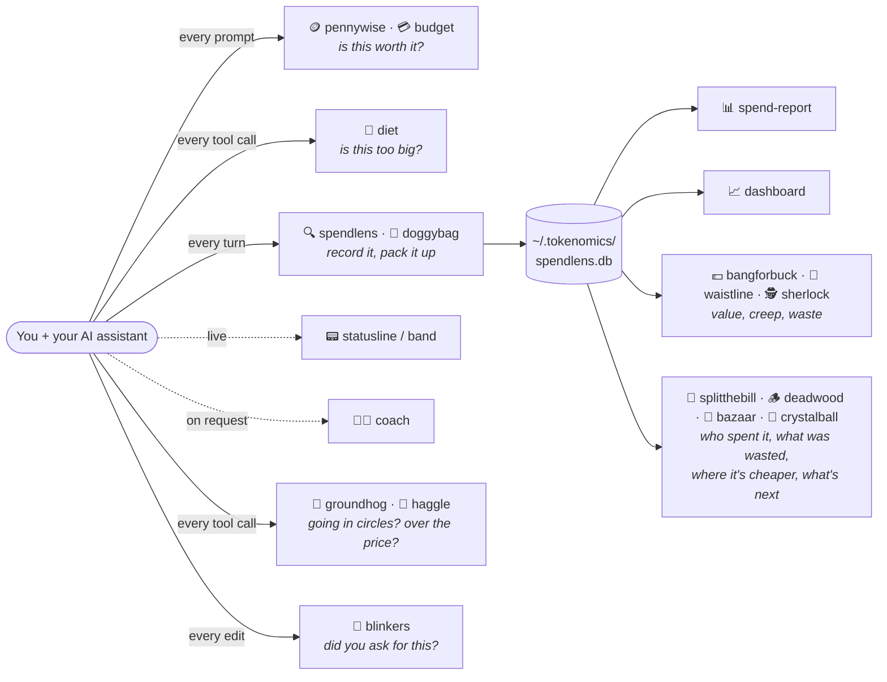

<p align="center">
  
</p>

<p align="center">
  <a href="#-install"></a>
  <a href="docs/installation.md#github-copilot-cli"></a>
  
  
  <a href="#-dependencies"></a>
  <br>
  <a href="https://github.com/andrew44/tokenomics/releases/latest"></a>
  <a href="https://github.com/andrew44/tokenomics/actions/workflows/tests.yml"></a>
  <a href="LICENSE"></a>
</p>

<h2 align="center">Make every AI token earn its keep.</h2>
<h3 align="center">Not just cheaper AI. Better value from AI.<br>An intelligence engine for Claude Code and GitHub Copilot CLI: it observes what your AI spends, understands where it's wasted, optimises it, and proves the result held up.</h3>

<p align="center">
  <a href="#-install"><b>Install</b></a> ·
  <a href="#-whats-in-the-box"><b>What you get</b></a> ·
  <a href="#-see-it-in-action"><b>See it in action</b></a> ·
  <a href="docs/README.md"><b>Docs</b></a>
</p>

---

Every message you send re-sends the **whole conversation**. Long chats, pasted logs, a 2 MB lockfile, the top-tier model for a one-line fix, a coffee break that lets the prompt cache expire: each one quietly multiplies the bill, and you never see it happen.

**tokenomics makes it visible, and then does something about it.**

<p align="center">
  
</p>

- 📟 **See it live.** A statusline in the terminal (and the same line in the desktop app's band) with context fill, tokens, cost in £/$/€ and a countdown to when the cache goes cold.
- 🛡️ **Stop waste automatically.** Guard-rails that catch context floods, over-specced models and runaway spend *before* they cost you.
- 🧑‍🏫 **Get better at it.** A coach that reviews your prompts, and a weekly spend report with three fixes tied to your own numbers.
- 💷 **Know what you're getting for it.** Cost per feature shipped and bug fixed, a price agreed before a task starts, a forensic audit of wasted steps, cost-regression checks (in CI too), and proof that a cheaper setup didn't cost you quality.
- 🧾 **Explain it to finance.** Spend by project, developer, agent, model and provider; what produced nothing this month; the cheapest provider for the same work; and a forecast before you roll AI out to a team.
- 🔒 **Stays on your machine.** One local SQLite file. No account, no telemetry, no packages to install: it's TypeScript that Node.js runs directly.

---

## 🧠 The tokenomics intelligence engine

Token counts tell you what AI cost. They don't tell you whether it was worth it. tokenomics works in four stages, on five shared services that run the same way for Claude Code and Copilot:

| | Stage | What it does | Helpers |
|---|---|---|---|
| 👁️ | **1. Observe** | Collect costs, tokens, tool calls, task outcomes and agent behaviour, from every assistant, in one event format. | spendlens · statusline · dashboard |
| 🧠 | **2. Understand** | Find waste, inefficiency, quality problems and spending patterns. | **sherlock** · splitthebill · deadwood · waistline · springclean · coach |
| ⚙️ | **3. Optimise** | Recommend, or apply automatically, the changes that improve value. | pennywise · bazaar · blinkers · diet · groundhog · budget · haggle · doggybag |
| ✅ | **4. Prove** | Measure savings against task success and output quality. | **bangforbuck** · **tastetest** · crystalball |

### ⭐ Signature features

The three together are the point: what you spent, what it bought, what was wasted, and proof the saving didn't cost quality. A token-saving tip can't do that.

- 💷 **Value meter: [bangforbuck](docs/reference.md#bangforbuck).** Cost per completed feature, bug fixed and passing test suite, and which model gives the cheapest *successful* result, not the cheapest request.
- 🕵️ **Agent forensics: [sherlock](docs/reference.md#sherlock).** A step-by-step audit of what the agent did, with the cost of every step that bought nothing.
- 👅 **Quality gate: [tastetest](docs/reference.md#tastetest).** Two runs of a task compared on cost *and* on your tests, linter and type checker. A cheaper setup that lost quality fails the gate (`--gate`, for CI).

Success is always measured from something that happened (tests green, a commit, a PR, a change accepted, reverted or refused), never inferred from token counts.

<sub>⚠️ Costs shown are estimates, not a bill. Always check your provider's billing page. See the <a href="#disclaimer">disclaimer</a>.</sub>

---

## ⚡ Install

### Claude Code: install the plugin (recommended)

tokenomics is a [Claude Code plugin](https://code.claude.com/docs/en/plugins). Inside Claude Code, paste:

```text
/plugin install tokenomics --marketplace andrew44/tokenomics
```

<sub>On Claude Code older than v2.1.275, use two lines instead: <code>/plugin marketplace add andrew44/tokenomics</code> then <code>/plugin install tokenomics@tokenomics</code>.</sub>

Choose **Install for you (user scope)** so it works in every project. That's it. 🎉 You get every skill, all the hooks and, from your next session, the live statusline (in the desktop app: the band). Now try:

> 💬 *"coach, review my prompts"*  ·  💬 *"spend report"*  ·  💬 `/tokenomics:dashboard`

**Stay up to date:** open `/plugin` → **Marketplaces** → **tokenomics** and switch on **auto-update**. (Claude Code only auto-updates its official marketplace unless you do.) Update button greyed out? See [Update isn't showing up](docs/installation.md#update-isnt-showing-up).

<details>
<summary><b>Using the Claude desktop app? No terminal needed</b></summary>

In the **Code** tab (a local session), click **+** next to the prompt box → **Add plugins** → add the marketplace `andrew44/tokenomics` → install **tokenomics**. Desktop and terminal share the same settings, so it works in both. The desktop app has no statusline, so there the same line sits in the **band** above the prompt box.
</details>

<details>
<summary><b>Rolling it out to a team?</b></summary>

Commit this to your repo's `.claude/settings.json`. Teammates are offered the marketplace when they trust the folder, then install it once with `/plugin install tokenomics@tokenomics`:

```json
{
  "extraKnownMarketplaces": {
    "tokenomics": { "source": { "source": "github", "repo": "andrew44/tokenomics" }, "autoUpdate": true }
  },
  "enabledPlugins": { "tokenomics@tokenomics": true }
}
```
</details>

<details>
<summary><b>Prefer a shell?</b></summary>

```bash
claude plugin install tokenomics --marketplace andrew44/tokenomics     # Claude Code v2.1.292+
# older: claude plugin marketplace add andrew44/tokenomics && claude plugin install tokenomics@tokenomics
```
</details>

The plugin needs **Node.js 22.18+** on your computer (no packages, no build step; see [Dependencies](#-dependencies)). Don't have it? The one-liner below fetches a private copy for you.

### GitHub Copilot CLI, or no Node.js: the one-line installer

Sets up Copilot CLI and/or Claude Code (it installs the same plugin), gets Node.js if you need it, and adds a `tokenomics` terminal command (`tokenomics dashboard`, `report`, `update`, `uninstall`).

```bash
curl -fsSL https://raw.githubusercontent.com/andrew44/tokenomics/main/install.sh | sh      # macOS / Linux
```

```powershell
irm https://raw.githubusercontent.com/andrew44/tokenomics/main/install.ps1 | iex           # Windows (PowerShell)
```

It never replaces a status line you already have, and running it again repairs the install. Read it first if you like: [install.sh](install.sh) · [install.ps1](install.ps1).

<details>
<summary><b>Using claude.ai/code (web)?</b></summary>

Plugins can't be installed on the web. Commit the coach to your repo instead: `npx skills@latest add andrew44/tokenomics --skill coach --copy`
</details>

Full details, updating and removing: **[Installation guide](docs/installation.md)**.

---

## 🧩 Or pick and choose

Every piece works on its own. Grab just what you want:

| I only want... | Run this |
|---|---|
| 🧑‍🏫 **coach** skill | `npx skills@latest add andrew44/tokenomics --skill coach` |
| 📊 **spend-report** skill | `npx skills@latest add andrew44/tokenomics --skill spend-report` *(reads spendlens data, so pair it with the plugin)* |
| 📟 **statusline** only | Install the plugin and switch the hooks off (below), or without the plugin: `curl -fsSL https://raw.githubusercontent.com/andrew44/tokenomics/main/install.sh \| sh -s -- --no-plugin` |
| 📈 **dashboard** | `/tokenomics:dashboard` with the plugin, or `tokenomics dashboard` after the one-liner |
| 🛡️ **Some of the hooks** | Install the plugin, then switch off the ones you don't want, e.g. `TOKENOMICS_DIET=off` or `TOKENOMICS_PENNYWISE=block` |

The `npx skills` commands need [Node.js](https://nodejs.org). See [Installation → pick and choose](docs/installation.md#install-pieces-individually) for every option.

---

## 🧰 What's in the box

| | Helper | What it does | Kind | Claude Code | Copilot CLI |
|---|---|---|:---:|:---:|:---:|
| 🧑‍🏫 | **[coach](docs/reference.md#coach)** | Reads your conversation and tells you where tokens were wasted, with the fixes and a rewrite of your weakest prompt. | skill | ✅ | — |
| 📊 | **[spend-report](docs/reference.md#spend-report)** | "Spend report" gets you the week's spend, OPEX vs CAPEX, costliest sessions, and three ways to spend less. | skill | ✅ | — |
| 🔍 | **[spendlens](docs/reference.md#spendlens)** | Silently labels each session **OPEX** (running things) or **CAPEX** (building things) and logs tokens and cost. | hook | ✅ | ✅ |
| 🪙 | **[pennywise](docs/reference.md#pennywise)** | Model router: scores every prompt and sends it to the model that suits it (Haiku for a hello-world, Opus for architecture). Runs as a hook, or as a local routing proxy. | hook + tool | ✅ | — |
| 🥗 | **[diet](docs/reference.md#diet)** | Stops tool calls that would flood the context (whole lockfiles, unbounded logs) and tells the AI to ask for less. | hook | ✅ | ✅ |
| 💳 | **[budget](docs/reference.md#budget)** | Daily and per-session limits in your currency. Warns at 80%, pauses at 100%. | hook | ✅ | — |
| 🥡 | **[doggybag](docs/reference.md#doggybag)** | Packs a free "where we got to" note into `.doggybag/` in your project just before the cache goes cold; `/clear` picks it straight back up. | hook | ✅ | ✅ |
| 📟 | **[statusline](docs/reference.md#statusline)** and **[band](docs/reference.md#band)** | Context fill, tokens, cost and a cache countdown, live: the statusline at the bottom of your assistant in a terminal, the band above the prompt box in the desktop app. On automatically; `/tokenomics:statusline` to manage both. | tool | ✅ | ✅ |
| 📈 | **[dashboard](docs/reference.md#dashboard)** | A local web view of where your tokens went, split by OPEX/CAPEX, project and day. | tool | ✅ | ✅ |
| 💷 | **[bangforbuck](docs/reference.md#bangforbuck)** | *Is the AI delivering value for the money?* Cost per completed feature, bug fixed, passing test suite and successful agent task, and which model gives the cheapest **successful** result. | skill + hook | ✅ | — |
| 🤝 | **[haggle](docs/reference.md#haggle)** | *Is this task worth £2?* Quotes a task before it starts (input, output and tool costs), warns when it runs over, and with `haggle £2:` stops the agent at the agreed price until you approve more. | skill + hook | ✅ | — |
| 🕵️ | **[sherlock](docs/reference.md#sherlock)** | *Where is the money disappearing?* A forensic audit of what the agent did: repeated reads, redundant calls, rephrased searches, unused output, overlapping or needless subagents, each costed. | skill + hook | ✅ | — |
| 📏 | **[waistline](docs/reference.md#waistline)** | *Am I getting worse value than last month?* Cost-regression checks on equivalent work: context creep, new expensive tools, model changes. Fails CI on cost creep. | skill + hook + CI | ✅ | — |
| 👅 | **[tastetest](docs/reference.md#tastetest)** | *Did the optimisation damage quality?* Compares two runs of a task on cost, tests, lint and type checks, and gives a quality-adjusted saving. | skill + tool | ✅ | — |
| 🧹 | **[springclean](docs/reference.md#springclean)** | Audits CLAUDE.md, AGENTS.md and friends for duplicated, outdated, bloated and contradictory instructions, with the saving from cleaning them up. | skill + tool | ✅ | ✅ |
| 🦫 | **[groundhog](docs/reference.md#groundhog)** | Catches the AI going round in circles (the same call again, a command failing over and over, edits made and undone) and makes it change strategy. | hook + skill | ✅ | ✅ |
| 🧾 | **[splitthebill](docs/reference.md#splitthebill)** | *Who or what is consuming the budget?* Spend by project, developer, agent and subagent, task category, model, provider and successful vs abandoned work, with a CSV for finance. | skill + tool | ✅ | counted |
| 🏪 | **[bazaar](docs/reference.md#bazaar)** | *Where is the same capability cheapest?* Prices your actual workload (input, output and cached tokens) across providers, weighs quality, latency and availability, and recommends the best value per successful task. | skill + tool | ✅ | — |
| 🐴 | **[blinkers](docs/reference.md#blinkers)** | *Is the AI doing more than I asked?* Spots unrequested docs, tests, dependency and config changes, unrelated refactors and stray files, and asks before expanding the scope. | hook + skill | ✅ | ✅ |
| 🔮 | **[crystalball](docs/reference.md#crystalball)** | *What will this cost?* Simulates a team's monthly AI spend across every model and provider before you adopt an agentic workflow. | skill + tool | ✅ | ✅ |
| 🪵 | **[deadwood](docs/reference.md#deadwood)** | *What did we pay for that produced nothing?* A monthly report of spend on failed, discarded and abandoned work, repeated debugging and unused files. | skill + tool | ✅ | counted |

> **Skills** run when you ask. **Hooks** run automatically. **Tools** you run yourself. Not sure which you need? → [Skills, tools and hooks](docs/skills-tools-and-hooks.md)

---

## 👀 See it in action

### pennywise routes the over-specced prompt

You ask for a hello-world on the priciest model. pennywise scores it SIMPLE and routes it to Haiku without you lifting a finger (and routes an architecture question *up* if you're on Haiku):

```text
pennywise: routing down to Haiku (SIMPLE, score -0.25) instead of Opus.
Start a prompt with 'keep-model:' to keep it on Opus.
```

Want true per-request routing, like an auto-router? `tokenomics router serve`, then start Claude Code with `ANTHROPIC_BASE_URL=http://127.0.0.1:8787 ANTHROPIC_MODEL=pennywise`. Every turn goes upstream on the right model, cache-aware, with fallback.

### diet stops the context flood

The AI goes to read a lockfile whole. diet steps in, and the AI retries with a `grep` by itself:

```text
tokenomics diet: package-lock.json is a generated file of about 180,000 tokens; reading it whole
is rarely useful. Search it instead (e.g. grep for the package or symbol you need), or read a
small range with offset/limit.
```

Unbounded `kubectl logs`, `git log`, `find /` and giant `cat`s get the same treatment. Append `# diet-ok` when you really do need it all.

### doggybag saves you from the cold-cache tax

Step away for a coffee and the prompt cache expires; carrying on means paying to reload everything. Sixty seconds before that happens, doggybag packs `.doggybag/latest.md` in your project (branch, changes, tasks, last requests) using **plain code, zero tokens**. The folder ignores itself in git. Come back, and your next prompt tells you:

```text
doggybag: the prompt cache went cold 42 min ago, so this prompt re-writes about 180,000 tokens (about £0.71).
Cheaper: /clear and your doggybag (1,450 tokens, .doggybag/latest.md) loads automatically.
```

### haggle agrees a price before the work starts

```text
you:     haggle £2: migrate the billing module to the new invoices API
haggle:  complex task, quoted £1.20 (likely £0.55–£2.90: input £0.40, tools £0.35, output £0.45). Agreed cap £2.00.
...
agent:   I've reached the agreed £2.00. Done: models and service layer. Left: 3 callers and their tests (about £0.60 more).
you:     haggle +£1
```

### groundhog breaks the loop

```text
groundhog: `npm test` has failed 3 times in a row (last error: "expected 200, received 401"). Running it again
will not change the answer. Stop and change strategy: re-read the error, say what you have tried and why it did
not work, form a different hypothesis, or ask the user for help. That loop has cost about £0.38 so far.
```

### bangforbuck measures the result, not the tokens

```text
£0.84 per session that got something done (-12% vs before). 41 of 52 sessions produced a result.

  bug fixed            14   £0.61 each
  completed feature     9   £1.92 each
  passing test suite   37   £0.33 each

Cheapest per session is claude-haiku-5-5, but best value per result is claude-sonnet-5-5.
```

### crystalball plans the budget before you roll out

```text
you:          what would 10 developers doing 20 tasks a day cost? 50k tokens in, 5k out per task.
crystalball:  4,200 tasks a month. Sonnet 5.5 £290 a month (£29 per developer), Opus 5.5 £581, Haiku 5.5 £15.
              Routing 60/35/5 Haiku/Sonnet/Opus: £140 a month (-52%). Without prompt caching: +£188 a month.
```

### deadwood finds the spend that bought nothing

```text
£41.20 of £172.80 (24%) bought nothing this month (-9% vs October).

  Failed implementations       6   £21.40
  Work discarded or rejected   4   £11.90
  Repeated debugging           9    £5.10
  Abandoned tasks              2    £2.80
```

### blinkers keeps the agent on the job

```text
blinkers: this looks like more than the task asked for (documentation nobody asked for): README.md is
documentation, and the task didn't ask for documentation. If this really is needed, ask the user before
expanding the scope.                                                      [Allow this edit?  Yes / No]
```

### The dashboard shows where it all went

<picture>
  <source media="(prefers-color-scheme: dark)" srcset="docs/assets/dashboard-dark.png">
  
</picture>

<p align="center"><sub>Shown with <code>--demo</code> data. Yours fills in as you work.</sub></p>

---

## 🧭 How it fits together



**OPEX or CAPEX?** spendlens answers the question finance teams keep asking: *how much of our AI spend goes on building things, and how much on keeping them running?* It scores the words in your prompts, the tools the AI used and the skills it ran. [How it decides →](docs/reference.md#how-it-decides)

---

## 🔒 Private by default

- **Local only.** Everything is written to one SQLite file at `~/.tokenomics/spendlens.db`. The dashboard listens on `127.0.0.1` only.
- **No prompt text stored** unless you opt in (`TOKENOMICS_STORE_PROMPT=1`).
- **Nothing leaves your machine** unless you switch on the optional [AI classifier](docs/reference.md#optional-let-an-ai-model-decide), which redacts first and works with local models.
- **Never in the way.** Hooks fail silently to a log file. Every guard-rail has a one-step override and a `warn` / `off` switch.
- **No runtime dependencies.** Node.js built-ins only (SQLite included). Nothing to `npm install` to use it, nothing to audit but this repo. TypeScript is the one dependency, for development only ([Dependencies](#-dependencies)).

---

## 📦 Dependencies

tokenomics is written in **TypeScript**. Node.js runs the `.ts` files directly (Node 22.18+ strips the types itself), so there is no build step and nothing is compiled or bundled.

| | Dependency | Version | What it's for |
|---|---|---|---|
| Runtime | [**Node.js**](https://nodejs.org) | 22.18 or newer | Runs every hook, skill and tool. Its built-in `node:sqlite` holds your data. The [one-line installer](#github-copilot-cli-or-no-nodejs-the-one-line-installer) fetches a private copy if you don't have it. |
| Development | [**TypeScript**](https://www.typescriptlang.org) (`typescript`) | ^5.9 | Type-checks the code: `npm run typecheck`. |
| Development | `@types/node` | ^22.18 | Node.js type definitions for the type-check. |

Nothing is installed from npm to *use* tokenomics: the plugin, the hooks and the installers only need Node.js. The dev dependencies in [`package.json`](package.json) are for working on it.

---

## 📚 Docs

| | Guide | |
|---|---|---|
| 🚀 | [**Installation**](docs/installation.md) | Whole toolkit, individual pieces, desktop, web, Copilot, teams, troubleshooting |
| 🧭 | [**Skills, tools and hooks**](docs/skills-tools-and-hooks.md) | What each helper does and when to reach for it |
| 🎓 | [**How tokens work**](docs/how-tokens-work.md) | Input, output, the prompt cache and tokenisers, in plain English then in depth |
| 💡 | [**Saving tokens**](docs/saving-tokens.md) | Practical habits for spending less, with worked examples |
| 🛠️ | [**Helper reference**](docs/reference.md) | Every helper in full detail, plus querying your data |
| ⚙️ | [**Configuration**](docs/configuration.md) | Every setting, currency and prices |
| 🏗️ | [**Architecture**](docs/architecture.md) | How it's built, and how to contribute |

---

## 🤝 Contributing

Issues and pull requests are welcome. The tests need nothing installed; the type-check needs TypeScript:

```bash
npm test                          # node:test, Node.js 22.18+
npm install && npm run typecheck  # tsc --noEmit
```

Start with [Architecture](docs/architecture.md).

## ☕ Support

If tokenomics saves you more than the price of a coffee, consider buying me one:

<p align="center">
  <a href="https://buymeacoffee.com/andrewgoadm">
    
  </a>
</p>

---

## Disclaimer

**The prices, token counts and costs shown by tokenomics are a rough indication of what your current session has cost, not a bill. They may be inaccurate, incomplete or out of date. The authors and contributors accept no liability for any loss or cost arising from prices or costs that turn out to be wrong, or from decisions made using them. You are responsible for checking your actual usage and charges in the Claude app (or your provider's billing page) and should not rely solely on this tool. tokenomics is provided "as is", without warranty of any kind; see sections 7 (Disclaimer of Warranty) and 8 (Limitation of Liability) of the [Apache License 2.0](LICENSE).**

## 🏁 Quick start

Convinced? In Claude Code:

```text
/plugin install tokenomics --marketplace andrew44/tokenomics
```

Then say *"coach, review my prompts"*. On Copilot CLI or without Node.js, use the [one-line installer](#github-copilot-cli-or-no-nodejs-the-one-line-installer).

Want only some of it? See [pick and choose](#-or-pick-and-choose). Anything else: [Installation guide](docs/installation.md).

---

## Licence

[Apache License 2.0](LICENSE)
