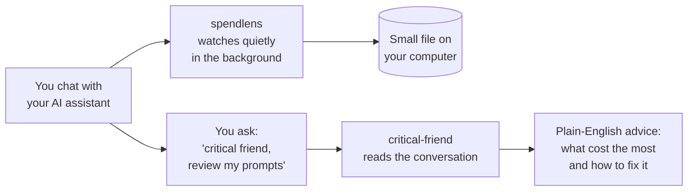
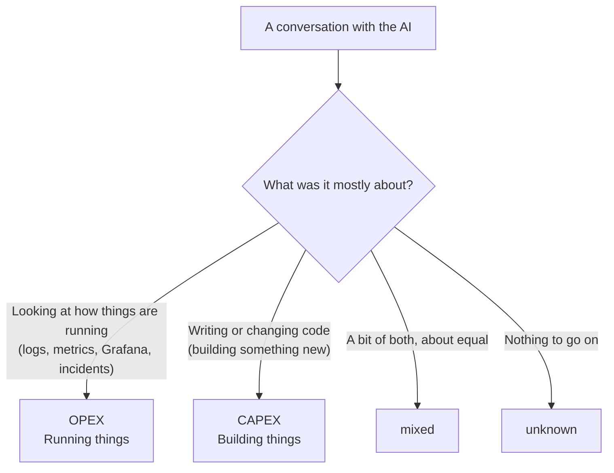
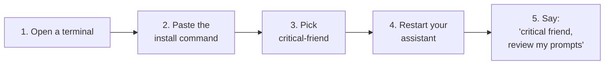
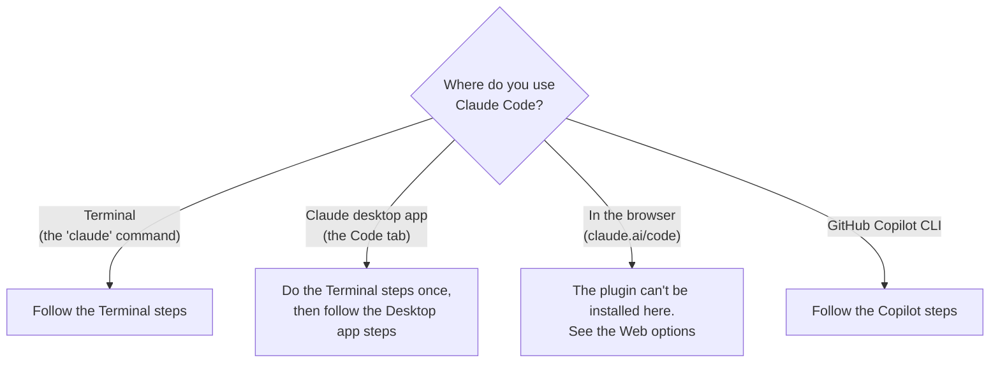
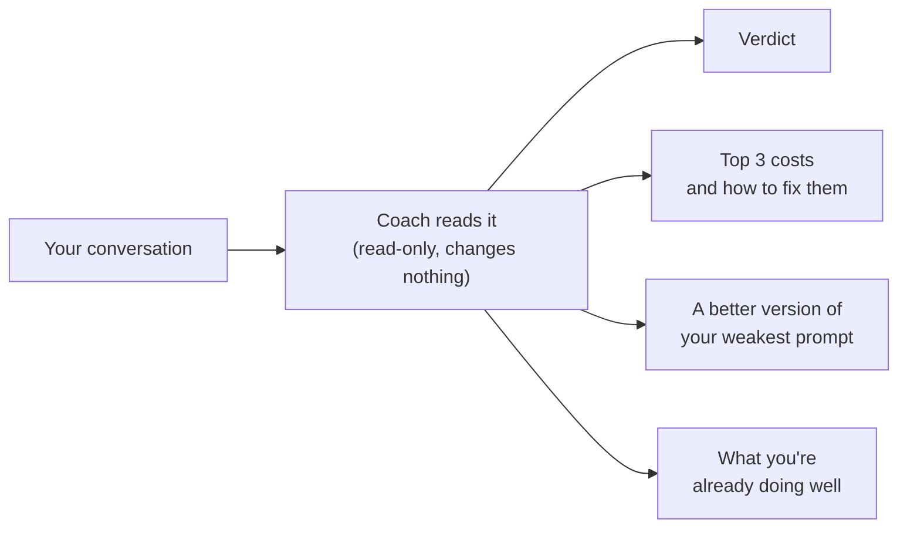
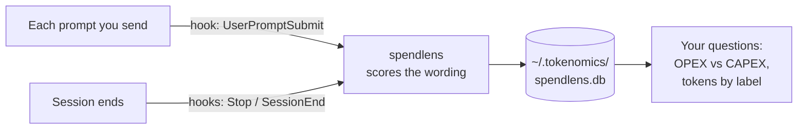
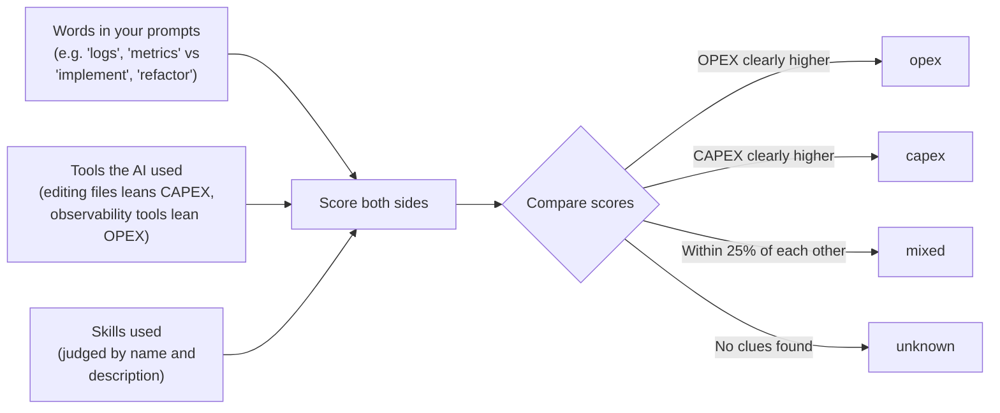
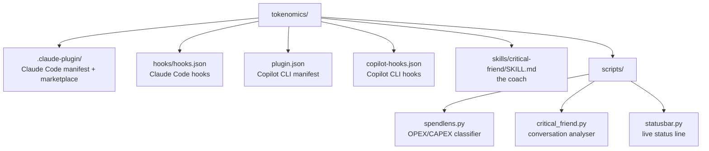

# tokenomics

**See where your AI tokens go, and get tips to stop wasting them.**

Works with **Claude Code** and **GitHub Copilot CLI**.

---

## What is this, in plain English?

When you use an AI coding assistant, every message you send and every reply you get uses up *tokens*. Tokens are the "units" you are charged for, a bit like minutes on a phone plan. Some conversations use a lot more than they need to.

**tokenomics** gives you three helpers:

| Helper | What it does | Think of it as... |
|--------|--------------|-------------------|
| **critical-friend** | Reads your conversation and tells you where tokens were wasted, with simple fixes. | A coach who reviews your prompts. |
| **spendlens** | Quietly labels each conversation as **OPEX** (running things) or **CAPEX** (building things) and saves it to a small file on your computer. | A timesheet that fills itself in. |
| **statusbar** | Shows a live line at the bottom of your assistant: how full the conversation is, tokens used, what it has cost in pounds, and a countdown to when the AI's short-term memory (the "prompt cache") expires. | A fuel gauge and a meter for your session. |



### What do OPEX and CAPEX mean here?

These are finance words. In this tool they describe **what you were using the AI for**:



This lets a team answer questions like *"How much of our AI spend goes on building, and how much on keeping things running?"*

---

## Get started (about a minute)

You only need to do this once.



1. Open a terminal and paste this:

   ```
   npx skills@latest add andrew44/tokenomics
   ```

2. Pick **critical-friend** and the assistant(s) you use. (Arrow keys to move, space to tick, Enter to confirm.)
3. Restart your assistant and say: **"critical friend, review my prompts"**.

That's it. You now have a prompt coach.

<details>
<summary><b>"npx: command not found"?</b> You need Node.js first.</summary>

1. Go to [nodejs.org](https://nodejs.org), download the version marked **LTS**, and run the installer.
2. **Close and reopen** your terminal, then paste the command from step 1 again.

How to open a terminal: on a **Mac** press `Cmd + Space`, type `Terminal`, press Enter. On **Windows** click Start, type `PowerShell`, press Enter.
</details>

> **Heads up:** this quick start installs the **critical-friend coach only**. For the automatic OPEX/CAPEX tracking (**spendlens**) and the full token numbers, install the plugin as described next.

---

## Want the automatic tracking too? Install the plugin

The plugin gives you **everything**: the coach *and* the background tracking.

Not sure which steps are yours? Follow the arrows:



### Terminal

1. Start Claude Code: type `claude` and press Enter.
2. Paste these two lines, one at a time, pressing Enter after each:

   ```
   /plugin marketplace add andrew44/tokenomics
   /plugin install tokenomics@tokenomics
   ```

3. A panel opens. Choose **Install for you (user scope)** so it works in every project.
4. Check it worked: type `/` and look for `/tokenomics:critical-friend`.

If Claude says `Run /reload-plugins to apply`, it does that for you. You need Python 3.8 or newer on your computer (nothing else to install).

### Desktop app

Works in **local** and **SSH** sessions (not cloud sessions).

1. Do the **Terminal** steps above once. The terminal and the desktop app share the same settings on your computer, so the plugin shows up in both.
2. Open the desktop app, go to the **Code** tab and start a local session.
3. Click **+** next to the prompt box, then **Add plugins** (or **Plugins**, then **Manage plugins**) to see **tokenomics** and switch it on or off.

Just want the coach in the desktop app? Run the quick start command with `-g` on the end: `npx skills@latest add andrew44/tokenomics -g`.

### Web (claude.ai/code)

Plugins **can't be installed** in Claude Code on the web. You have two options:

- **Use the terminal or desktop app** for the full plugin and tracking.
- **Add just the coach to your repo.** In your repo folder, run the command below, then commit the new `critical-friend` folder it adds:

  ```
  npx skills@latest add andrew44/tokenomics --copy
  ```

  (`--copy` makes real files instead of shortcuts, which is what you want when committing.) On the web the coach may only be able to review the prompts it can see in the conversation.

Tracking on the web isn't useful: the data would be saved on a temporary cloud machine, not your computer.

### GitHub Copilot CLI

```
copilot plugin install your-org/tokenomics          # from a GitHub repo
copilot plugin install ./path/to/tokenomics         # from a local folder
```

Then start `copilot`, check that `/plugin list` shows `tokenomics`, and send a prompt.

<details>
<summary><b>Copilot notes and known limits</b></summary>

- Copilot reads `plugin.json` and `copilot-hooks.json` at the plugin root (`userPromptSubmitted` and `sessionEnd` hooks).
- Copilot may not provide a session id. If it doesn't, spendlens builds one from the working directory and date.
- Copilot sessions are labelled from the words in each prompt only. There is no full conversation file to read, so token counts and the critical-friend coach don't work for Copilot.
- The hook commands use the relative path `scripts/spendlens.py`. If Copilot runs them from a different folder and you see "file not found" in `<db>.err`, change the path in `copilot-hooks.json` to an absolute one.
- Copilot's plugin format is still changing; check the current Copilot docs if the install fails.
</details>

### Requirements at a glance

| You want... | You need |
|-------------|----------|
| Just the coach (quick start) | Node.js |
| The full plugin | Python 3.8+ (`python3` on Mac/Linux, `python` on Windows). No extra packages. |
| Either | Claude Code and/or GitHub Copilot CLI |

<details>
<summary><b>Update, remove, or check the plugin</b></summary>

| I want to... | Do this |
|--------------|---------|
| Check it's installed | In Claude Code, run `/plugin` and open the **Installed** tab. Or run `claude plugin list` in a terminal. Run `/hooks` to see the three spendlens hooks (`UserPromptSubmit`, `Stop`, `SessionEnd`). |
| Update it | `/plugin marketplace update tokenomics`, then `claude plugin update tokenomics@tokenomics` in a terminal. (Third-party marketplaces don't update on their own.) |
| Remove it | `/plugin uninstall tokenomics@tokenomics` (or `claude plugin uninstall tokenomics@tokenomics` in a terminal) |
| Update or remove the **coach** (from the quick start) | `npx skills update` or `npx skills remove critical-friend`. `npx skills list` shows what's installed. |
| Install for a whole team | Choose **project scope** at the install panel, or run `claude plugin install tokenomics@tokenomics --scope project`. Each teammate also runs that command once. |

</details>

<details>
<summary><b>For developers: other ways to install</b></summary>

One command from a normal terminal (no Claude session needed). The plugin switches on next time you start Claude Code:
```
claude plugin marketplace add andrew44/tokenomics
claude plugin install tokenomics@tokenomics
```
Add and install in one step (recent Claude Code; v2.1.275+ in a session, v2.1.292+ from a shell):
```
/plugin install tokenomics --marketplace andrew44/tokenomics
```
From a local folder:
```
/plugin marketplace add ./path/to/tokenomics
/plugin install tokenomics@tokenomics
```
Try it for one session without installing:
```
claude --plugin-dir ./path/to/tokenomics
```
To host your own copy for a team, push the folder to your own Git repo and use `your-org/tokenomics` in place of `andrew44/tokenomics`. The repo doubles as a marketplace (`.claude-plugin/marketplace.json`).

Choosing what gets installed: `npx skills@latest add andrew44/tokenomics --list` previews the skills without installing, and `--skill critical-friend` installs one by name.
</details>

---

## Using critical-friend (the coach)

Just ask in Claude Code:

- *"critical friend, review my prompts"*
- *"why was that session expensive?"*
- or type `/tokenomics:critical-friend`



**What it looks for:**

| Common problem | In everyday words |
|----------------|-------------------|
| Low cache hit ratio / cache rebuilds | The AI keeps re-reading things it could have remembered cheaply. |
| Vague or correction-heavy prompts | Unclear asks lead to wrong answers and costly do-overs. |
| Oversized context | Too much material loaded into the conversation. |
| Repeated file reads | The same file is opened again and again. |
| Mixed topics | One long chat covering several unrelated jobs. |

> The coach needs a Claude Code conversation record, so Copilot sessions can't be reviewed.

Developers can run the script directly for raw numbers: `python3 scripts/critical_friend.py [--session ID] [--json]`

---

## What spendlens saves

At the end of each session spendlens writes one row to a small database file (SQLite) on your computer. It never blocks or slows your session, and it shows nothing on screen.



**What gets recorded for each session:**

- The **session id** and which assistant it was (`source`)
- The **label**: `opex`, `capex`, `mixed` or `unknown`
- The **scores** behind that label and the **number of prompts**
- Which **skills** were used, and whether each looks like OPEX or CAPEX
- **Token counts**: input, output, and prompt-cache reads and writes

Your prompts' text is **not** stored unless you switch that on (see Settings below).

### How does it decide OPEX or CAPEX?

It scores the conversation by looking for telltale words and actions:



<details>
<summary><b>More detail on the scoring</b></summary>

- At session end, the whole transcript is re-scored and tool calls are counted.
- Each distinct skill that lands clearly on one side adds weight 6 to it, so one skill outweighs a few keyword hits. An ambiguous skill adds nothing.
- Example: "Analyses App Insights" → OPEX; "Create Unit Tests using NUnit" → CAPEX.
- A skill's description is read from its `SKILL.md` / command file on disk (project `.claude/` or `.github/`, user `~/.claude/`, installed plugins), or otherwise from a skill listing found in the transcript.
- To adjust the scoring, edit `OPEX_PATTERNS` / `CAPEX_PATTERNS` in `scripts/spendlens.py`, or use `TOKENOMICS_SKILL_MAP` (below).
</details>

<details>
<summary><b>Optional: let an AI model decide instead of keywords</b></summary>

Keywords miss prompts that use none of your words. Set `TOKENOMICS_LLM=1` and a model reads the session and decides; if the call fails or times out, the keyword label is used instead, so nothing is ever lost.

- It runs **once per session**, not per prompt. `Stop` fires every turn, so it only classifies the first time there; at `SessionEnd` (or Copilot's `sessionEnd`) it re-classifies if the session has changed. Identical input is never classified twice.
- The model sees the first 5 prompts (300 characters each), the **names and counts** of tools used (never their arguments or file contents), and the skills used with their descriptions.
- Text is redacted first (API keys, tokens, emails, long opaque strings), but **it still leaves your machine**. Point it at a local model if your prompts are sensitive.
- It works with any OpenAI-compatible endpoint: OpenAI, OpenRouter, or a local server such as Ollama or LM Studio.

| Column (`sessions` table) | Meaning |
|---------------------------|---------|
| `label` | The label to use: the model's if it succeeded, otherwise the keyword label |
| `label_source` | `llm` or `keywords` |
| `llm_label`, `llm_confidence`, `llm_reason`, `llm_model` | The model's verdict (`opex`, `capex`, `mixed` or `unknown`), a 0 to 1 confidence, a one-sentence reason, and which model said it |

The keyword scores are always stored too, so you can compare the two. Failures are written to `spendlens.db.err`; the hook still never blocks a session.
</details>

<details>
<summary><b>Token columns explained</b></summary>

| Column (`sessions` table) | Meaning |
|---------------------------|---------|
| `skills` | List of distinct skills used (Skill tool calls and `/slash` commands) |
| `skill_opex`, `skill_capex` | How many of those skills were judged OPEX / CAPEX |
| `skill_detail` | Per skill: `name`, judged `side`, `basis` (`map`, `name`, `description`, `name+description`, `none`) and the description used |
| `input_tokens`, `output_tokens` | Fresh input and generated tokens |
| `cache_creation_tokens`, `cache_read_tokens` | Prompt-cache writes and reads |
| `total_tokens` | Sum of the four above. Cache reads usually dominate, so use `input_tokens + output_tokens` for a leaner figure. |

Tokens are counted once per message. Work done by sub-agents in separate transcript files is not included. Copilot sessions have no transcript, so skills and tokens stay empty there.
</details>

---

## Using the status bar

A live line that sits at the bottom of Claude Code or GitHub Copilot CLI:

```
◆ Sonnet 5.5 │ ctx █████████▏▒▒ 76% │ Σ 8.5M │ £1.37 │ ⏳︎ 02:29
```

| Part | What it tells you |
|------|-------------------|
| `ctx ████▒▒ 76%` | How full the conversation is. The bar goes **green**, turns **yellow at 75%** and **red at 90%**. A `▲` appears from 90%. When it is nearly full, start a fresh conversation. |
| `Σ 8.5M` | Total tokens used so far, in short form (`950`, `12.3K`, `8.5M`). |
| `£1.37` | What the session has cost, in pounds. A `~` in front (`~£1.37`) means it is an estimate. |
| `⧗ 04:12` | A countdown to when the prompt cache expires. While it runs, repeated context is cheap. The egg timer starts **full (green)**, is **half-empty (amber)** at about half time and **empty (red)** when it is running out. `00:00` means the cache has gone cold, and `--:--` means nothing has been cached yet. |

**To install it** (needs Python 3.8 or newer, nothing else). From the repo folder:

```
python3 scripts/statusbar.py --install claude     # or: copilot, both
```

This adds the status line to your Claude Code and/or Copilot settings (a backup of the old settings is saved first), then restart the assistant. To remove it, run the same command with `--uninstall`.

**Light or dark.** It follows your computer's setting by default. To force one, put `{"theme": "dark"}` (or `"light"`) in `~/.tokenomics/statusbar.json`. To preview all the states, run `python3 scripts/statusbar.py --demo --theme light`. For very plain terminals use `--ascii` or set `NO_COLOR=1`.

**Pounds.** Claude Code reports the cost in dollars and the bar converts it at 0.76 pounds per dollar. Run `python3 scripts/statusbar.py --update-rate` to fetch today's rate, or set `"usd_gbp"` in the same file.

<details>
<summary><b>Good to know about the countdown</b></summary>

- It counts from the last request that used the cache. The cache lasts 5 minutes, or 1 hour if your session uses the 1-hour cache. Override with `"cache_ttl"` (seconds).
- Claude Code redraws the line every second (this needs a recent version; on older ones it updates after each message).
- Copilot CLI doesn't say how often it redraws or when its cache expires, so there the countdown is approximate and may only move when Copilot redraws.
- For a smoothly ticking countdown in any assistant, run `python3 scripts/statusbar.py --watch` in a spare terminal pane.
</details>

---

## Settings (optional)

Most people never need these. They are "environment variables", set in your shell profile or in Claude Code's `settings.json` under `"env"`.

| Setting | Default | What it does |
|---------|---------|--------------|
| `TOKENOMICS_DB` | `~/.tokenomics/spendlens.db` | Where the database file lives. Point it at a shared location to collect several machines' data. |
| `TOKENOMICS_STORE_PROMPT` | off | Set to `1` to keep a 200-character excerpt of each prompt. Off by default for privacy. |
| `TOKENOMICS_SKILL_MAP` | none | Path to a JSON file that tells spendlens which side a skill belongs to, e.g. `{"our-grafana-skill": "opex", "pdf": "capex"}`. This always wins over the built-in guessing. |
| `TOKENOMICS_LLM` | off | Set to `1` to have an AI model decide OPEX or CAPEX at session end (see "How does it decide" above). Sends redacted prompt text to the endpoint. |
| `TOKENOMICS_LLM_URL` | `https://api.openai.com/v1/chat/completions` | Any OpenAI-compatible chat endpoint. A non-default URL needs no key, so local models work. |
| `TOKENOMICS_LLM_KEY` | `OPENAI_API_KEY` | API key for that endpoint. |
| `TOKENOMICS_LLM_MODEL` | `gpt-4o-mini` | Which model to ask. |
| `TOKENOMICS_LLM_TIMEOUT` | `12` | Seconds to wait before falling back to keywords (capped at 15 to fit the 20-second hook limit). |
| `TOKENOMICS_THEME` | `system` | Status bar colours: `light`, `dark` or `system`. |
| `TOKENOMICS_USD_GBP` | `0.76` | Pounds per dollar, used for the status bar's cost. |
| `TOKENOMICS_CACHE_TTL` | auto | Cache lifetime in seconds for the status bar's countdown. |

---

## Looking at your data

You can open the database with any SQLite tool. These examples use the `sqlite3` command.

Your 10 most recent sessions:
```
sqlite3 ~/.tokenomics/spendlens.db \
  "select session_id, source, label, opex_score, capex_score, prompt_count from sessions order by updated_at desc limit 10;"
```

How many sessions of each label:
```
sqlite3 ~/.tokenomics/spendlens.db "select label, count(*) from sessions group by label;"
```

Tokens used by each label:
```
sqlite3 ~/.tokenomics/spendlens.db "select label, count(*) sessions, sum(input_tokens+output_tokens) tokens from sessions group by label;"
```

The database has two tables: `sessions` (one row per session) and `prompt_events` (one row per prompt, with its scores).

---

## Troubleshooting

| What you see | Try this |
|--------------|----------|
| No database file appears | Check Python is installed: run `python3 --version`. On Windows, change the hook to use `python`. |
| Hooks don't seem to run (Claude Code) | Restart Claude Code, then run `/hooks`. Make sure the plugin is switched on in `/plugin`. |
| Sessions are missing, or labelled `unknown` | Look for a file called `spendlens.db.err` next to the database. Errors go there, never on screen. |
| *Everything* is labelled `unknown` | Your prompts didn't match any keywords. Add terms to the pattern lists in `scripts/spendlens.py`. |

---

## For contributors: what's in the repo



```
tokenomics/
├── .claude-plugin/
│   ├── plugin.json         Claude Code manifest
│   └── marketplace.json    lets the repo be added as a marketplace
├── hooks/hooks.json        Claude Code hooks
├── plugin.json             Copilot CLI manifest
├── copilot-hooks.json      Copilot CLI hooks
├── skills/critical-friend/SKILL.md   prompt and cache review skill
├── scripts/spendlens.py       the opex/capex classifier
├── scripts/critical_friend.py transcript analyser used by the skill
├── scripts/statusbar.py       status line for Claude Code and Copilot CLI
└── README.md
```

More hooks, tools and skills will be added over time.
