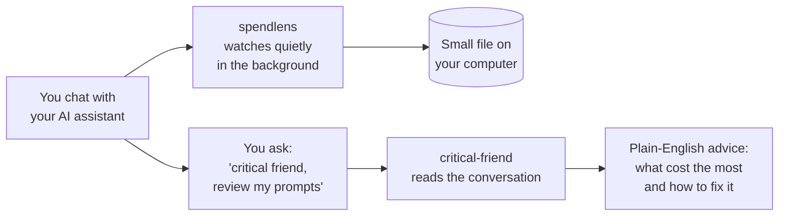
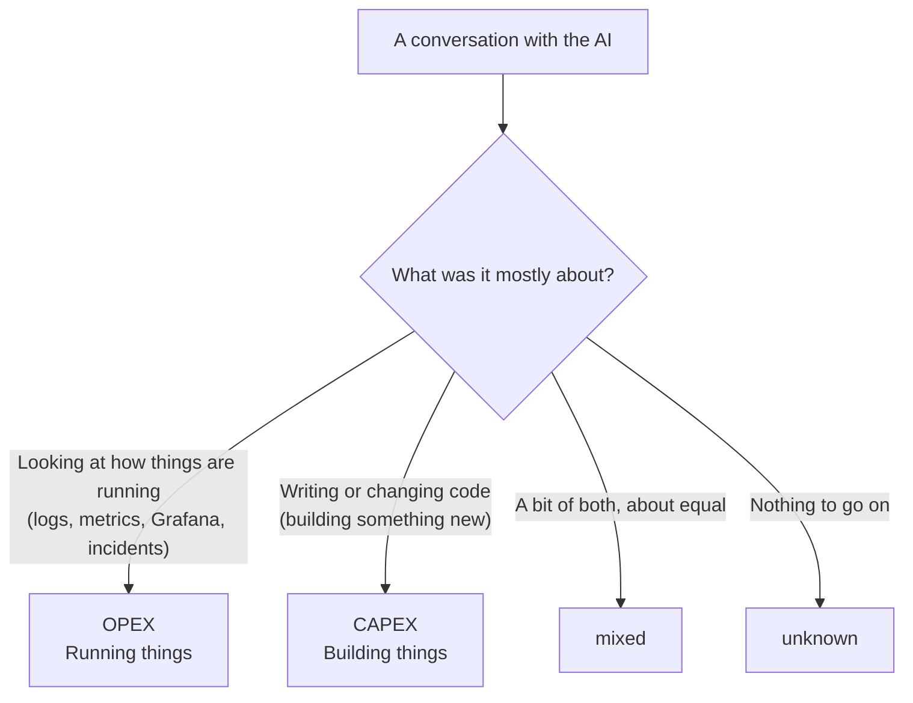
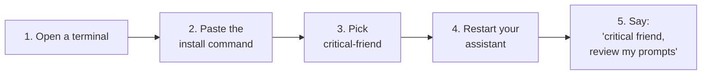
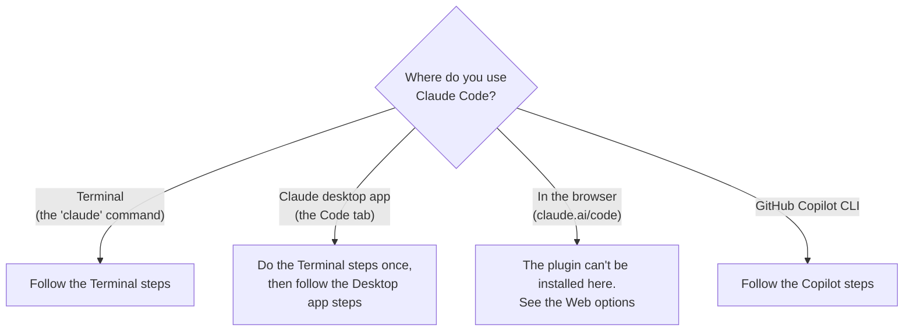
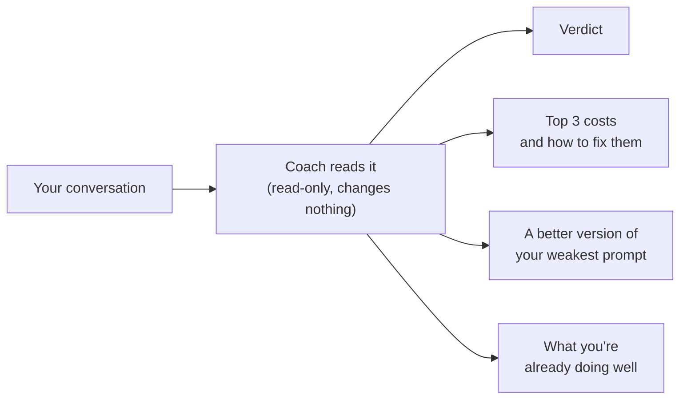
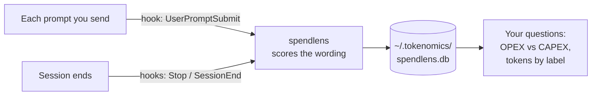
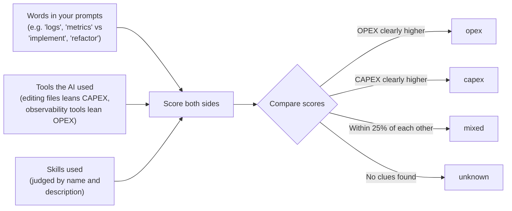
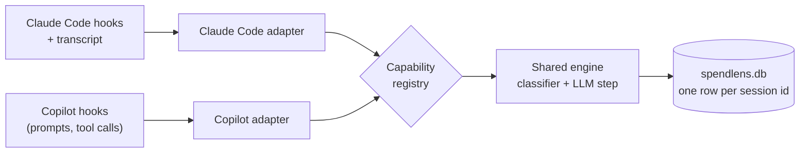
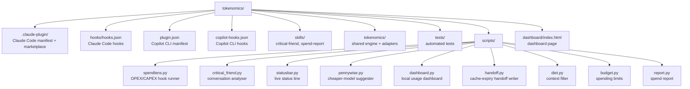

# tokenomics

**See where your AI tokens go, and get tips to stop wasting them.**

Works with **Claude Code** and **GitHub Copilot CLI**.

> **Disclaimer: the prices, token counts and costs shown by tokenomics are a rough indication of what your current session has cost, not a bill. They may be inaccurate, incomplete or out of date. The authors and contributors accept no liability for any loss or cost arising from prices or costs that turn out to be wrong, or from decisions made using them. You are responsible for checking your actual usage and charges in the Claude app (or your provider's billing page) and should not rely solely on this tool. tokenomics is provided "as is", without warranty of any kind; see sections 7 (Disclaimer of Warranty) and 8 (Limitation of Liability) of the [Apache License 2.0](LICENSE).**

---

## What is this, in plain English?

When you use an AI coding assistant, every message you send and every reply you get uses up *tokens*. Tokens are the "units" you are charged for, a bit like minutes on a phone plan. Some conversations use a lot more than they need to.

> New to tokens? [How tokens work](docs/how-tokens-work.md) explains input, output, the prompt cache and tokenisers, first in plain English and then in technical depth. [Saving tokens](docs/saving-tokens.md) has practical tips for spending less.

**tokenomics** gives you these helpers:

| Helper | What it does | Think of it as... |
|--------|--------------|-------------------|
| **critical-friend** | Reads your conversation and tells you where tokens were wasted, with simple fixes. | A coach who reviews your prompts. |
| **spendlens** | Quietly labels each conversation as **OPEX** (running things) or **CAPEX** (building things) and saves it to a small file on your computer. | A timesheet that fills itself in. |
| **pennywise** | Checks each prompt before it runs. If a cheaper model would do the job (say, a hello-world app on the priciest model), it pauses the prompt and suggests the cheaper one. | A friend who stops you buying the premium option you don't need. |
| **statusbar** | Shows a live line at the bottom of your assistant: how full the conversation is, tokens used, what it has cost (in pounds, dollars or euros), and a countdown to when the AI's short-term memory (the "prompt cache") expires. | A fuel gauge and a meter for your session. |
| **handoff** | Just before the AI's short-term memory (the prompt cache) runs out, writes a short "where we got to" note. You can pick the work up in a new session for a fraction of the cost of reloading the old one. | Leaving a note on the desk before you step away. |
| **diet** | Stops the AI from pulling huge, low-value text into the conversation (a whole lockfile, every log line ever, the entire git history) and tells it to ask for just the part it needs. | A friend who stops you printing the whole manual to read one page. |
| **budget** | Lets you set a daily or per-session spending limit in your currency. Warns you at 80% and pauses at 100%, with a one-step way to carry on. | A spending limit on a bank card. |
| **spend-report** | Say "spend report" and get a short summary of the week: money spent, OPEX vs CAPEX, the costliest projects and sessions, what the other helpers saved, and three ways to spend less. | A monthly statement with advice. |



### What do OPEX and CAPEX mean here?

These are finance words. In this tool they describe **what you were using the AI for**:



This lets a team answer questions like *"How much of our AI spend goes on building, and how much on keeping things running?"*

---

## Get started (about a minute)

You only need to do this once.



1. Open a terminal and paste this:

   ```
   npx skills@latest add andrew44/tokenomics
   ```

2. Pick **critical-friend** and the assistant(s) you use. (Arrow keys to move, space to tick, Enter to confirm.)
3. Restart your assistant and say: **"critical friend, review my prompts"**.

That's it. You now have a prompt coach.

<details>
<summary><b>"npx: command not found"?</b> You need Node.js first.</summary>

1. Go to [nodejs.org](https://nodejs.org), download the version marked **LTS**, and run the installer.
2. **Close and reopen** your terminal, then paste the command from step 1 again.

How to open a terminal: on a **Mac** press `Cmd + Space`, type `Terminal`, press Enter. On **Windows** click Start, type `PowerShell`, press Enter.
</details>

> **Heads up:** this quick start installs the **critical-friend coach only**. For the automatic OPEX/CAPEX tracking (**spendlens**) and the full token numbers, install the plugin as described next.

---

## Want the automatic tracking too? Install the plugin

The plugin gives you **everything**: the coach *and* the background tracking.

Not sure which steps are yours? Follow the arrows:



### Terminal

1. Start Claude Code: type `claude` and press Enter.
2. Paste these two lines, one at a time, pressing Enter after each:

   ```
   /plugin marketplace add andrew44/tokenomics
   /plugin install tokenomics@tokenomics
   ```

3. A panel opens. Choose **Install for you (user scope)** so it works in every project.
4. Check it worked: type `/` and look for `/tokenomics:critical-friend`.

If Claude says `Run /reload-plugins to apply`, it does that for you. You need Python 3.8 or newer on your computer (nothing else to install).

### Desktop app

Works in **local** and **SSH** sessions (not cloud sessions).

1. Do the **Terminal** steps above once. The terminal and the desktop app share the same settings on your computer, so the plugin shows up in both.
2. Open the desktop app, go to the **Code** tab and start a local session.
3. Click **+** next to the prompt box, then **Add plugins** (or **Plugins**, then **Manage plugins**) to see **tokenomics** and switch it on or off.

Just want the coach in the desktop app? Run the quick start command with `-g` on the end: `npx skills@latest add andrew44/tokenomics -g`.

### Web (claude.ai/code)

Plugins **can't be installed** in Claude Code on the web. You have two options:

- **Use the terminal or desktop app** for the full plugin and tracking.
- **Add just the coach to your repo.** In your repo folder, run the command below, then commit the new `critical-friend` folder it adds:

  ```
  npx skills@latest add andrew44/tokenomics --copy
  ```

  (`--copy` makes real files instead of shortcuts, which is what you want when committing.) On the web the coach may only be able to review the prompts it can see in the conversation.

Tracking on the web isn't useful: the data would be saved on a temporary cloud machine, not your computer.

### GitHub Copilot CLI

```
copilot plugin install your-org/tokenomics          # from a GitHub repo
copilot plugin install ./path/to/tokenomics         # from a local folder
```

Then start `copilot`, check that `/plugin list` shows `tokenomics`, and send a prompt.

<details>
<summary><b>Copilot notes and known limits</b></summary>

- Copilot reads `plugin.json` and `copilot-hooks.json` at the plugin root (`userPromptSubmitted`, `postToolUse` and `sessionEnd` hooks).
- Copilot sends a session id with every hook, and spendlens logs each session under it. If one is ever missing, spendlens builds one from the working directory and date.
- Copilot sessions are labelled from the words in each prompt **and** the tools Copilot used (file edits lean CAPEX, observability tools and commands like `kubectl logs` lean OPEX). Same scoring as Claude Code.
- Copilot doesn't tell hooks how many tokens or premium requests a session used, so those columns stay empty (`usage_status = unavailable`). spendlens never guesses a number for them. The critical-friend coach doesn't work for Copilot either, because there's no conversation file to read.
- The hook commands use the relative path `scripts/spendlens.py`. If Copilot runs them from a different folder and you see "file not found" in `<db>.err`, change the path in `copilot-hooks.json` to an absolute one.
- Copilot's plugin format is still changing; check the current Copilot docs if the install fails.
</details>

### Requirements at a glance

| You want... | You need |
|-------------|----------|
| Just the coach (quick start) | Node.js |
| The full plugin | Python 3.8+ (`python3` on Mac/Linux, `python` on Windows). No extra packages. |
| Either | Claude Code and/or GitHub Copilot CLI |

<details>
<summary><b>Update, remove, or check the plugin</b></summary>

| I want to... | Do this |
|--------------|---------|
| Check it's installed | In Claude Code, run `/plugin` and open the **Installed** tab. Or run `claude plugin list` in a terminal. Run `/hooks` to see the three spendlens hooks (`UserPromptSubmit`, `Stop`, `SessionEnd`). |
| Update it | `/plugin marketplace update tokenomics`, then `claude plugin update tokenomics@tokenomics` in a terminal. (Third-party marketplaces don't update on their own.) |
| Remove it | `/plugin uninstall tokenomics@tokenomics` (or `claude plugin uninstall tokenomics@tokenomics` in a terminal) |
| Update or remove the **coach** (from the quick start) | `npx skills update` or `npx skills remove critical-friend`. `npx skills list` shows what's installed. |
| Install for a whole team | Choose **project scope** at the install panel, or run `claude plugin install tokenomics@tokenomics --scope project`. Each teammate also runs that command once. |

</details>

<details>
<summary><b>For developers: other ways to install</b></summary>

One command from a normal terminal (no Claude session needed). The plugin switches on next time you start Claude Code:
```
claude plugin marketplace add andrew44/tokenomics
claude plugin install tokenomics@tokenomics
```
Add and install in one step (recent Claude Code; v2.1.275+ in a session, v2.1.292+ from a shell):
```
/plugin install tokenomics --marketplace andrew44/tokenomics
```
From a local folder:
```
/plugin marketplace add ./path/to/tokenomics
/plugin install tokenomics@tokenomics
```
Try it for one session without installing:
```
claude --plugin-dir ./path/to/tokenomics
```
To host your own copy for a team, push the folder to your own Git repo and use `your-org/tokenomics` in place of `andrew44/tokenomics`. The repo doubles as a marketplace (`.claude-plugin/marketplace.json`).

Choosing what gets installed: `npx skills@latest add andrew44/tokenomics --list` previews the skills without installing, and `--skill critical-friend` installs one by name.
</details>

---

## Using critical-friend (the coach)

Just ask in Claude Code:

- *"critical friend, review my prompts"*
- *"why was that session expensive?"*
- or type `/tokenomics:critical-friend`



**What it looks for:**

| Common problem | In everyday words |
|----------------|-------------------|
| Low cache hit ratio / cache rebuilds | The AI keeps re-reading things it could have remembered cheaply. |
| Vague or correction-heavy prompts | Unclear asks lead to wrong answers and costly do-overs. |
| Oversized context | Too much material loaded into the conversation. |
| Repeated file reads | The same file is opened again and again. |
| Mixed topics | One long chat covering several unrelated jobs. |

> The coach needs a Claude Code conversation record, so Copilot sessions can't be reviewed.

Developers can run the script directly for raw numbers: `python3 scripts/critical_friend.py [--session ID] [--json]`

---

## What spendlens saves

At the end of each session spendlens writes one row to a small database file (SQLite) on your computer. It never blocks or slows your session, and it shows nothing on screen.



**What gets recorded for each session:**

- The **session id** and which assistant it was (`source`)
- The **label**: `opex`, `capex`, `mixed` or `unknown`
- The **scores** behind that label and the **number of prompts**
- Which **skills** were used, and whether each looks like OPEX or CAPEX
- **Token counts**: input, output, and prompt-cache reads and writes

Your prompts' text is **not** stored unless you switch that on (see Settings below).

### How does it decide OPEX or CAPEX?

It scores the conversation by looking for telltale words and actions:



<details>
<summary><b>More detail on the scoring</b></summary>

- At session end, the whole transcript is re-scored and tool calls are counted.
- Each distinct skill that lands clearly on one side adds weight 6 to it, so one skill outweighs a few keyword hits. An ambiguous skill adds nothing.
- Example: "Analyses App Insights" → OPEX; "Create Unit Tests using NUnit" → CAPEX.
- A skill's description is read from its `SKILL.md` / command file on disk. Claude Code looks in the project's `.claude/`, `~/.claude/` and installed plugins, or otherwise in a skill listing found in the transcript. Copilot looks in the project's `.github/` and `.claude/` and in `~/.copilot/`.
- To adjust the scoring, edit `OPEX_PATTERNS` / `CAPEX_PATTERNS` in `tokenomics/engine/classifier.py`, or use `TOKENOMICS_SKILL_MAP` (below). One change applies to Claude Code and Copilot alike.
</details>

<details>
<summary><b>Optional: let an AI model decide instead of keywords</b></summary>

Keywords miss prompts that use none of your words. Set `TOKENOMICS_LLM=1` and a model reads the session and decides; if the call fails or times out, the keyword label is used instead, so nothing is ever lost.

- It runs **once per session**, not per prompt. `Stop` fires every turn, so it only classifies the first time there; at `SessionEnd` (or Copilot's `sessionEnd`) it re-classifies if the session has changed. Identical input is never classified twice.
- The model sees the first 5 prompts (300 characters each), the **names and counts** of tools used (never their arguments or file contents), and the skills used with their descriptions.
- Text is redacted first (API keys, tokens, emails, long opaque strings), but **it still leaves your machine**. Point it at a local model if your prompts are sensitive.
- It works with any OpenAI-compatible endpoint: OpenAI, OpenRouter, or a local server such as Ollama or LM Studio.

| Column (`sessions` table) | Meaning |
|---------------------------|---------|
| `label` | The label to use: the model's if it succeeded, otherwise the keyword label |
| `label_source` | `llm` or `keywords` |
| `llm_label`, `llm_confidence`, `llm_reason`, `llm_model` | The model's verdict (`opex`, `capex`, `mixed` or `unknown`), a 0 to 1 confidence, a one-sentence reason, and which model said it |

The keyword scores are always stored too, so you can compare the two. Failures are written to `spendlens.db.err`; the hook still never blocks a session.
</details>

<details>
<summary><b>Token columns explained</b></summary>

| Column (`sessions` table) | Meaning |
|---------------------------|---------|
| `skills` | List of distinct skills used (Skill tool calls and `/slash` commands) |
| `skill_opex`, `skill_capex` | How many of those skills were judged OPEX / CAPEX |
| `skill_detail` | Per skill: `name`, judged `side`, `basis` (`map`, `name`, `description`, `name+description`, `none`) and the description used |
| `input_tokens`, `output_tokens` | Fresh input and generated tokens |
| `cache_creation_tokens`, `cache_read_tokens` | Prompt-cache writes and reads |
| `total_tokens` | Sum of the four above. Cache reads usually dominate, so use `input_tokens + output_tokens` for a leaner figure. |
| `billing_model` | What the assistant charges for: `anthropic_tokens` (Claude Code) or `copilot_premium_requests` (Copilot). Don't add the two together. |
| `usage_status` | `reported` when the assistant gave token counts, `unavailable` when it didn't (always the case for Copilot). Empty token columns mean "not known", not zero. |
| `evidence` | What the label is based on: `transcript` (the whole conversation) or `hook-events` (prompts and tool calls seen one at a time) |

Tokens are counted once per message. Work done by sub-agents in separate transcript files is not included. For Copilot, tool calls are also kept one row each in the `tool_events` table (tool name and kind only, never arguments).
</details>

---

## Using the status bar

A live line that sits at the bottom of Claude Code or GitHub Copilot CLI:

```
◆ Sonnet 5.5 │ ctx █████████▏▒▒ 76% │ Σ 8.5M │ £1.37 │ ⏳︎ 02:29
```

| Part | What it tells you |
|------|-------------------|
| `ctx ████▒▒ 76%` | How full the conversation is. The bar goes **green**, turns **yellow at 75%** and **red at 90%**. A `▲` appears from 90%. When it is nearly full, start a fresh conversation. |
| `Σ 8.5M` | Total tokens used so far, in short form (`950`, `12.3K`, `8.5M`). |
| `£1.37` | What the session has cost, in your currency (pounds unless you choose dollars or euros). A `~` in front (`~£1.37`) means it is an estimate. |
| `⧗ 04:12` | A countdown to when the prompt cache expires. While it runs, repeated context is cheap. The egg timer starts **full (green)**, is **half-empty (amber)** at about half time and **empty (red)** when it is running out. `00:00` means the cache has gone cold, and `--:--` means nothing has been cached yet. |

**To install it** (needs Python 3.8 or newer, nothing else). From the repo folder:

```
python3 scripts/statusbar.py --install claude     # or: copilot, both
```

This adds the status line to your Claude Code and/or Copilot settings (a backup of the old settings is saved first), then restart the assistant. To remove it, run the same command with `--uninstall`.

**Light or dark.** It follows your computer's setting by default. To force one, put `{"theme": "dark"}` (or `"light"`) in `~/.tokenomics/statusbar.json`. To preview all the states, run `python3 scripts/statusbar.py --demo --theme light`. For very plain terminals use `--ascii` or set `NO_COLOR=1`.

**Currency.** Costs show in pounds (£) by default. To use US dollars ($) or euros (€) instead, run one of:

```
python3 scripts/statusbar.py --set-currency USD     # or EUR, or GBP
export TOKENOMICS_CURRENCY=EUR                      # or set it per shell / in Claude Code's "env"
```

The choice is saved as `"currency"` in `~/.tokenomics/statusbar.json`, and the status bar, budget, spend report and handoff notes all use it (`$`, `€` and `£` work too, e.g. `--set-currency €`). `TOKENOMICS_CURRENCY` wins over the saved choice, and `--currency USD` on a single status bar or report run wins over both. Prices are in dollars, so dollars need no conversion; pounds and euros are converted at 0.76 and 0.86 per dollar unless you set the rate. Run `python3 scripts/statusbar.py --update-rate` to fetch today's rates, or set `"usd_gbp"` / `"usd_eur"` in the same file (or `TOKENOMICS_USD_GBP` / `TOKENOMICS_USD_EUR`).

**Prices.** When the assistant doesn't report a cost itself (Copilot, older Claude Code), and always for budget and the spend report, tokenomics prices each request from `data/model-prices.json`: input, output, cache-write and cache-read prices for **every Claude model version**, from Haiku 3.5 to Fable 5.2 (for example Fable 5.2 is $8/$40 per million input/output tokens, Opus 5.5 $4/$20, Sonnet 5.5 $2/$10, Haiku 5.5 $0.10/$0.50, or $0.50/$2.50 for prompts over 100K tokens). Each model's own cache rates are used (e.g. cache reads cost $0.20 on Fable 5.2 and $0.10 on Sonnet 5.5), fast mode counts double, and a model switch mid-session is priced message by message. A scheduled GitHub Action (`.github/workflows/update-prices.yml`) refreshes that file from Claude's pricing page every Monday and commits any change; run `python3 scripts/update_prices.py` to refresh it yourself, and `--install` copies the current file next to the installed status bar. Retired models that drop off the page keep their last known price. To override a price, add it to `~/.tokenomics/statusbar.json` by model version: `{"prices": {"opus-5-5": [4, 20], "sonnet-5-5": [2, 10, 0.1]}}` (input, output and optionally cache read, dollars per million tokens; the most specific key wins).

<details>
<summary><b>Good to know about the countdown</b></summary>

- It counts from the last request that used the cache. The cache lasts 5 minutes, or 1 hour if your session uses the 1-hour cache. Override with `"cache_ttl"` (seconds).
- Claude Code redraws the line every second (this needs a recent version; on older ones it updates after each message).
- Copilot CLI doesn't say how often it redraws or when its cache expires, so there the countdown is approximate and may only move when Copilot redraws.
- For a smoothly ticking countdown in any assistant, run `python3 scripts/statusbar.py --watch` in a spare terminal pane.
</details>

---

## Using pennywise (the money-saver)

*Penny wise, pound foolish.* pennywise is a `UserPromptSubmit` hook (`scripts/pennywise.py`). It rates the prompt (small and self-contained, short and routine, or complex/unclear), finds the session's model (hook payload, then transcript, `ANTHROPIC_MODEL`, `settings.json`), and if a cheaper tier would cope it blocks with a suggestion such as `/model haiku`. Complex or ambiguous prompts are never blocked.

To run the prompt anyway, send the same prompt again or start it with `keep-model:`. Each decision (`blocked`, `warned`, `overridden`) is logged to the `pennywise_events` table in the spendlens database. The checks are keyword-based; tune `SIMPLE` / `HARD` in the script. Copilot CLI ignores hook output on prompt submit, so pennywise is Claude Code only.

---

## Using handoff (the bookmark)

When the prompt cache goes cold, resuming the old session means paying to re-write the whole conversation into the cache again. **handoff** (`scripts/handoff.py`) writes a small digest first, so a fresh session can carry on from that instead.

Hooks cannot run on a timer, so on every `Stop` (Claude Code) or `userPromptSubmitted` (Copilot) it starts a small background watcher. The watcher reads the cache clock from the transcript (5 minutes, or 1 hour if the session uses the 1-hour cache), and writes the file 60 seconds before expiry. If you carry on working, the clock moves and the watcher simply waits for the new deadline. `SessionEnd` stops the watcher and writes a handoff if there is not already a current one.

The file lands in `~/.tokenomics/handoffs/<session id>.md`: git branch and changes, tasks, your last few requests, the last reply, files edited, recent commands, an estimate of what a full resume would cost against the size of the note, and how to resume. It is built from the transcript by plain code; no model is called, so it costs no tokens.

To resume cheaply, start a new session in the same folder and say `Continue from @<that file>`. A `SessionStart` hook tells you when a handoff from the last 24 hours exists for the folder (set `TOKENOMICS_HANDOFF_INJECT=1` to load it automatically instead). `python3 scripts/handoff.py write` makes one on demand. Each one is logged to the `handoff_events` table in the spendlens database. Copilot CLI support is best effort: its hook payload and transcript format are less documented, so the digest may be thinner.

---

## Using diet (the context filter)

Every token pulled into the conversation is paid for again on every later turn. **diet** (`scripts/diet.py`) is a pre-tool hook (`PreToolUse` on `Read|Bash` in Claude Code, `preToolUse` in Copilot CLI) that refuses a small set of calls known to flood the context, and tells the AI how to ask for less. The AI then retries with a narrower call by itself:

| Stopped | Suggested instead |
|---------|-------------------|
| Reading a generated file whole: lockfiles, `*.min.js`, source maps, snapshots (over 64 KB) | `grep` for what you need, or read a range |
| `kubectl logs`, `docker logs`, `journalctl` with no limit | `--tail=200`, `--since=15m` |
| `git log` with no limit | `-n 20 --oneline` |
| `find /` or `find ~` with no `-maxdepth`; `ls -R`; `tree` with no `-L` | start from the project, `git ls-files`, `-L 2` |
| `cat` of a file over 64 KB | `grep -n`, `head`, `sed -n 'A,Bp'` |

A command that already pipes (`| grep`, `| head`), redirects to a file, or limits itself is never touched, and a file that can't be found is never blocked. To let one command through, append `# diet-ok`. Each block is logged to `diet_events` with an estimate of the tokens kept out, which shows up in the spend report. Rules live in `tokenomics/engine/diet.py`, shared by both assistants.

---

## Using budget (the spending limit)

Set a limit and **budget** (`scripts/budget.py`, a `UserPromptSubmit` hook) keeps an eye on it. Limits are in your chosen currency (see "Currency" above; pounds by default), so `20` means £20, $20 or €20:

```
export TOKENOMICS_BUDGET_DAILY=20      # per day, all sessions together
export TOKENOMICS_BUDGET_SESSION=5     # per session
```

At 80% of a limit you get one notice. Once a limit is reached, your next prompt is paused with what you've spent and some cheaper ways on (`/compact`, a smaller model, a fresh session). To carry on anyway, send the same prompt again or start it with `over-budget:`; you won't be paused again for that limit that day. `TOKENOMICS_BUDGET_MODE=warn` only ever shows notices. Check where you are with `python3 scripts/budget.py status`.

Spend is worked out from the token counts spendlens records at the end of each turn, priced per model like the status bar (so it is at most one turn behind, and an estimate, not your invoice). Each increase is stored with its date, so a session that runs past midnight counts towards the right day. Copilot bills premium requests, which hooks can't see, so Copilot sessions never count towards a budget. Copilot also ignores prompt-hook output, so budget is Claude Code only.

---

## Getting a spend report

Say **"spend report"** (or "where did my tokens go this week?") and the **spend-report** skill runs `scripts/report.py` and summarises it: money spent (in your currency) and the OPEX/CAPEX split of that spend, top projects and models, the costliest sessions, what pennywise, handoff, diet and budget did, and three suggestions tied to your own numbers. Ask for any period ("this month", "today", "all time").

You can also run it yourself:

```
python3 scripts/report.py               # last 7 days, as Markdown
python3 scripts/report.py --days 30 --json
python3 scripts/report.py --currency EUR        # GBP, USD or EUR for this run
```

---

## Settings (optional)

Most people never need these. They are "environment variables", set in your shell profile or in Claude Code's `settings.json` under `"env"`.

| Setting | Default | What it does |
|---------|---------|--------------|
| `TOKENOMICS_PENNYWISE` | `block` | `block`, `warn` (notice only) or `off` for pennywise. |
| `TOKENOMICS_DIET` | `block` | `block`, `warn` (notice only, never stops a call) or `off` for diet. |
| `TOKENOMICS_DIET_MAX_KB` | `64` | diet never blocks a file smaller than this. |
| `TOKENOMICS_BUDGET_DAILY` | none | Daily spending limit in your currency, e.g. `20`. No limit = budget does nothing. |
| `TOKENOMICS_BUDGET_SESSION` | none | Per-session spending limit in your currency. |
| `TOKENOMICS_BUDGET_WARN` | `80` | Percent of a limit at which budget shows a notice. |
| `TOKENOMICS_BUDGET_MODE` | `block` | `block`, `warn` (notices only) or `off`. |
| `TOKENOMICS_HANDOFF` | `on` | `off` stops handoff from writing or watching. |
| `TOKENOMICS_HANDOFF_LEAD` | `60` | Seconds before the cache expires to write the handoff. |
| `TOKENOMICS_HANDOFF_DIR` | `~/.tokenomics/handoffs` | Where handoff files go. The newest 30 are kept (`TOKENOMICS_HANDOFF_KEEP`). |
| `TOKENOMICS_HANDOFF_INJECT` | off | Set to `1` to load the latest handoff into a new session automatically. |
| `TOKENOMICS_DB` | `~/.tokenomics/spendlens.db` | Where the database file lives. Point it at a shared location to collect several machines' data. |
| `TOKENOMICS_STORE_PROMPT` | off | Set to `1` to keep a 200-character excerpt of each prompt. Off by default for privacy. |
| `TOKENOMICS_SKILL_MAP` | none | Path to a JSON file that tells spendlens which side a skill belongs to, e.g. `{"our-grafana-skill": "opex", "pdf": "capex"}`. This always wins over the built-in guessing. |
| `TOKENOMICS_LLM` | off | Set to `1` to have an AI model decide OPEX or CAPEX at session end (see "How does it decide" above). Sends redacted prompt text to the endpoint. |
| `TOKENOMICS_LLM_URL` | `https://api.openai.com/v1/chat/completions` | Any OpenAI-compatible chat endpoint. A non-default URL needs no key, so local models work. |
| `TOKENOMICS_LLM_KEY` | `OPENAI_API_KEY` | API key for that endpoint. |
| `TOKENOMICS_LLM_MODEL` | `gpt-4o-mini` | Which model to ask. |
| `TOKENOMICS_LLM_TIMEOUT` | `12` | Seconds to wait before falling back to keywords (capped at 15 to fit the 20-second hook limit). |
| `TOKENOMICS_THEME` | `system` | Status bar colours: `light`, `dark` or `system`. |
| `TOKENOMICS_CURRENCY` | `GBP` | Currency for every cost shown: `GBP` (£), `USD` ($) or `EUR` (€). Also saved by `statusbar.py --set-currency`. |
| `TOKENOMICS_USD_EUR` | `0.86` | Euros per dollar, when the currency is EUR. |
| `TOKENOMICS_USD_GBP` | `0.76` | Pounds per dollar, when the currency is GBP. Prices per model version can be overridden with `"prices"` in `~/.tokenomics/statusbar.json` (see "Using the status bar"). |
| `TOKENOMICS_CACHE_TTL` | auto | Cache lifetime in seconds for the status bar's countdown. |

---

## Dashboard

A local web UI over the spendlens database: a headline **% OPEX vs % CAPEX** split bar, daily usage trend, per-project split, skills used and recent sessions. Switch the measure between tokens, sessions and prompts, and the range between 7d, 30d, 90d and all time. Light and dark mode follow your system.

```
python3 scripts/dashboard.py              # opens http://127.0.0.1:8765
python3 scripts/dashboard.py --demo       # preview with seeded fake data
python3 scripts/dashboard.py --db /path/to/spendlens.db --port 9000
```

It reads the database read-only, listens on 127.0.0.1 only, and needs nothing beyond Python 3.8+. It uses `TOKENOMICS_DB` if set.

## Looking at your data

You can open the database with any SQLite tool. These examples use the `sqlite3` command.

Your 10 most recent sessions:
```
sqlite3 ~/.tokenomics/spendlens.db \
  "select session_id, source, label, opex_score, capex_score, prompt_count from sessions order by updated_at desc limit 10;"
```

How many sessions of each label:
```
sqlite3 ~/.tokenomics/spendlens.db "select label, count(*) from sessions group by label;"
```

Tokens used by each label:
```
sqlite3 ~/.tokenomics/spendlens.db "select label, count(*) sessions, sum(input_tokens+output_tokens) tokens from sessions group by label;"
```

Main tables: `sessions` (one row per session, including `cost_usd` and `model` for Claude Code), `prompt_events` (one row per prompt, with its scores), `tool_events` (Copilot tool calls) and `cost_events` (dated spend increases). The helpers log to `pennywise_events`, `handoff_events`, `diet_events` and `budget_events`.

---

## Troubleshooting

| What you see | Try this |
|--------------|----------|
| No database file appears | Check Python is installed: run `python3 --version`. On Windows, change the hook to use `python`. |
| Hooks don't seem to run (Claude Code) | Restart Claude Code, then run `/hooks`. Make sure the plugin is switched on in `/plugin`. |
| Sessions are missing, or labelled `unknown` | Look for a file called `spendlens.db.err` next to the database. Errors go there, never on screen. |
| *Everything* is labelled `unknown` | Your prompts didn't match any keywords. Add terms to the pattern lists in `tokenomics/engine/classifier.py`. |

---

## For contributors: how it's built

The OPEX/CAPEX logic is written **once**, in a shared engine. Claude Code and Copilot each have a small **adapter** that turns that assistant's hook messages into a common format and says what the assistant can and can't report. The engine never assumes a feature exists: it asks the adapter first, then does the best it can with what's there.



- **Shared engine** (`tokenomics/engine/`): the scoring rules, the optional AI-model check, and the database. Both assistants go through exactly the same code.
- **Adapters** (`tokenomics/adapters/`): translation only, no scoring. Each one lists its capabilities (transcript, token counts, tool events, billing and so on) as `native`, `partial` or `none`.
- **If something is missing**, the engine copes: no transcript means it uses the prompt and tool events it stored; an unknown assistant, or an adapter that fails to load, still gets its prompts logged by session id, and the other assistant is unaffected.
- **Billing stays separate**: Claude Code tokens are priced (`engine/pricing.py`); Copilot premium requests are never turned into tokens or money.
- **Guards share the engine too**: diet's rules (`engine/diet.py`) and budget's limits (`engine/budget.py`) are written once; each adapter says how to deny a tool call, block a prompt or show a notice on its platform (or that it can't).
- See what each assistant supports: `python3 scripts/spendlens.py capabilities`
- Run the tests (no installs needed): `cd tests && python3 -m unittest`

The older tools (status bar, pennywise, handoff, critical-friend) are still standalone scripts; the status bar must stay a single file because `--install` copies it.

### What's in the repo



```
tokenomics/
├── .claude-plugin/
│   ├── plugin.json         Claude Code manifest
│   └── marketplace.json    lets the repo be added as a marketplace
├── hooks/hooks.json        Claude Code hooks
├── plugin.json             Copilot CLI manifest
├── copilot-hooks.json      Copilot CLI hooks
├── skills/critical-friend/SKILL.md   prompt and cache review skill
├── skills/spend-report/SKILL.md     weekly spend report skill
├── tokenomics/
│   ├── engine/             shared logic: classifier.py, llm.py, store.py, session.py, evidence.py,
│   │                       pricing.py, currency.py, diet.py, budget.py, events.py
│   ├── platform/           common adapter interface + capability registry
│   ├── adapters/           claude_code.py, copilot.py (translation only)
│   ├── config.py           shared settings
│   └── util.py             shared helpers
├── tests/                  unittest suite (python3 -m unittest, from tests/)
├── scripts/spendlens.py       the opex/capex hook runner (calls the engine)
├── scripts/pennywise.py       cheaper-model suggester (blocks over-spec'd prompts)
├── scripts/handoff.py         writes a resume note before the cache expires
├── scripts/diet.py            stops tool calls that would flood the context
├── scripts/budget.py          daily / per-session spending limits
├── scripts/report.py          spend report (used by the spend-report skill)
├── scripts/critical_friend.py transcript analyser used by the skill
├── scripts/statusbar.py       status line for Claude Code and Copilot CLI
├── scripts/update_prices.py   refreshes data/model-prices.json from Claude's pricing page
├── data/model-prices.json     Claude prices per model (Haiku 3.5 to Fable 5.2), updated weekly
├── .github/workflows/update-prices.yml   scheduled job that runs update_prices.py and commits changes
├── scripts/dashboard.py       local web server over the spendlens database
├── dashboard/index.html       the dashboard page
└── README.md
```

More hooks, tools and skills will be added over time.
