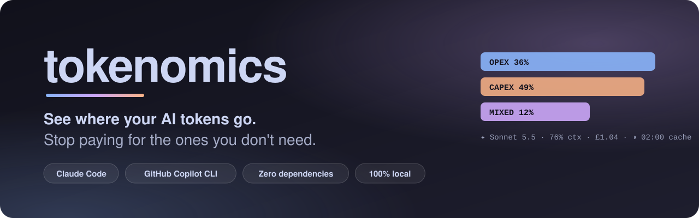
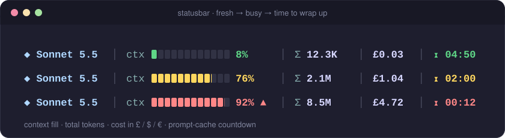
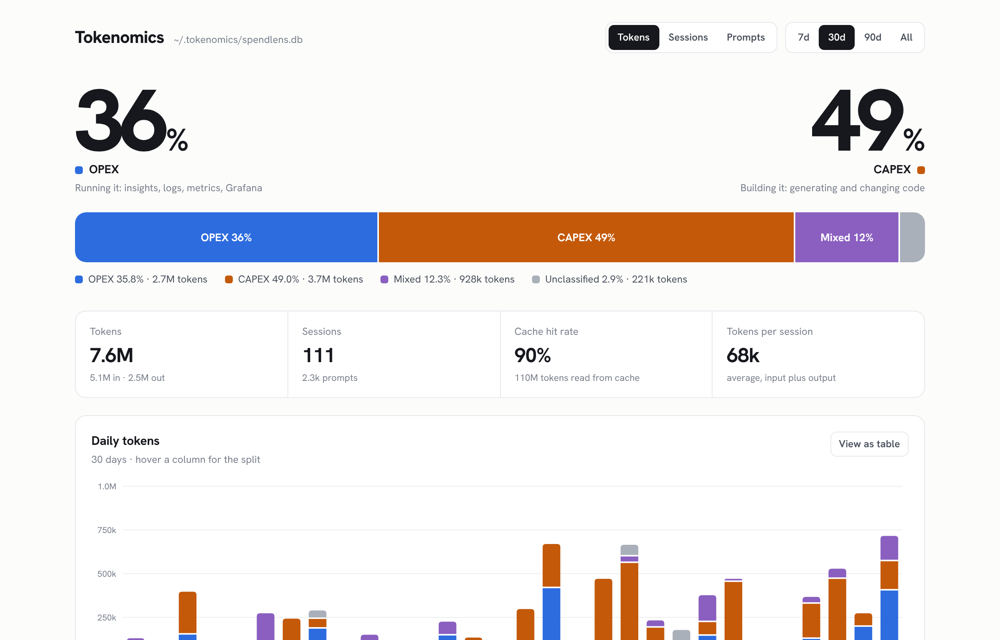
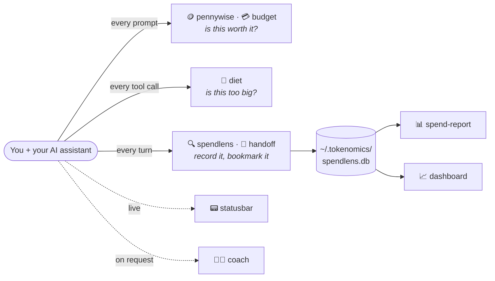

<p align="center">
  
</p>

<p align="center">
  <a href="#-install"></a>
  <a href="docs/installation.md#github-copilot-cli"></a>
  
  
  <br>
  <a href="https://github.com/andrew44/tokenomics/releases/latest"></a>
  <a href="https://github.com/andrew44/tokenomics/actions/workflows/tests.yml"></a>
  <a href="LICENSE"></a>
</p>

<h3 align="center">A cost-cutting toolkit for AI coding assistants.<br>Watch your spend live, get coached on wasted tokens, and let guard-rails stop the expensive mistakes before they happen.</h3>

<p align="center">
  <a href="#-install"><b>Install</b></a> ·
  <a href="#-whats-in-the-box"><b>What you get</b></a> ·
  <a href="#-see-it-in-action"><b>See it in action</b></a> ·
  <a href="docs/README.md"><b>Docs</b></a>
</p>

---

Every message you send re-sends the **whole conversation**. Long chats, pasted logs, a 2 MB lockfile, the top-tier model for a one-line fix, a coffee break that lets the prompt cache expire: each one quietly multiplies the bill, and you never see it happen.

**tokenomics makes it visible, and then does something about it.**

<p align="center">
  
</p>

- 📟 **See it live.** A status bar with context fill, tokens, cost in £/$/€ and a countdown to when the cache goes cold.
- 🛡️ **Stop waste automatically.** Guard-rails that catch context floods, over-specced models and runaway spend *before* they cost you.
- 🧑‍🏫 **Get better at it.** A coach that reviews your prompts, and a weekly spend report with three fixes tied to your own numbers.
- 🔒 **Stays on your machine.** One local SQLite file. No account, no telemetry, no packages to install.

<sub>⚠️ Costs shown are estimates, not a bill. Always check your provider's billing page. See the <a href="#disclaimer">disclaimer</a>.</sub>

---

## ⚡ Install

### Claude Code: install the plugin (recommended)

tokenomics is a [Claude Code plugin](https://code.claude.com/docs/en/plugins). Inside Claude Code, paste:

```text
/plugin install tokenomics --marketplace andrew44/tokenomics
```

<sub>On Claude Code older than v2.1.275, use two lines instead: <code>/plugin marketplace add andrew44/tokenomics</code> then <code>/plugin install tokenomics@tokenomics</code>.</sub>

Choose **Install for you (user scope)** so it works in every project. That's it. 🎉 You get every skill, all five hooks and, from your next session, the live status bar. Now try:

> 💬 *"coach, review my prompts"*  ·  💬 *"spend report"*  ·  💬 `/tokenomics:dashboard`

**Stay up to date:** open `/plugin` → **Marketplaces** → **tokenomics** and switch on **auto-update**. (Claude Code only auto-updates its official marketplace unless you do.)

<details>
<summary><b>Using the Claude desktop app? No terminal needed</b></summary>

In the **Code** tab (a local session), click **+** next to the prompt box → **Add plugins** → add the marketplace `andrew44/tokenomics` → install **tokenomics**. Desktop and terminal share the same settings, so it works in both. The status bar shows in the terminal only.
</details>

<details>
<summary><b>Rolling it out to a team?</b></summary>

Commit this to your repo's `.claude/settings.json`. Teammates are offered the marketplace when they trust the folder, then install it once with `/plugin install tokenomics@tokenomics`:

```json
{
  "extraKnownMarketplaces": {
    "tokenomics": { "source": { "source": "github", "repo": "andrew44/tokenomics" }, "autoUpdate": true }
  },
  "enabledPlugins": { "tokenomics@tokenomics": true }
}
```
</details>

<details>
<summary><b>Prefer a shell?</b></summary>

```bash
claude plugin install tokenomics --marketplace andrew44/tokenomics     # Claude Code v2.1.292+
# older: claude plugin marketplace add andrew44/tokenomics && claude plugin install tokenomics@tokenomics
```
</details>

The plugin needs **Python 3.8+** on your computer (no packages). Don't have it? The one-liner below fetches a private copy for you.

### GitHub Copilot CLI, or no Python: the one-line installer

Sets up Copilot CLI and/or Claude Code (it installs the same plugin), gets Python if you need it, and adds a `tokenomics` terminal command (`tokenomics dashboard`, `report`, `update`, `uninstall`).

```bash
curl -fsSL https://raw.githubusercontent.com/andrew44/tokenomics/main/install.sh | sh      # macOS / Linux
```

```powershell
irm https://raw.githubusercontent.com/andrew44/tokenomics/main/install.ps1 | iex           # Windows (PowerShell)
```

It never replaces a status line you already have, and running it again repairs the install. Read it first if you like: [install.sh](install.sh) · [install.ps1](install.ps1).

<details>
<summary><b>Using claude.ai/code (web)?</b></summary>

Plugins can't be installed on the web. Commit the coach to your repo instead: `npx skills@latest add andrew44/tokenomics --skill coach --copy`
</details>

Full details, updating and removing: **[Installation guide](docs/installation.md)**.

---

## 🧩 Or pick and choose

Every piece works on its own. Grab just what you want:

| I only want... | Run this |
|---|---|
| 🧑‍🏫 **coach** skill | `npx skills@latest add andrew44/tokenomics --skill coach` |
| 📊 **spend-report** skill | `npx skills@latest add andrew44/tokenomics --skill spend-report` *(reads spendlens data, so pair it with the plugin)* |
| 📟 **statusbar** only | Install the plugin and switch the hooks off (below), or without the plugin: `curl -fsSL https://raw.githubusercontent.com/andrew44/tokenomics/main/install.sh \| sh -s -- --no-plugin` |
| 📈 **dashboard** | `/tokenomics:dashboard` with the plugin, or `tokenomics dashboard` after the one-liner |
| 🛡️ **Some of the hooks** | Install the plugin, then switch off the ones you don't want, e.g. `TOKENOMICS_DIET=off` or `TOKENOMICS_PENNYWISE=block` |

The `npx skills` commands need [Node.js](https://nodejs.org). See [Installation → pick and choose](docs/installation.md#install-pieces-individually) for every option.

---

## 🧰 What's in the box

| | Helper | What it does | Kind | Claude Code | Copilot CLI |
|---|---|---|:---:|:---:|:---:|
| 🧑‍🏫 | **[coach](docs/reference.md#coach)** | Reads your conversation and tells you where tokens were wasted, with the fixes and a rewrite of your weakest prompt. | skill | ✅ | — |
| 📊 | **[spend-report](docs/reference.md#spend-report)** | "Spend report" gets you the week's spend, OPEX vs CAPEX, costliest sessions, and three ways to spend less. | skill | ✅ | — |
| 🔍 | **[spendlens](docs/reference.md#spendlens)** | Silently labels each session **OPEX** (running things) or **CAPEX** (building things) and logs tokens and cost. | hook | ✅ | ✅ |
| 🪙 | **[pennywise](docs/reference.md#pennywise)** | Model router: hands simple prompts to a cheaper model (e.g. Haiku) automatically, keeps hard ones on yours. | hook | ✅ | — |
| 🥗 | **[diet](docs/reference.md#diet)** | Stops tool calls that would flood the context (whole lockfiles, unbounded logs) and tells the AI to ask for less. | hook | ✅ | ✅ |
| 💳 | **[budget](docs/reference.md#budget)** | Daily and per-session limits in your currency. Warns at 80%, pauses at 100%. | hook | ✅ | — |
| 🔖 | **[handoff](docs/reference.md#handoff)** | Writes a free "where we got to" note just before the cache expires, so you can resume cheaply. | hook | ✅ | ✅ |
| 📟 | **[statusbar](docs/reference.md#statusbar)** | Context fill, tokens, cost and a cache countdown, live at the bottom of your assistant. On automatically; `/tokenomics:statusbar` to manage it. | tool | ✅ | ✅ |
| 📈 | **[dashboard](docs/reference.md#dashboard)** | A local web view of where your tokens went, split by OPEX/CAPEX, project and day. | tool | ✅ | ✅ |

> **Skills** run when you ask. **Hooks** run automatically. **Tools** you run yourself. Not sure which you need? → [Skills, tools and hooks](docs/skills-tools-and-hooks.md)

---

## 👀 See it in action

### pennywise routes the over-specced prompt

You ask for a hello-world on the priciest model. pennywise routes it to Haiku without you lifting a finger:

```text
pennywise: routing this small, self-contained task to Haiku instead of Opus.
Prefix a prompt with 'keep-model:' to keep it on Opus.
```

### diet stops the context flood

The AI goes to read a lockfile whole. diet steps in, and the AI retries with a `grep` by itself:

```text
tokenomics diet: package-lock.json is a generated file of about 180,000 tokens; reading it whole
is rarely useful. Search it instead (e.g. grep for the package or symbol you need), or read a
small range with offset/limit.
```

Unbounded `kubectl logs`, `git log`, `find /` and giant `cat`s get the same treatment. Append `# diet-ok` when you really do need it all.

### handoff saves you from the cold-cache tax

Step away for a coffee and the prompt cache expires; resuming means paying to reload everything. Sixty seconds before that happens, handoff writes `~/.tokenomics/handoffs/<session>.md` (branch, changes, tasks, last requests) using **plain code, zero tokens**. Start fresh with `Continue from @<that file>`.

### The dashboard shows where it all went

<picture>
  <source media="(prefers-color-scheme: dark)" srcset="docs/assets/dashboard-dark.png">
  
</picture>

<p align="center"><sub>Shown with <code>--demo</code> data. Yours fills in as you work.</sub></p>

---

## 🧭 How it fits together



**OPEX or CAPEX?** spendlens answers the question finance teams keep asking: *how much of our AI spend goes on building things, and how much on keeping them running?* It scores the words in your prompts, the tools the AI used and the skills it ran. [How it decides →](docs/reference.md#how-it-decides)

---

## 🔒 Private by default

- **Local only.** Everything is written to one SQLite file at `~/.tokenomics/spendlens.db`. The dashboard listens on `127.0.0.1` only.
- **No prompt text stored** unless you opt in (`TOKENOMICS_STORE_PROMPT=1`).
- **Nothing leaves your machine** unless you switch on the optional [AI classifier](docs/reference.md#optional-let-an-ai-model-decide), which redacts first and works with local models.
- **Never in the way.** Hooks fail silently to a log file. Every guard-rail has a one-step override and a `warn` / `off` switch.
- **Zero dependencies.** Python standard library only. Nothing to `pip install`, nothing to audit but this repo.

---

## 📚 Docs

| | Guide | |
|---|---|---|
| 🚀 | [**Installation**](docs/installation.md) | Whole toolkit, individual pieces, desktop, web, Copilot, teams, troubleshooting |
| 🧭 | [**Skills, tools and hooks**](docs/skills-tools-and-hooks.md) | What each helper does and when to reach for it |
| 🎓 | [**How tokens work**](docs/how-tokens-work.md) | Input, output, the prompt cache and tokenisers, in plain English then in depth |
| 💡 | [**Saving tokens**](docs/saving-tokens.md) | Practical habits for spending less, with worked examples |
| 🛠️ | [**Helper reference**](docs/reference.md) | Every helper in full detail, plus querying your data |
| ⚙️ | [**Configuration**](docs/configuration.md) | Every setting, currency and prices |
| 🏗️ | [**Architecture**](docs/architecture.md) | How it's built, and how to contribute |

---

## 🤝 Contributing

Issues and pull requests are welcome. The tests need nothing installed:

```bash
cd tests && python3 -m unittest
```

Start with [Architecture](docs/architecture.md). More hooks, tools and skills are on the way.

## ☕ Support

If tokenomics saves you more than the price of a coffee, consider buying me one:

<p align="center">
  <a href="https://buymeacoffee.com/andrewgoadm">
    
  </a>
</p>

---

## Disclaimer

**The prices, token counts and costs shown by tokenomics are a rough indication of what your current session has cost, not a bill. They may be inaccurate, incomplete or out of date. The authors and contributors accept no liability for any loss or cost arising from prices or costs that turn out to be wrong, or from decisions made using them. You are responsible for checking your actual usage and charges in the Claude app (or your provider's billing page) and should not rely solely on this tool. tokenomics is provided "as is", without warranty of any kind; see sections 7 (Disclaimer of Warranty) and 8 (Limitation of Liability) of the [Apache License 2.0](LICENSE).**

## 🏁 Quick start

Convinced? In Claude Code:

```text
/plugin install tokenomics --marketplace andrew44/tokenomics
```

Then say *"coach, review my prompts"*. On Copilot CLI or without Python, use the [one-line installer](#github-copilot-cli-or-no-python-the-one-line-installer).

Want only some of it? See [pick and choose](#-or-pick-and-choose). Anything else: [Installation guide](docs/installation.md).

---

## Licence

[Apache License 2.0](LICENSE)
