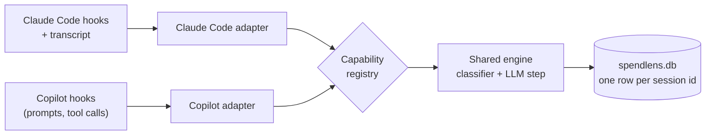

<p align="right"><a href="../README.md">← Back to README</a> · <a href="README.md">All docs</a></p>

# Architecture (for contributors)

The OPEX/CAPEX logic is written **once**, in a shared engine. Claude Code and Copilot each have a small **adapter** that turns that assistant's hook messages into a common format and says what the assistant can and can't report. The engine never assumes a feature exists: it asks the adapter first, then does the best it can with what's there.



- **Shared engine** (`tokenomics/engine/`): the scoring rules, the optional AI-model check, and the database. Both assistants go through exactly the same code.
- **Adapters** (`tokenomics/adapters/`): translation only, no scoring. Each one lists its capabilities (transcript, token counts, tool events, billing and so on) as `native`, `partial` or `none`.
- **If something is missing**, the engine copes: no transcript means it uses the prompt and tool events it stored; an unknown assistant, or an adapter that fails to load, still gets its prompts logged by session id, and the other assistant is unaffected.
- **Billing stays separate**: Claude Code tokens are priced (`engine/pricing.ts`); Copilot premium requests are never turned into tokens or money.
- **Value helpers read behaviour, not totals**: `engine/trace.ts` turns a transcript into steps (each tool call with its input and result) and turns (each request with its usage and cost). bangforbuck, sherlock, groundhog, haggle and tastetest all work on that, so a new transcript format means one new parser, not seven.
- **Guards share the engine too**: diet's rules (`engine/diet.ts`) and budget's limits (`engine/budget.ts`) are written once; each adapter says how to deny a tool call, block a prompt or show a notice on its platform (or that it can't).

Everything is TypeScript. Node.js 22.18+ runs the `.ts` files directly (it strips the types itself), so there is no build step and nothing is compiled; SQLite comes from Node's built-in `node:sqlite`. There are no runtime packages at all: TypeScript and `@types/node` are dev dependencies, used only to type-check (`npm run typecheck`).

The older tools (statusline, pennywise, doggybag, coach) are still standalone scripts; the statusline must stay a single file because `--install` copies it to `~/.tokenomics/statusline.mts` (and the plugin's `statusline.ts --sync` SessionStart hook refreshes that copy after each plugin update). The band (`hooks/band.tsx`) is a [mod](https://code.claude.com/docs/en/plugins/mods/interface) that draws the statusline's numbers (`statusline.ts --json`) above the prompt box in the desktop app, where there is no statusline. Its tests run with `claude plugin test .`.

## Handy commands

```bash
node scripts/spendlens.ts capabilities     # what each assistant supports
npm test                                   # run the tests (node:test; no installs needed)
npm install && npm run typecheck           # type-check with TypeScript (the only dev dependencies)
node scripts/update_prices.ts              # refresh data/model-prices.json
```

Tests run on every push and pull request against Node.js 22.18 (the oldest supported) and 24 on Linux and macOS, and every push is type-checked with `tsc` (`.github/workflows/tests.yml`).

## What's in the repo

```text
tokenomics/
├── .claude-plugin/
│   ├── plugin.json                 Claude Code manifest
│   └── marketplace.json            lets the repo be added as a marketplace
├── hooks/hooks.json                Claude Code hooks (and the band module)
├── hooks/band.tsx                  the band: the statusline in the desktop app, above the prompt box (a mod)
├── plugin.json                     Copilot CLI manifest
├── copilot-hooks.json              Copilot CLI hooks
├── skills/
│   ├── coach/SKILL.md              prompt and cache review skill
│   ├── spend-report/SKILL.md       weekly spend report skill
│   ├── dashboard/SKILL.md          opens the dashboard (/tokenomics:dashboard)
│   ├── statusline/SKILL.md         installs / removes the statusline, band on/off (/tokenomics:statusline)
│   └── bangforbuck/ haggle/ sherlock/ waistline/ tastetest/ springclean/ groundhog/
│                                   value, waste and quality skills (each a SKILL.md over its script)
├── tokenomics/
│   ├── engine/                     shared logic: classifier.ts, llm.ts, store.ts, session.ts, evidence.ts,
│   │                               pricing.ts, currency.ts, diet.ts, budget.ts, events.ts, and for the
│   │                               value helpers: trace.ts (what the agent did, from a transcript),
│   │                               outcomes.ts, ledger.ts, forensics.ts, loops.ts, contract.ts
│   ├── platform/                   common adapter interface + capability registry
│   ├── adapters/                   claude_code.ts, copilot.ts (translation only)
│   ├── config.ts                   shared settings
│   └── util.ts                     shared helpers
├── install.sh / install.ps1        one-line installers (download, then run scripts/cli.ts setup)
├── scripts/
│   ├── cli.ts                      the `tokenomics` command: setup, update, uninstall, dashboard, report
│   ├── run.sh                      launcher every hook and skill uses: finds Node.js 22.18+ on any OS
│   ├── spendlens.ts                the OPEX/CAPEX hook runner (calls the engine)
│   ├── pennywise.ts                model router: complexity tiers; hook (subagent) or local proxy
│   ├── doggybag.ts                 packs a resume note into <project>/.doggybag before the cache expires
│   ├── diet.ts                     stops tool calls that would flood the context
│   ├── budget.ts                   daily / per-session spending limits
│   ├── report.ts                   spend report (used by the spend-report skill)
│   ├── coach.ts                    transcript analyser used by the coach skill
│   ├── statusline.ts               the statusline for Claude Code and Copilot CLI (terminal); --json feeds the band
│   ├── dashboard.ts                local web server over the spendlens database (--background)
│   ├── bangforbuck.ts              cost per outcome; writes the ledger at each turn end
│   ├── haggle.ts                   task quotes and contracts (prompt, guard, settle, close hooks)
│   ├── sherlock.ts                 agent forensics: costed waste in a session
│   ├── waistline.ts                cost regression between periods or against a baseline (--ci)
│   ├── tastetest.ts                two runs of a task: cost vs quality, quality-adjusted saving
│   ├── springclean.ts              context hygiene audit of instruction files
│   ├── groundhog.ts                loop breaker (pre-tool hook) and session replay
│   └── update_prices.ts            refreshes data/model-prices.json from Claude's pricing page
├── data/model-prices.json          Claude prices per model (Haiku 3.5 to Fable 5.2), updated weekly
├── dashboard/index.html            the dashboard page
├── tests/                          node:test suite (*.test.ts) and the installer check
├── package.json / tsconfig.json    dev dependencies (TypeScript, @types/node) and type-check settings
├── docs/                           guides (you are here)
└── .github/workflows/              tests, installer checks (macOS/Windows/Linux), weekly price refresh, releases
```

## Adding a helper

1. Put shared logic in `tokenomics/engine/` so both assistants use it.
2. Add a thin script in `scripts/` that reads the hook payload through the adapter.
3. Register the hook in `hooks/hooks.json` (Claude Code) and, if Copilot can support it, `copilot-hooks.json`. Always call it through the launcher (`sh "${CLAUDE_PLUGIN_ROOT}/scripts/run.sh" <name>.ts ...`), never `node` directly: the launcher finds the right Node.js on every OS, including Windows.
4. Add a settings switch (`TOKENOMICS_<NAME>=off`) so people can opt out.
5. Log what it did to a `<name>_events` table so the spend report can show it.
6. Add tests, and document it in [the reference](reference.md) and [Skills, tools and hooks](skills-tools-and-hooks.md).


## Releasing

There's nothing to do by hand: **every update to `main` becomes a GitHub release** once the tests pass ([release.yml](../.github/workflows/release.yml)).

- **Patch releases are automatic.** The workflow bumps the patch number (1.3.0 → 1.3.1), writes it to both `.claude-plugin/plugin.json` and `plugin.json`, commits `Release v1.3.1` to `main`, then publishes the release with generated notes and the installers attached. The version bump matters: Claude Code only sends plugin users an update when the version changes.
- **Minor or major release?** Raise `version` in both manifests in your pull request (e.g. to `1.4.0`). That version is released as it is.
- **Price updates** from the weekly workflow are released too. If nothing changed since the last release, no release is made.
- If `main` is protected, allow GitHub Actions to push to it (or the version-bump commit will be refused).

---

<p align="center"><a href="configuration.md">← Configuration</a> · <a href="README.md">All docs</a></p>
