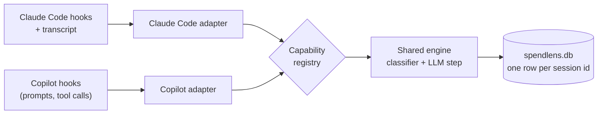

<p align="right"><a href="../README.md">← Back to README</a> · <a href="README.md">All docs</a></p>

# Architecture (for contributors)

The OPEX/CAPEX logic is written **once**, in a shared engine. Claude Code and Copilot each have a small **adapter** that turns that assistant's hook messages into a common format and says what the assistant can and can't report. The engine never assumes a feature exists: it asks the adapter first, then does the best it can with what's there.



- **Shared engine** (`tokenomics/engine/`): the scoring rules, the optional AI-model check, and the database. Both assistants go through exactly the same code.
- **Adapters** (`tokenomics/adapters/`): translation only, no scoring. Each one lists its capabilities (transcript, token counts, tool events, billing and so on) as `native`, `partial` or `none`.
- **If something is missing**, the engine copes: no transcript means it uses the prompt and tool events it stored; an unknown assistant, or an adapter that fails to load, still gets its prompts logged by session id, and the other assistant is unaffected.
- **Billing stays separate**: Claude Code tokens are priced (`engine/pricing.py`); Copilot premium requests are never turned into tokens or money.
- **Guards share the engine too**: diet's rules (`engine/diet.py`) and budget's limits (`engine/budget.py`) are written once; each adapter says how to deny a tool call, block a prompt or show a notice on its platform (or that it can't).

The older tools (status bar, pennywise, handoff, coach) are still standalone scripts; the status bar must stay a single file because `--install` copies it.

## Handy commands

```bash
python3 scripts/spendlens.py capabilities     # what each assistant supports
cd tests && python3 -m unittest               # run the tests (no installs needed)
python3 scripts/update_prices.py              # refresh data/model-prices.json
```

Tests run on every push and pull request against Python 3.8 and 3.13 on Linux and macOS (`.github/workflows/tests.yml`).

## What's in the repo

```text
tokenomics/
├── .claude-plugin/
│   ├── plugin.json                 Claude Code manifest
│   └── marketplace.json            lets the repo be added as a marketplace
├── hooks/hooks.json                Claude Code hooks
├── plugin.json                     Copilot CLI manifest
├── copilot-hooks.json              Copilot CLI hooks
├── skills/
│   ├── coach/SKILL.md              prompt and cache review skill
│   └── spend-report/SKILL.md       weekly spend report skill
├── tokenomics/
│   ├── engine/                     shared logic: classifier.py, llm.py, store.py, session.py, evidence.py,
│   │                               pricing.py, currency.py, diet.py, budget.py, events.py
│   ├── platform/                   common adapter interface + capability registry
│   ├── adapters/                   claude_code.py, copilot.py (translation only)
│   ├── config.py                   shared settings
│   └── util.py                     shared helpers
├── scripts/
│   ├── spendlens.py                the OPEX/CAPEX hook runner (calls the engine)
│   ├── pennywise.py                model router (cheaper-model subagent)
│   ├── handoff.py                  writes a resume note before the cache expires
│   ├── diet.py                     stops tool calls that would flood the context
│   ├── budget.py                   daily / per-session spending limits
│   ├── report.py                   spend report (used by the spend-report skill)
│   ├── coach.py                    transcript analyser used by the coach skill
│   ├── statusbar.py                status line for Claude Code and Copilot CLI
│   ├── dashboard.py                local web server over the spendlens database
│   └── update_prices.py            refreshes data/model-prices.json from Claude's pricing page
├── data/model-prices.json          Claude prices per model (Haiku 3.5 to Fable 5.2), updated weekly
├── dashboard/index.html            the dashboard page
├── tests/                          unittest suite
├── docs/                           guides (you are here)
└── .github/workflows/              tests + weekly price refresh
```

## Adding a helper

1. Put shared logic in `tokenomics/engine/` so both assistants use it.
2. Add a thin script in `scripts/` that reads the hook payload through the adapter.
3. Register the hook in `hooks/hooks.json` (Claude Code) and, if Copilot can support it, `copilot-hooks.json`.
4. Add a settings switch (`TOKENOMICS_<NAME>=off`) so people can opt out.
5. Log what it did to a `<name>_events` table so the spend report can show it.
6. Add tests, and document it in [the reference](reference.md) and [Skills, tools and hooks](skills-tools-and-hooks.md).

---

<p align="center"><a href="configuration.md">← Configuration</a> · <a href="README.md">All docs</a></p>
