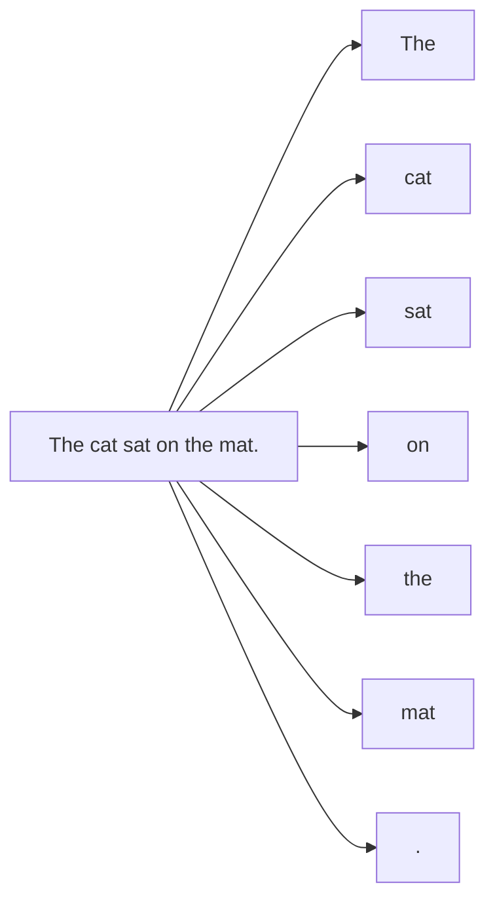
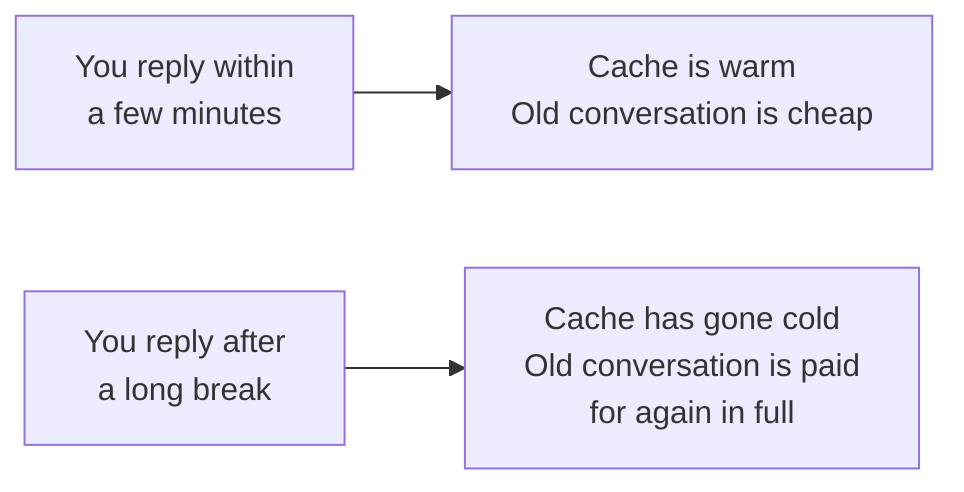

# How tokens work

Every number tokenomics shows you (tokens used, cache countdown, cost in pounds) comes back to one idea: **tokens**. This guide explains them in two parts:

1. **[The simple version](#part-1-the-simple-version)**: no technical background needed. Five minutes.
2. **[The technical version](#part-2-the-technical-version)**: how tokenisers, input, output and the prompt cache actually work, and how they show up in your bill.

Read Part 1 and stop there if that is all you need.

---

## Part 1: The simple version

### What is a token?

An AI model doesn't read words the way you do. It chops text into small pieces called **tokens**, a bit like how a child sounds out a long word one chunk at a time.

- A short, common word is usually **one token**: `cat`, `the`, `hello`.
- A longer or rarer word is split into **a few tokens**: `tokenomics` might become `token` + `omics`.
- Spaces, punctuation, numbers and code symbols take up tokens too.

**Rule of thumb:** in everyday English, 100 tokens is roughly 75 words. A page of text is about 500 to 700 tokens.



*Seven pieces, so seven tokens.*

### Why should I care?

Because **tokens are what you pay for**, and they also set the limit on how much the AI can keep in mind at once.

Think of it like a taxi meter. The meter doesn't care whether the trip was useful; it just counts distance. The AI's meter counts tokens.

### The three kinds of token

Every time you send a message, the meter counts three things:

| Kind | What it is | Everyday comparison |
|------|------------|---------------------|
| **Input** | Everything the AI reads before it replies: your message, the files it looked at, *and the whole conversation so far*. | The pile of paperwork you hand to an expert. |
| **Output** | Everything the AI writes back to you. | The expert's written answer. |
| **Cache** | Input the AI has seen very recently and can re-read cheaply. | The expert's sticky notes from five minutes ago. |

Two things surprise most people:

1. **The AI has no memory between messages.** Each time you reply, the *whole conversation* is sent again from the top. So message 50 in a long chat costs far more than message 1, even if you only typed "thanks".
2. **Writing costs more than reading.** Output tokens are usually about **five times** the price of input tokens. A long, wordy answer costs more than a long question.

### What is the cache?

Because the whole conversation is re-sent every time, re-reading it at full price would get expensive fast. So the AI keeps a **short-term memory**, the **prompt cache**.

- If you reply within a few minutes, the AI re-reads the earlier conversation from the cache at roughly **a tenth of the normal price** (often less on newer models).
- The cache only lasts a short while (usually **5 minutes**, sometimes 1 hour). Each time you send a message, the timer resets.
- If you wander off for a coffee and come back after it expires, the AI has to read the whole conversation in at full price again, and pay a little extra to put it back in the cache.



That is what the egg timer in the **statusbar** shows you, and why **handoff** writes you a short note just before the cache runs out: starting fresh from a short note is cheaper than reloading a long, cold conversation.

### What is a tokeniser?

The **tokeniser** is the tool that does the chopping. Different AI models use different tokenisers, so the same sentence can be 10 tokens on one model and 12 on another. That's why you can't always compare token counts between products like for like.

### Five habits that save tokens

1. **Start a new conversation for a new task.** A long chat drags all its history along with every message.
2. **Don't paste huge files "just in case".** Point the AI at the part that matters.
3. **Ask for short answers when short will do.** Output is the expensive kind.
4. **Keep working while the cache is warm**, or let **handoff** write a note and start fresh later.
5. **Use a smaller model for simple jobs.** That's what **pennywise** nudges you about.

For more on each of these, with worked examples, see [Saving tokens](saving-tokens.md).

That's all you need to know to use tokenomics well. If you want to see the machinery, read on.

---

## Part 2: The technical version

### 2.1 Tokenisers

A large language model works on a fixed **vocabulary** of integer IDs, typically somewhere between 50,000 and a few hundred thousand entries. The tokeniser is the deterministic function that maps text to a sequence of those IDs and back again.

```
"Hello, world!"  ->  [ 9906, 11, 1917, 0 ]    (illustrative IDs)
```

#### Subword tokenisation

Modern tokenisers sit between two extremes:

- **Word-level** tokenisers can't handle words they never saw ("out of vocabulary").
- **Character-level** tokenisers handle anything but produce very long sequences, and the cost of attention grows with sequence length.

**Subword** tokenisation takes the middle road: frequent strings get their own token, rare strings are built from smaller pieces, and nothing is ever unrepresentable. The common algorithms are:

| Algorithm | Idea | Used by (examples) |
|-----------|------|--------------------|
| **Byte-Pair Encoding (BPE)** | Start from bytes or characters; repeatedly merge the most frequent adjacent pair into a new token until the vocabulary is full. Encoding replays those merges. | GPT family, Llama, many others |
| **Byte-level BPE** | BPE over raw UTF-8 bytes, so any input (emoji, binary-ish text, any script) is encodable without an "unknown" token. | Most current LLMs |
| **WordPiece** | Like BPE, but picks merges that maximise training-data likelihood rather than raw frequency. | BERT |
| **Unigram (SentencePiece)** | Start with a large candidate vocabulary and prune the pieces that contribute least to the likelihood. | T5, some multilingual models |

#### Why token counts vary

How many tokens a piece of text costs depends on how well it matches what the tokeniser was trained on:

- **English prose** compresses well: roughly 4 characters or 0.75 words per token.
- **Code** costs more: indentation, brackets, `camelCase` and `snake_case` identifiers often split into many pieces.
- **Other languages and scripts** often cost more, sometimes much more, if they were under-represented in training.
- **Numbers, hashes, UUIDs, base64 and minified JSON** are close to worst case: little repetition for merges to exploit.
- **Leading spaces matter.** `" cat"` and `"cat"` are usually different tokens, which is why tokens are often shown with a leading space.

#### Tokenisers are model-specific

Each model family ships its own tokeniser, and it can change between generations. Practical consequences:

- **Never estimate one vendor's tokens with another vendor's tokeniser.** For example, OpenAI's `tiktoken` undercounts Claude tokens, noticeably so on code and non-English text.
- **Re-measure when you change model.** Anthropic's newer tokeniser (introduced with Claude Opus 4.7) produces roughly 1x to 1.35x as many tokens as older Claude models for the same text, so a prompt can get "bigger" without a single character changing.
- **Use the provider's counter for exact figures.** For Claude that is the `count_tokens` endpoint (`POST /v1/messages/count_tokens`), which takes the same model ID and message shape as a real request and returns `input_tokens` without running the model.

#### Images and other media

Non-text inputs are tokenised too. Images are converted into a number of tokens that scales with their pixel dimensions, and PDFs are billed for both their extracted text and their page images. A screenshot can easily cost as much as a page or two of text.

### 2.2 The context window

A model's **context window** is the maximum number of tokens it can attend to in one request: input and output combined. Current frontier models offer windows of hundreds of thousands to around a million tokens.

Two separate limits apply:

| Limit | Meaning |
|-------|---------|
| **Context window** | Input tokens + output tokens must fit inside it. |
| **Max output (`max_tokens`)** | A cap you set on how much the model may generate in one response. It is a ceiling, not a target. |

When a conversation approaches the window, something has to give: older content is dropped, summarised (**compaction**) or cleared (**context editing**). The statusbar's "how full" indicator tracks this.

### 2.3 Input tokens

The model API is **stateless**. A chat "conversation" is an illusion maintained by the client, which re-sends the full history on every turn. A single request's input is assembled in a fixed order:

```
tools  ->  system prompt  ->  messages (turn 1, turn 2, ... turn N)
```

That means input includes far more than what you typed:

- the system prompt and any project instructions (for example `CLAUDE.md`);
- the definitions of every tool the assistant can call;
- every previous user message and assistant reply;
- every tool call and **tool result** (file contents, command output, search results);
- any images or documents.

In agentic coding sessions, **tool results usually dominate**. Reading a 2,000-line file once puts it into the history, and it is re-sent on every subsequent turn until the session ends or the context is compacted.

#### Why long sessions get expensive

If each turn adds roughly `k` tokens, turn `n` has about `n x k` tokens of input, and the cumulative input across `N` turns grows with the **square** of the session length:

```
total input  ~  k x (1 + 2 + ... + N)  =  k x N(N+1)/2
```

Doubling the length of a session roughly quadruples its uncached input. Caching (below) cuts the price per re-read token, but doesn't change the shape of the curve. This is the main reason "start a new session for a new task" is the single most effective habit.

### 2.4 Output tokens

Output tokens are generated one at a time. Each one needs a full forward pass of the model, whereas input tokens are processed in parallel in one go (the **prefill** phase). That's why output is priced higher: typically **about 5x** the input rate on Anthropic's models.

Output includes:

- the visible reply text;
- the JSON arguments of every **tool call** the model makes (including whole files it writes);
- **thinking / reasoning tokens**, where the model reasons before answering. These are billed as output whether or not the reasoning text is shown to you.

Every output token then becomes **input** on the next turn, so a verbose answer is paid for once as output and again (at the input or cache-read rate) on every turn after it.

Levers that reduce output: asking for concise answers or diffs instead of whole files, lowering the **effort** level for simple tasks, and choosing a smaller model where it holds quality.

### 2.5 The prompt cache

Because so much of each request repeats the previous one, providers cache the model's internal state for a **prefix** of the prompt. On the next request, if the beginning of the prompt is byte-for-byte identical, the cached prefix is reused instead of being recomputed.

#### How it works

- **Prefix match.** The cache key is the exact bytes from the start of the prompt (tools, then system, then messages) up to a **breakpoint**. Change one byte anywhere in that prefix (a timestamp in the system prompt, a reordered tool list, an edited earlier message) and everything after the change is a miss.
- **Breakpoints.** The client marks where cacheable prefixes end (`cache_control` on the Claude API, up to four per request; automatic caching places one for you). Coding assistants such as Claude Code handle this automatically.
- **Minimum size.** Prefixes shorter than a model-specific minimum (roughly 512 to 4,096 tokens) are not cached at all.
- **Time to live (TTL).** Entries last **5 minutes** by default, or **1 hour** if requested. Every cache read resets the timer, so a conversation with replies less than 5 minutes apart stays warm indefinitely. The clock runs from the *start* of each request, so a long generation eats into it.
- **Scope.** Caches are per model and per workspace/organisation. Switching model mid-session means starting with a cold cache.

#### How it is priced

Relative to the model's normal input price:

| Token type | Price multiplier | When it happens |
|------------|------------------|-----------------|
| Uncached input | 1x | New content after the last cache hit, or no caching at all. |
| **Cache write**, 5-minute TTL | **1.25x** | The first time a prefix is stored, and again whenever it has expired. |
| **Cache write**, 1-hour TTL | **2x** | As above, with the longer lifetime. |
| **Cache read** | **about 0.1x** (as low as 0.025x to 0.05x on some newer models) | The prefix matched a live entry. |

The break-even is quick: with the 5-minute TTL, a prefix used twice already costs less (1.25x + 0.1x = 1.35x) than sending it uncached twice (2x).

#### The cold-cache penalty

The expensive moment is when a large conversation's cache **expires**. The next message pays the 1.25x write price on the *entire* history: for a 300,000-token session that is like paying for 375,000 fresh input tokens just to say "carry on". A small handoff note (a few thousand tokens) in a new session avoids most of that, which is exactly the trade **handoff** makes for you.

#### Reading the usage fields

Each Claude API response reports four token counts. tokenomics stores them as the columns described in the main README:

| API field | tokenomics column | Meaning |
|-----------|-------------------|---------|
| `input_tokens` | `input_tokens` | Uncached input only: the remainder after the cache. |
| `cache_creation_input_tokens` | `cache_creation_tokens` | Tokens written to the cache this request (write premium). |
| `cache_read_input_tokens` | `cache_read_tokens` | Tokens served from the cache this request (discounted). |
| `output_tokens` | `output_tokens` | Generated tokens, including thinking and tool-call arguments. |

Things to keep in mind when reading them:

- **Total prompt size is the sum** `input_tokens + cache_creation_input_tokens + cache_read_input_tokens`. A tiny `input_tokens` in a long session doesn't mean a small prompt, just a well-cached one.
- **Healthy sessions look like this:** `cache_read` grows turn by turn, while `cache_creation` stays small (just the latest turn).
- **Unhealthy sessions look like this:** `cache_creation` close to the full conversation size on many turns, or `cache_read` stuck at zero. Something is invalidating the prefix (a long idle gap, a model switch, or changing content near the top of the prompt). critical-friend flags these as "cache rebuilds".
- **Raw totals overstate cost.** Cache reads are often the biggest number but the cheapest tokens, which is why `total_tokens` alone is misleading and a cost figure weights each column by its price.

### 2.6 Putting it together: what a turn costs

For one request:

```
cost = input_tokens          x input_price
     + cache_creation_tokens x input_price x 1.25   (or x 2 for the 1-hour TTL)
     + cache_read_tokens     x input_price x ~0.1
     + output_tokens         x output_price
```

A worked example on a hypothetical model priced at **£4 per million input tokens** and **£20 per million output tokens**, during a coding session with 200,000 tokens of history:

| Scenario | Input | Cache write | Cache read | Output | Approx. cost |
|----------|------:|------------:|-----------:|-------:|-------------:|
| Warm cache, short reply | 500 | 1,500 | 200,000 | 400 | 0.2p + 0.75p + 8p + 0.8p = **~10p** |
| Cold cache (after a break), same reply | 500 | 201,500 | 0 | 400 | 0.2p + 100.75p + 0p + 0.8p = **~£1.02** |
| Fresh session from a 3,000-token handoff | 500 | 3,000 + system | 0 | 400 | **a few pence** |

The same "short reply" costs roughly ten times more after the cache has gone cold, and a fresh session from a handoff note costs a fraction of either.

### 2.7 Quick reference

| Concept | One-line summary |
|---------|------------------|
| Token | A subword unit; ~0.75 English words. |
| Tokeniser | Model-specific text-to-ID mapping; counts differ between models. |
| Context window | Max input + output tokens in one request. |
| Input | Everything sent, including the full history, re-sent every turn. |
| Output | Everything generated, including thinking and tool calls; ~5x input price. |
| Cache write | Storing a prefix; 1.25x (5 min) or 2x (1 h) input price. |
| Cache read | Reusing a live prefix; ~0.1x input price or less. |
| TTL | 5 min default; reset by every read; expiry forces a full re-write. |

### Further reading

- Anthropic: [Prompt caching](https://platform.claude.com/docs/en/build-with-claude/prompt-caching)
- Anthropic: [Token counting](https://platform.claude.com/docs/en/build-with-claude/token-counting)
- Anthropic: [Pricing](https://platform.claude.com/docs/en/about-claude/pricing)
- Sennrich, Haddow and Birch (2016), *Neural Machine Translation of Rare Words with Subword Units*: the paper that introduced BPE to NLP.
