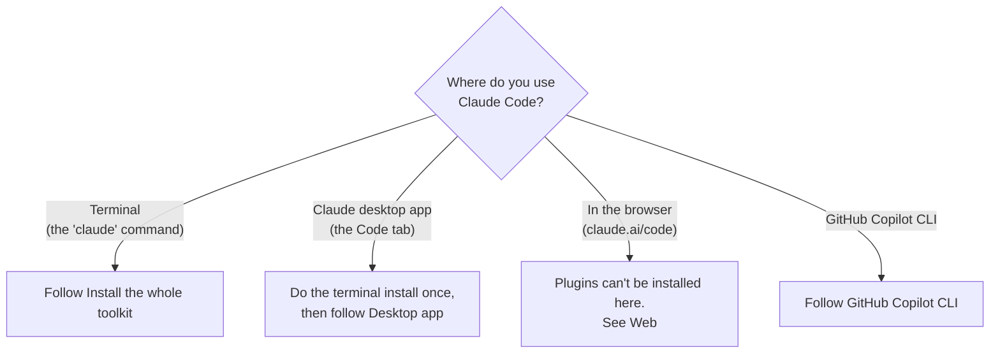

<p align="right"><a href="../README.md">← Back to README</a> · <a href="README.md">All docs</a></p>

# Installation

Everything you need to get tokenomics running, from the one-minute install to team roll-outs and every assistant it supports.

**On this page**

- [Install the whole toolkit](#install-the-whole-toolkit) (recommended)
- [Install pieces individually](#install-pieces-individually)
- [Where do you use Claude Code?](#where-do-you-use-claude-code): terminal, desktop app, web
- [GitHub Copilot CLI](#github-copilot-cli)
- [Requirements](#requirements)
- [Update, remove or check](#update-remove-or-check)
- [Other ways to install](#other-ways-to-install-for-developers)
- [Troubleshooting](#troubleshooting)

---

## Install the whole toolkit

Two steps, about a minute. You need **Python 3.8+** (no packages) and **Claude Code**.

### Step 1: the plugin (skills + all hooks)

Inside Claude Code (type `claude` in a terminal, then paste these one at a time):

```text
/plugin marketplace add andrew44/tokenomics
/plugin install tokenomics@tokenomics
```

When the panel opens, choose **Install for you (user scope)** so it works in every project. If Claude says `Run /reload-plugins to apply`, it does that for you.

Prefer a plain shell? This does the same and switches on the next time you start Claude Code:

```bash
claude plugin marketplace add andrew44/tokenomics && claude plugin install tokenomics@tokenomics
```

**You now have:** `coach`, `spend-report`, `statusbar` (the installer skill), `spendlens`, `pennywise`, `diet`, `budget` and `handoff`.

**Check it worked:** type `/` and look for `/tokenomics:coach`. Run `/hooks` to see the hooks.

### Step 2: the status bar

The status bar ships with the plugin, but Claude Code only lets one thing own the status line, so it's opt-in. Switch it on from inside Claude Code:

```text
/tokenomics:statusbar
```

Or just ask: *"install the tokenomics status bar"*. Add `copilot` or `both` (e.g. `/tokenomics:statusbar both`) if you also use Copilot CLI. Restart your assistant and the bar appears.

What it does: copies the script and the price list into `~/.tokenomics/`, backs up your `settings.json` and points `statusLine` at the copy. If you already have a different status line, it asks before replacing it.

- **It updates itself.** Each time a session starts, the plugin refreshes `~/.tokenomics/statusbar.py` and the price list if the plugin has a newer version.
- **A one-time tip.** If you have no status line, the first session after installing the plugin shows a single tip pointing to `/tokenomics:statusbar`. It never shows again.
- **Fully automatic?** Set `TOKENOMICS_STATUSBAR=auto` (in your shell profile or `settings.json` under `"env"`) and the plugin installs the bar at the next session start, as long as no other status line is set. `TOKENOMICS_STATUSBAR=off` silences the tip.

<details>
<summary><b>Without the plugin</b></summary>

```bash
git clone --depth 1 https://github.com/andrew44/tokenomics && python3 tokenomics/scripts/statusbar.py --install claude
```

`--install` copies everything it needs into `~/.tokenomics/`, so you can delete the clone afterwards. Without the plugin it won't update itself: run `--install` again from a fresh clone.
</details>

> On Windows, use `python` in place of `python3`.

### Step 3 (optional): the dashboard

From that same clone:

```bash
python3 tokenomics/scripts/dashboard.py          # opens http://127.0.0.1:8765
```

It reads what spendlens records, so it fills up as you work. Try `--demo` to see it with sample data straight away.

---

## Install pieces individually

Every helper works on its own. Pick what you want:

| I only want... | Install | Notes |
|---|---|---|
| **coach** (prompt review skill) | `npx skills@latest add andrew44/tokenomics --skill coach` | Needs Node.js. Works in Claude Code and other assistants the `skills` CLI supports. Without the plugin it reviews the prompts it can see; with the plugin it also gets exact token and cache numbers. |
| **spend-report** (weekly spend skill) | `npx skills@latest add andrew44/tokenomics --skill spend-report` | Reports on what **spendlens** has recorded, so install the plugin too. |
| **Both skills** | `npx skills@latest add andrew44/tokenomics` | Pick from the list (arrows to move, space to tick, Enter to confirm). Add `-g` to install globally, `--list` to preview. |
| **statusbar** | `/tokenomics:statusbar` (with the plugin), or `git clone --depth 1 https://github.com/andrew44/tokenomics && python3 tokenomics/scripts/statusbar.py --install claude` | Standalone, needs only Python. `--uninstall` removes it. |
| **dashboard** | `python3 tokenomics/scripts/dashboard.py` (from a clone) | Read-only view of the spendlens database. |
| **Just some of the hooks** | Install the plugin, then switch off the ones you don't want | See below. |

### Choosing which hooks run

The hooks (`spendlens`, `pennywise`, `diet`, `budget`, `handoff`) ship together in the plugin and share one engine. To keep only the ones you want, switch the others off with a setting, in your shell profile or in Claude Code's `settings.json` under `"env"`:

| Hook | Switch it off | Or soften it |
|---|---|---|
| **pennywise** | `TOKENOMICS_PENNYWISE=off` | `warn` shows a notice but never pauses |
| **diet** | `TOKENOMICS_DIET=off` | `warn` shows a notice but never blocks |
| **budget** | `TOKENOMICS_BUDGET_MODE=off` (or just don't set a limit) | `warn` |
| **handoff** | `TOKENOMICS_HANDOFF=off` | |
| **spendlens** | Always on with the plugin: it's the data source for everything else. It never blocks or prints anything. | |

Example `~/.claude/settings.json`:

```json
{
  "env": {
    "TOKENOMICS_PENNYWISE": "warn",
    "TOKENOMICS_DIET": "off"
  }
}
```

All settings are listed in [Configuration](configuration.md).

<details>
<summary><b>"npx: command not found"?</b> You need Node.js first.</summary>

1. Go to [nodejs.org](https://nodejs.org), download the version marked **LTS**, and run the installer.
2. **Close and reopen** your terminal, then run the command again.

How to open a terminal: on a **Mac** press `Cmd + Space`, type `Terminal`, press Enter. On **Windows** click Start, type `PowerShell`, press Enter.
</details>

---

## Where do you use Claude Code?



### Terminal

Follow [Install the whole toolkit](#install-the-whole-toolkit). That's it.

### Desktop app

Works in **local** and **SSH** sessions (not cloud sessions).

1. Do the terminal install once. The terminal and the desktop app share the same settings on your computer, so the plugin shows up in both.
2. Open the desktop app, go to the **Code** tab and start a local session.
3. Click **+** next to the prompt box, then **Add plugins** (or **Plugins**, then **Manage plugins**) to see **tokenomics** and switch it on or off.

Just want the coach in the desktop app? `npx skills@latest add andrew44/tokenomics --skill coach -g`.

### Web (claude.ai/code)

Plugins **can't be installed** in Claude Code on the web. You have two options:

- **Use the terminal or desktop app** for the full toolkit and tracking.
- **Add just the coach to your repo.** In your repo folder, run the command below, then commit the new `coach` folder it adds:

  ```bash
  npx skills@latest add andrew44/tokenomics --skill coach --copy
  ```

  (`--copy` makes real files instead of shortcuts, which is what you want when committing.) On the web the coach may only be able to review the prompts it can see in the conversation.

Tracking on the web isn't useful: the data would be saved on a temporary cloud machine, not your computer.

---

## GitHub Copilot CLI

```bash
copilot plugin install andrew44/tokenomics          # from GitHub
copilot plugin install ./path/to/tokenomics         # from a local folder
```

Then start `copilot`, check that `/plugin list` shows `tokenomics`, and send a prompt. Add the status bar with `python3 tokenomics/scripts/statusbar.py --install copilot`.

What works on Copilot:

| Helper | Copilot CLI |
|---|---|
| spendlens | ✅ (labels from prompts and tool calls; no token counts) |
| diet | ✅ |
| handoff | ✅ best effort |
| statusbar | ✅ (countdown is approximate) |
| dashboard | ✅ |
| pennywise, budget | ❌ Copilot ignores prompt-hook output |
| coach | ❌ no conversation file to read |

<details>
<summary><b>Copilot notes and known limits</b></summary>

- Copilot reads `plugin.json` and `copilot-hooks.json` at the plugin root (`userPromptSubmitted`, `preToolUse`, `postToolUse` and `sessionEnd` hooks).
- Copilot sends a session id with every hook, and spendlens logs each session under it. If one is ever missing, spendlens builds one from the working directory and date.
- Copilot sessions are labelled from the words in each prompt **and** the tools Copilot used (file edits lean CAPEX, observability tools and commands like `kubectl logs` lean OPEX). Same scoring as Claude Code.
- Copilot doesn't tell hooks how many tokens or premium requests a session used, so those columns stay empty (`usage_status = unavailable`). spendlens never guesses a number for them.
- The hook commands use the relative path `scripts/spendlens.py`. If Copilot runs them from a different folder and you see "file not found" in `<db>.err`, change the path in `copilot-hooks.json` to an absolute one.
- Copilot's plugin format is still changing; check the current Copilot docs if the install fails.
</details>

---

## Requirements

| You want... | You need |
|---|---|
| The plugin, status bar or dashboard | **Python 3.8+** (`python3` on Mac/Linux, `python` on Windows). No extra packages, ever. |
| Skills via `npx skills` | Node.js |
| Any of it | Claude Code and/or GitHub Copilot CLI |

---

## Update, remove or check

| I want to... | Do this |
|---|---|
| Check it's installed | In Claude Code, run `/plugin` and open the **Installed** tab, or run `claude plugin list` in a terminal. `/hooks` shows the hooks. |
| Update it | `/plugin marketplace update tokenomics`, then `claude plugin update tokenomics@tokenomics` in a terminal. (Third-party marketplaces don't update on their own.) |
| Remove it | `/plugin uninstall tokenomics@tokenomics` (or `claude plugin uninstall tokenomics@tokenomics` in a terminal) |
| Update or remove the status bar | With the plugin it updates itself. `/tokenomics:statusbar uninstall` (or `python3 ~/.tokenomics/statusbar.py --uninstall claude`) removes it; `--status` shows where it's installed. Without the plugin, run `--install` again from a fresh clone to update. |
| Update or remove skills installed with `npx` | `npx skills update` or `npx skills remove coach`. `npx skills list` shows what's installed. |
| Install for a whole team | Choose **project scope** at the install panel, or run `claude plugin install tokenomics@tokenomics --scope project` and commit `.claude/settings.json`. Each teammate also runs that command once. |

---

## Other ways to install (for developers)

Add and install in one step (recent Claude Code; v2.1.275+ in a session, v2.1.292+ from a shell):

```text
/plugin install tokenomics --marketplace andrew44/tokenomics
```

From a local folder:

```text
/plugin marketplace add ./path/to/tokenomics
/plugin install tokenomics@tokenomics
```

Try it for one session without installing:

```bash
claude --plugin-dir ./path/to/tokenomics
```

To host your own copy for a team, push the folder to your own Git repo and use `your-org/tokenomics` in place of `andrew44/tokenomics`. The repo doubles as a marketplace (`.claude-plugin/marketplace.json`).

---

## Troubleshooting

| What you see | Try this |
|---|---|
| No database file appears | Check Python is installed: run `python3 --version`. On Windows, change the hook to use `python`. |
| Hooks don't seem to run (Claude Code) | Restart Claude Code, then run `/hooks`. Make sure the plugin is switched on in `/plugin`. |
| Sessions are missing, or labelled `unknown` | Look for `spendlens.db.err` next to the database (`~/.tokenomics/`). Errors go there, never on screen. |
| *Everything* is labelled `unknown` | Your prompts didn't match any keywords. Add terms to the pattern lists in `tokenomics/engine/classifier.py`, or switch on the [AI classifier](reference.md#optional-let-an-ai-model-decide). |
| The status bar doesn't show | Restart the assistant. Run `python3 ~/.tokenomics/statusbar.py --status` to see which settings file it's in, or re-run `/tokenomics:statusbar`. |
| Odd characters in the status bar | Use `--ascii`, or set `NO_COLOR=1` for no colours. |

---

<p align="center"><a href="README.md">All docs</a> · <a href="reference.md">Helper reference →</a></p>
