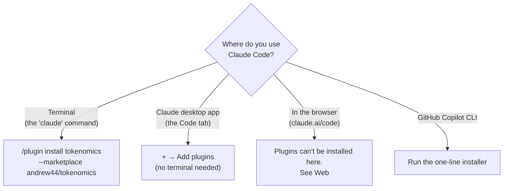

<p align="right"><a href="../README.md">← Back to README</a> · <a href="README.md">All docs</a></p>

# Installation

Everything you need to get tokenomics running, from the one-minute install to team roll-outs and every assistant it supports.

**On this page**

- [Claude Code: install the plugin](#claude-code-install-the-plugin) (recommended)
- [The one-line installer](#the-one-line-installer) (Copilot CLI, no Python, or the `tokenomics` command)
- [Install pieces individually](#install-pieces-individually)
- [Where do you use Claude Code?](#where-do-you-use-claude-code): terminal, desktop app, web
- [GitHub Copilot CLI](#github-copilot-cli)
- [Requirements](#requirements)
- [Update, remove or check](#update-remove-or-check)
- [Other ways to install](#other-ways-to-install-for-developers)
- [Troubleshooting](#troubleshooting)

---

## Claude Code: install the plugin

**This is the recommended way.** tokenomics is a [Claude Code plugin](https://code.claude.com/docs/en/plugins): one install gives you every skill and hook, and Claude Code keeps it managed for you (switch it on or off, update or remove it from `/plugin`).

### In the terminal

Inside Claude Code (type `claude` in a terminal), paste:

```text
/plugin install tokenomics --marketplace andrew44/tokenomics
```

When the panel opens, choose **Install for you (user scope)** so it works in every project. If Claude says `Run /reload-plugins to apply`, closing the panel does that for you.

On Claude Code older than v2.1.275, use two lines instead:

```text
/plugin marketplace add andrew44/tokenomics
/plugin install tokenomics@tokenomics
```

From a plain shell instead: `claude plugin install tokenomics --marketplace andrew44/tokenomics` (v2.1.292+), or on older versions `claude plugin marketplace add andrew44/tokenomics && claude plugin install tokenomics@tokenomics`.

### In the desktop app (no terminal needed)

In the **Code** tab, start a **local** (or SSH) session, click **+** next to the prompt box → **Add plugins**, add the marketplace `andrew44/tokenomics` and install **tokenomics**. The desktop app and the terminal share the same settings, so it shows up in both.

### What you get

- **Skills:** `/tokenomics:coach`, `/tokenomics:spend-report`, `/tokenomics:dashboard`, `/tokenomics:statusline`. You don't need the slash: *"coach, review my prompts"* or *"open the tokenomics dashboard"* works too.
- **Hooks:** `spendlens`, `pennywise`, `diet`, `budget` and `doggybag`, running automatically. `/hooks` lists them.
- **The statusline** switches itself on at the start of your next session, as long as you don't already have a status line, and updates itself with the plugin. Set `TOKENOMICS_STATUSLINE=ask` to be asked first, or `off` to leave it off. `/tokenomics:statusline` installs, removes or changes it.
- **The band** (desktop app): the same line above the prompt box, on from your next session whether or not the statusline is installed. `/tokenomics:statusline band off` hides it.

**Check it worked:** type `/` and look for `/tokenomics:coach`.

**Needs Python 3.8+** on your computer (standard library only). The hooks find it whether it's called `python3`, `python` or `py`. No Python? Run the [one-line installer](#the-one-line-installer) once: it fetches a private copy that the plugin then uses.

### Keep it up to date

Claude Code auto-updates only its official marketplace. To get tokenomics updates automatically, open `/plugin` → **Marketplaces** → **tokenomics** and switch on **auto-update**. To update by hand: `/plugin` → **Installed** → **tokenomics** → **Update now**, or `claude plugin update tokenomics@tokenomics` in a shell.

### For a team

Commit this to the repo's `.claude/settings.json`:

```json
{
  "extraKnownMarketplaces": {
    "tokenomics": {
      "source": { "source": "github", "repo": "andrew44/tokenomics" },
      "autoUpdate": true
    }
  },
  "enabledPlugins": { "tokenomics@tokenomics": true }
}
```

When a teammate trusts the folder, Claude Code adds the marketplace for them. Each teammate still installs the plugin once, with `/plugin install tokenomics@tokenomics` (choose **project scope**) or `claude plugin install tokenomics@tokenomics --scope project`.

---

## The one-line installer

For **GitHub Copilot CLI**, for computers **without Python**, or if you want the `tokenomics` terminal command. One line, no git, no `pip`. If it finds Claude Code it installs the same plugin as above.

**macOS / Linux** (in Terminal):

```bash
curl -fsSL https://raw.githubusercontent.com/andrew44/tokenomics/main/install.sh | sh
```

**Windows** (in PowerShell):

```powershell
irm https://raw.githubusercontent.com/andrew44/tokenomics/main/install.ps1 | iex
```

Then restart Claude Code or Copilot CLI. That's it.

How to open a terminal: on a **Mac** press `Cmd + Space`, type `Terminal`, press Enter. On **Windows** click Start, type `PowerShell`, press Enter.

#### What the installer does

1. **Checks for Python 3.8+.** It only uses Python's standard library. If there's no Python (or only the Mac placeholder that asks you to install developer tools), it downloads a private copy into `~/.tokenomics/runtime`: no admin rights, no pop-ups.
2. **Downloads tokenomics** to `~/.tokenomics/app` (a plain download, not a git clone).
3. **Adds the plugin** to every assistant it finds: Claude Code (`claude plugin install`, user scope) and/or GitHub Copilot CLI (`copilot plugin install`).
4. **Switches on the statusline** for those assistants. If you already have a status line, it's left alone (replace it later with `tokenomics statusline --install claude`).
5. **Adds a `tokenomics` command** (in `~/.local/bin` on macOS/Linux, `~/.tokenomics/bin` on Windows, put on your PATH for you).

It's safe to run again: it repairs and updates what's there. Want to look before you run? Read [install.sh](../install.sh) and [install.ps1](../install.ps1).

**Options.** Skip parts with `sh -s -- --no-plugin` or `--no-statusline` (on Windows set `$env:TOKENOMICS_SETUP_ARGS = "--no-statusline"` first). To install from a fork or a tag, set `TOKENOMICS_REPO=your-org/tokenomics` or `TOKENOMICS_REF=v1.2.0`.

**Check it worked:** run `tokenomics`. It shows which assistants it found and where the statusline is installed. In Claude Code, type `/` and look for `/tokenomics:coach`; `/hooks` lists the hooks.

#### The `tokenomics` command

| Command | What it does |
|---|---|
| `tokenomics` | What's installed and where your data is |
| `tokenomics dashboard` | Opens the dashboard in your browser (`--demo` for sample data, `--stop` to stop it) |
| `tokenomics report` | Spend report in the terminal (`--days 30`, `--json`) |
| `tokenomics statusline ...` | Statusline and band options: `--demo`, `--set-currency USD`, `--install both`, `--uninstall claude`, `--band-off` (the old name, `tokenomics statusbar`, still works) |
| `tokenomics update` | Downloads the latest version and updates the plugins and statusline |
| `tokenomics uninstall` | Removes the plugins, statusline and command (keeps your data; `--purge` deletes it too) |

> **Windows:** where a command below says `python3`, type `python`.

---

## Install pieces individually

Every helper works on its own. Pick what you want:

| I only want... | Install | Notes |
|---|---|---|
| **coach** (prompt review skill) | `npx skills@latest add andrew44/tokenomics --skill coach` | Needs Node.js. Works in Claude Code and other assistants the `skills` CLI supports. Without the plugin it reviews the prompts it can see; with the plugin it also gets exact token and cache numbers. |
| **spend-report** (weekly spend skill) | `npx skills@latest add andrew44/tokenomics --skill spend-report` | Reports on what **spendlens** has recorded, so install the plugin too. |
| **Both skills** | `npx skills@latest add andrew44/tokenomics` | Pick from the list (arrows to move, space to tick, Enter to confirm). Add `-g` to install globally, `--list` to preview. |
| **statusline** only | `curl -fsSL https://raw.githubusercontent.com/andrew44/tokenomics/main/install.sh \| sh -s -- --no-plugin` | Statusline and the `tokenomics` command, no hooks. Needs only Python. `tokenomics statusline --uninstall claude` removes it. |
| **dashboard** | `tokenomics dashboard`, or `/tokenomics:dashboard` with the plugin | Read-only view of the spendlens database. |
| **Just some of the hooks** | Install everything, then switch off the ones you don't want | See below. |

### Choosing which hooks run

The hooks (`spendlens`, `pennywise`, `diet`, `budget`, `doggybag`) ship together in the plugin and share one engine. To keep only the ones you want, switch the others off with a setting, in your shell profile or in Claude Code's `settings.json` under `"env"`:

| Hook | Switch it off | Or soften it |
|---|---|---|
| **pennywise** | `TOKENOMICS_PENNYWISE=off` | `block` asks you to switch with `/model` instead of routing; `warn` only shows a notice |
| **diet** | `TOKENOMICS_DIET=off` | `warn` shows a notice but never blocks |
| **budget** | `TOKENOMICS_BUDGET_MODE=off` (or just don't set a limit) | `warn` |
| **doggybag** | `TOKENOMICS_DOGGYBAG=off` | `TOKENOMICS_DOGGYBAG_COLD=off` keeps it packing but stops the cold-prompt notice |
| **spendlens** | Always on with the plugin: it's the data source for everything else. It never blocks or prints anything. | |

Example `~/.claude/settings.json`:

```json
{
  "env": {
    "TOKENOMICS_PENNYWISE": "warn",
    "TOKENOMICS_DIET": "off"
  }
}
```

All settings are listed in [Configuration](configuration.md).

<details>
<summary><b>"npx: command not found"?</b> You need Node.js first.</summary>

1. Go to [nodejs.org](https://nodejs.org), download the version marked **LTS**, and run the installer.
2. **Close and reopen** your terminal, then run the command again.

How to open a terminal: on a **Mac** press `Cmd + Space`, type `Terminal`, press Enter. On **Windows** click Start, type `PowerShell`, press Enter.
</details>

---

## Where do you use Claude Code?



### Terminal

[Install the plugin](#in-the-terminal) from inside Claude Code. That's it.

### Desktop app

Works in **local** and **SSH** sessions (not cloud sessions).

1. Open the desktop app, go to the **Code** tab and start a local session.
2. Click **+** next to the prompt box, then **Add plugins**. Add the marketplace `andrew44/tokenomics` and install **tokenomics**.
3. Use the same menu (**Plugins**, then **Manage plugins**) to switch it on or off later. Anything you install in the terminal shows up here too, and vice versa.

Just want the coach in the desktop app? `npx skills@latest add andrew44/tokenomics --skill coach -g`.

### Web (claude.ai/code)

Plugins **can't be installed** in Claude Code on the web. You have two options:

- **Use the terminal or desktop app** for the full toolkit and tracking.
- **Add just the coach to your repo.** In your repo folder, run the command below, then commit the new `coach` folder it adds:

  ```bash
  npx skills@latest add andrew44/tokenomics --skill coach --copy
  ```

  (`--copy` makes real files instead of shortcuts, which is what you want when committing.) On the web the coach may only be able to review the prompts it can see in the conversation.

Tracking on the web isn't useful: the data would be saved on a temporary cloud machine, not your computer.

---

## GitHub Copilot CLI

The [one-line installer](#the-one-line-installer) sets up Copilot CLI too: the plugin and the statusline. To do it by hand instead:

```bash
copilot plugin install andrew44/tokenomics          # from GitHub
copilot plugin install ./path/to/tokenomics         # from a local folder
```

Then start `copilot`, check that `/plugin list` shows `tokenomics`, and send a prompt. Add the statusline with `tokenomics statusline --install copilot`.

What works on Copilot:

| Helper | Copilot CLI |
|---|---|
| spendlens | ✅ (labels from prompts and tool calls; no token counts) |
| diet | ✅ |
| doggybag | ✅ best effort |
| statusline | ✅ (countdown is approximate) |
| dashboard | ✅ |
| pennywise, budget | ❌ Copilot ignores prompt-hook output |
| coach | ❌ no conversation file to read |

<details>
<summary><b>Copilot notes and known limits</b></summary>

- Copilot reads `plugin.json` and `copilot-hooks.json` at the plugin root (`userPromptSubmitted`, `preToolUse`, `postToolUse` and `sessionEnd` hooks).
- Copilot sends a session id with every hook, and spendlens logs each session under it. If one is ever missing, spendlens builds one from the working directory and date.
- Copilot sessions are labelled from the words in each prompt **and** the tools Copilot used (file edits lean CAPEX, observability tools and commands like `kubectl logs` lean OPEX). Same scoring as Claude Code.
- Copilot doesn't tell hooks how many tokens or premium requests a session used, so those columns stay empty (`usage_status = unavailable`). spendlens never guesses a number for them.
- The hook commands use relative paths (`scripts/run.sh`, `scripts\\spendlens.py`). If Copilot runs them from a different folder and you see "file not found" in `<db>.err`, change the path in `copilot-hooks.json` to an absolute one.
- Copilot's plugin format is still changing; check the current Copilot docs if the install fails.
</details>

---

## Requirements

| You want... | You need |
|---|---|
| The plugin, statusline or dashboard | **Python 3.8+** (`python3` on Mac/Linux, `python` on Windows). No extra packages, ever. The Windows installer gets it for you if it's missing. |
| Skills via `npx skills` | Node.js |
| Any of it | Claude Code and/or GitHub Copilot CLI |

---

## Update, remove or check

| I want to... | Do this |
|---|---|
| Check it's installed | In Claude Code, run `/plugin` and open the **Installed** tab, or run `claude plugin list` in a terminal. `/hooks` shows the hooks. |
| Update it | Switch on auto-update: `/plugin` → **Marketplaces** → **tokenomics**. Or by hand: `/plugin` → **Installed** → **Update now**, or `claude plugin update tokenomics@tokenomics`. Used the one-liner? `tokenomics update` also works. |
| Remove it | `/plugin uninstall tokenomics@tokenomics` (or `claude plugin uninstall tokenomics@tokenomics`). Used the one-liner? `tokenomics uninstall` removes the plugins, statusline and command and keeps your data (`--purge` deletes `~/.tokenomics` too). |
| Update or remove the statusline | It updates itself with the plugin (or `tokenomics update`). `tokenomics statusline --uninstall claude` or `/tokenomics:statusline uninstall` removes it; `tokenomics statusline --status` shows where it's installed. |
| Update or remove skills installed with `npx` | `npx skills update` or `npx skills remove coach`. `npx skills list` shows what's installed. |
| Install for a whole team | See [For a team](#for-a-team). |

---

## Other ways to install (for developers)

From a local folder:

```text
/plugin marketplace add ./path/to/tokenomics
/plugin install tokenomics@tokenomics
```

Try it for one session without installing:

```bash
claude --plugin-dir ./path/to/tokenomics
```

To host your own copy for a team, push the folder to your own Git repo and use `your-org/tokenomics` in place of `andrew44/tokenomics`. The repo doubles as a marketplace (`.claude-plugin/marketplace.json`).

---

## Troubleshooting

| What you see | Try this |
|---|---|
| `tokenomics: command not found` | Open a new terminal (the installer added it to your PATH). Or run `~/.local/bin/tokenomics` directly. |
| The installer says Python is missing | Mac: `xcode-select --install`. Linux: `sudo apt install python3` (or your distro's equivalent). Windows: [python.org/downloads](https://www.python.org/downloads/), ticking **Add python.exe to PATH**. Then run the installer again. |
| No database file appears | Check Python is installed (`python3 --version`, or `python --version` on Windows), then run `tokenomics setup` once: it records which Python the hooks should use in `~/.tokenomics/python`. If that file points at a Python you've since removed, the hooks find another by themselves. |
| Hooks don't seem to run (Claude Code) | Restart Claude Code, then run `/hooks`. Make sure the plugin is switched on in `/plugin`. |
| Sessions are missing, or labelled `unknown` | Look for `spendlens.db.err` next to the database (`~/.tokenomics/`). Errors go there, never on screen. |
| *Everything* is labelled `unknown` | Your prompts didn't match any keywords. Add terms to the pattern lists in `tokenomics/engine/classifier.py`, or switch on the [AI classifier](reference.md#optional-let-an-ai-model-decide). |
| The statusline doesn't show | The statusline is for the terminal: restart the assistant there. Run `tokenomics statusline --status` to see which settings file it's in (another status line wins until you replace it), or re-run `/tokenomics:statusline`. |
| The band doesn't show in the desktop app | It sits above the prompt box (in VS Code: the plugin's line above the prompt box). Start a new session after installing or updating the plugin, check `tokenomics statusline --status` says the band is on, and that the band isn't collapsed (`[-]`). |
| Odd characters in the statusline | Use `--ascii`, or set `NO_COLOR=1` for no colours. |

---

<p align="center"><a href="README.md">All docs</a> · <a href="reference.md">Helper reference →</a></p>
