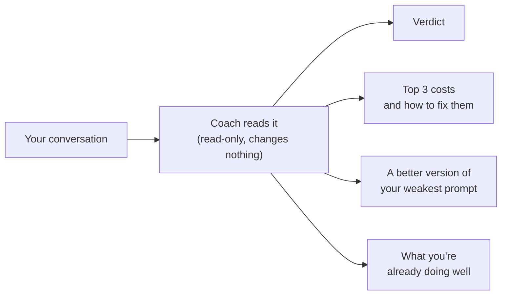
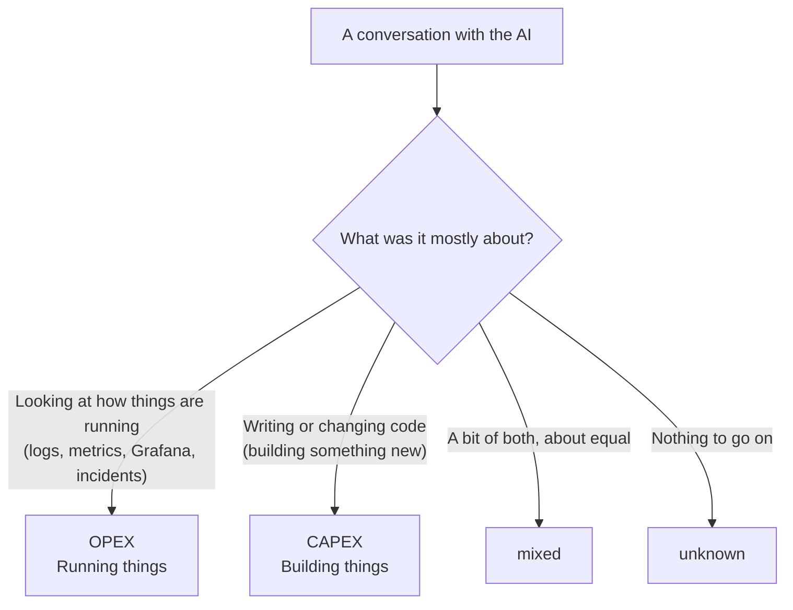
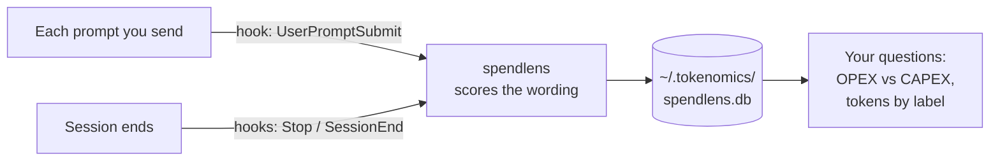
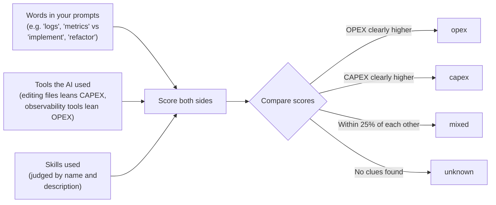
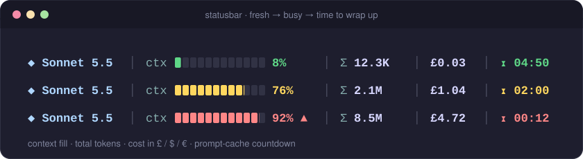

<p align="right"><a href="../README.md">← Back to README</a> · <a href="README.md">All docs</a></p>

# Helper reference

The full detail on every tokenomics helper: what it does, how it decides, and what it records. For a shorter "which one do I need?" guide, see [Skills, tools and hooks](skills-tools-and-hooks.md).

| | Helper | Kind | Jump to |
|---|---|---|---|
| 🧑‍🏫 | **coach** | skill | [coach](#coach) |
| 📊 | **spend-report** | skill | [spend-report](#spend-report) |
| 🔍 | **spendlens** | hook | [spendlens](#spendlens) |
| 🪙 | **pennywise** | hook | [pennywise](#pennywise) |
| 🥗 | **diet** | hook | [diet](#diet) |
| 💳 | **budget** | hook | [budget](#budget) |
| 🔖 | **handoff** | hook | [handoff](#handoff) |
| 📟 | **statusbar** | tool | [statusbar](#statusbar) |
| 📈 | **dashboard** | tool | [dashboard](#dashboard) |
| 🗄️ | **your data** | | [Looking at your data](#looking-at-your-data) |

> Every cost tokenomics shows is an estimate, not a bill. See the [disclaimer](../README.md#disclaimer).

---

## coach

Reads your conversation and tells you where tokens were wasted, with simple fixes. Read-only: it changes nothing.

Ask in Claude Code:

- *"coach, review my prompts"*
- *"why was that session expensive?"*
- or type `/tokenomics:coach`



**What it looks for:**

| Common problem | In everyday words |
|---|---|
| Low cache hit ratio / cache rebuilds | The AI keeps re-reading things it could have remembered cheaply. |
| Vague or correction-heavy prompts | Unclear asks lead to wrong answers and costly do-overs. |
| Oversized context | Too much material loaded into the conversation. |
| Repeated file reads | The same file is opened again and again. |
| Mixed topics | One long chat covering several unrelated jobs. |

The coach needs a Claude Code conversation record, so Copilot sessions can't be reviewed.

For raw numbers, run the analyser directly: `python3 scripts/coach.py [--session ID] [--json]`

---

## spend-report

Say **"spend report"** (or "where did my tokens go this week?") and the skill runs `scripts/report.py` and summarises it:

- money spent (in your currency) and the OPEX/CAPEX split of that spend
- top projects and models
- the costliest sessions
- what pennywise, handoff, diet and budget did
- three suggestions tied to your own numbers

Ask for any period: "this month", "today", "all time".

Run it yourself:

```bash
python3 scripts/report.py                       # last 7 days, as Markdown
python3 scripts/report.py --days 30 --json
python3 scripts/report.py --currency EUR        # GBP, USD or EUR for this run
```

---

## spendlens

Quietly labels each conversation as **OPEX** (running things) or **CAPEX** (building things) and saves it to a small database on your computer. It never blocks or slows your session, and it shows nothing on screen.

### What OPEX and CAPEX mean here



This lets a team answer questions like *"How much of our AI spend goes on building, and how much on keeping things running?"*

### When it runs



### What gets recorded for each session

- The **session id** and which assistant it was (`source`)
- The **label**: `opex`, `capex`, `mixed` or `unknown`
- The **scores** behind that label and the **number of prompts**
- Which **skills** were used, and whether each looks like OPEX or CAPEX
- **Token counts**: input, output, and prompt-cache reads and writes

Your prompts' text is **not** stored unless you switch that on (`TOKENOMICS_STORE_PROMPT=1`).

### How it decides



- At session end, the whole transcript is re-scored and tool calls are counted.
- Each distinct skill that lands clearly on one side adds weight 6 to it, so one skill outweighs a few keyword hits. An ambiguous skill adds nothing.
- Example: "Analyses App Insights" → OPEX; "Create Unit Tests using NUnit" → CAPEX.
- A skill's description is read from its `SKILL.md` / command file on disk. Claude Code looks in the project's `.claude/`, `~/.claude/` and installed plugins, or otherwise in a skill listing found in the transcript. Copilot looks in the project's `.github/` and `.claude/` and in `~/.copilot/`.
- To adjust the scoring, edit `OPEX_PATTERNS` / `CAPEX_PATTERNS` in `tokenomics/engine/classifier.py`, or use `TOKENOMICS_SKILL_MAP` (see [Configuration](configuration.md)). One change applies to Claude Code and Copilot alike.

### Optional: let an AI model decide

Keywords miss prompts that use none of your words. Set `TOKENOMICS_LLM=1` and a model reads the session and decides; if the call fails or times out, the keyword label is used instead, so nothing is ever lost.

- It runs **once per session**, not per prompt. `Stop` fires every turn, so it only classifies the first time there; at `SessionEnd` (or Copilot's `sessionEnd`) it re-classifies if the session has changed. Identical input is never classified twice.
- The model sees the first 5 prompts (300 characters each), the **names and counts** of tools used (never their arguments or file contents), and the skills used with their descriptions.
- Text is redacted first (API keys, tokens, emails, long opaque strings), but **it still leaves your machine**. Point it at a local model if your prompts are sensitive.
- It works with any OpenAI-compatible endpoint: OpenAI, OpenRouter, or a local server such as Ollama or LM Studio.

| Column (`sessions` table) | Meaning |
|---|---|
| `label` | The label to use: the model's if it succeeded, otherwise the keyword label |
| `label_source` | `llm` or `keywords` |
| `llm_label`, `llm_confidence`, `llm_reason`, `llm_model` | The model's verdict (`opex`, `capex`, `mixed` or `unknown`), a 0 to 1 confidence, a one-sentence reason, and which model said it |

The keyword scores are always stored too, so you can compare the two. Failures are written to `spendlens.db.err`; the hook still never blocks a session.

### Token columns

| Column (`sessions` table) | Meaning |
|---|---|
| `skills` | List of distinct skills used (Skill tool calls and `/slash` commands) |
| `skill_opex`, `skill_capex` | How many of those skills were judged OPEX / CAPEX |
| `skill_detail` | Per skill: `name`, judged `side`, `basis` (`map`, `name`, `description`, `name+description`, `none`) and the description used |
| `input_tokens`, `output_tokens` | Fresh input and generated tokens |
| `cache_creation_tokens`, `cache_read_tokens` | Prompt-cache writes and reads |
| `total_tokens` | Sum of the four above. Cache reads usually dominate, so use `input_tokens + output_tokens` for a leaner figure. |
| `billing_model` | What the assistant charges for: `anthropic_tokens` (Claude Code) or `copilot_premium_requests` (Copilot). Don't add the two together. |
| `usage_status` | `reported` when the assistant gave token counts, `unavailable` when it didn't (always the case for Copilot). Empty token columns mean "not known", not zero. |
| `evidence` | What the label is based on: `transcript` (the whole conversation) or `hook-events` (prompts and tool calls seen one at a time) |

Tokens are counted once per message. Work done by sub-agents in separate transcript files is not included. For Copilot, tool calls are also kept one row each in the `tool_events` table (tool name and kind only, never arguments).

---

## pennywise

*Penny wise, pound foolish.* A `UserPromptSubmit` hook (`scripts/pennywise.py`) that routes each prompt to the cheapest model that can handle it, so a hello-world never runs on the priciest model.

It rates the prompt (small and self-contained, short and routine, or complex/unclear) and finds the session's model (hook payload, then transcript, `ANTHROPIC_MODEL`, `settings.json`). If a cheaper tier would cope, it routes the prompt there automatically:

```text
pennywise: routing this small, self-contained task to Haiku instead of Opus.
Prefix a prompt with 'keep-model:' to keep it on Opus.
```

**How the routing works.** Claude Code doesn't let a hook switch the session's model; only `/model` can. So pennywise routes through the Agent tool's `model` parameter instead: it tells your session model to hand the prompt, word for word, to a subagent on the cheaper tier (`haiku` or `sonnet`) and relay the answer. The tool calls, file reads and output, which are most of a task's tokens, are billed at the cheaper tier. Your session model still reads the prompt and writes a short reply, so the saving is large on real tasks and small on one-line questions.

- Complex or ambiguous prompts are **never** routed: they stay on your model.
- Prompts already on the cheapest suitable tier, and slash commands, are left alone.
- To keep one prompt on your model, start it with `keep-model:`.
- If the request depends on the conversation in a way that can't be handed over in a few lines, the session model does it itself.
- `TOKENOMICS_PENNYWISE=block` pauses instead of routing and suggests `/model haiku` (send the same prompt again to run it anyway). `warn` shows that suggestion without pausing. `off` disables pennywise.
- Each decision (`routed`, `blocked`, `warned`, `overridden`) is logged to the `pennywise_events` table.
- The checks are keyword-based; tune `SIMPLE` / `HARD` in the script.
- Claude Code only: Copilot CLI ignores hook output on prompt submit.

---

## diet

Every token pulled into the conversation is paid for again on every later turn. **diet** (`scripts/diet.py`) is a pre-tool hook (`PreToolUse` on `Read|Bash` in Claude Code, `preToolUse` in Copilot CLI) that refuses a small set of calls known to flood the context, and tells the AI how to ask for less. The AI then retries with a narrower call by itself:

| Stopped | Suggested instead |
|---|---|
| Reading a generated file whole: lockfiles, `*.min.js`, source maps, snapshots (over 64 KB) | `grep` for what you need, or read a range |
| `kubectl logs`, `docker logs`, `journalctl` with no limit | `--tail=200`, `--since=15m` |
| `git log` with no limit | `-n 20 --oneline` |
| `find /` or `find ~` with no `-maxdepth`; `ls -R`; `tree` with no `-L` | start from the project, `git ls-files`, `-L 2` |
| `cat` of a file over 64 KB | `grep -n`, `head`, `sed -n 'A,Bp'` |

- A command that already pipes (`| grep`, `| head`), redirects to a file, or limits itself is never touched, and a file that can't be found is never blocked.
- To let one command through, append `# diet-ok`.
- Each block is logged to `diet_events` with an estimate of the tokens kept out, which shows up in the spend report.
- Rules live in `tokenomics/engine/diet.py`, shared by both assistants.

---

## budget

Set a limit and **budget** (`scripts/budget.py`, a `UserPromptSubmit` hook) keeps an eye on it. Limits are in your chosen [currency](configuration.md#currency) (pounds by default), so `20` means £20, $20 or €20:

```bash
export TOKENOMICS_BUDGET_DAILY=20      # per day, all sessions together
export TOKENOMICS_BUDGET_SESSION=5     # per session
```

- At **80%** of a limit you get one notice.
- At **100%**, your next prompt is paused with what you've spent and some cheaper ways on (`/compact`, a smaller model, a fresh session).
- To carry on anyway, send the same prompt again or start it with `over-budget:`; you won't be paused again for that limit that day.
- `TOKENOMICS_BUDGET_MODE=warn` only ever shows notices.
- Check where you are with `python3 scripts/budget.py status`.

Spend is worked out from the token counts spendlens records at the end of each turn, priced per model like the status bar (so it is at most one turn behind, and an estimate, not your invoice). Each increase is stored with its date, so a session that runs past midnight counts towards the right day. Copilot bills premium requests, which hooks can't see, so Copilot sessions never count towards a budget. Copilot also ignores prompt-hook output, so budget is Claude Code only.

---

## handoff

When the prompt cache goes cold, resuming the old session means paying to re-write the whole conversation into the cache again. **handoff** (`scripts/handoff.py`) writes a small digest first, so a fresh session can carry on from that instead.

**How it times it.** Hooks cannot run on a timer, so on every `Stop` (Claude Code) or `userPromptSubmitted` (Copilot) it starts a small background watcher. The watcher reads the cache clock from the transcript (5 minutes, or 1 hour if the session uses the 1-hour cache), and writes the file 60 seconds before expiry. If you carry on working, the clock moves and the watcher simply waits for the new deadline. `SessionEnd` stops the watcher and writes a handoff if there is not already a current one.

**What's in the note.** The file lands in `~/.tokenomics/handoffs/<session id>.md`: git branch and changes, tasks, your last few requests, the last reply, files edited, recent commands, an estimate of what a full resume would cost against the size of the note, and how to resume. It is built from the transcript by plain code; **no model is called, so it costs no tokens**.

**To resume cheaply**, start a new session in the same folder and say `Continue from @<that file>`. A `SessionStart` hook tells you when a handoff from the last 24 hours exists for the folder (set `TOKENOMICS_HANDOFF_INJECT=1` to load it automatically instead).

- `python3 scripts/handoff.py write` makes one on demand.
- Each one is logged to the `handoff_events` table.
- Copilot CLI support is best effort: its hook payload and transcript format are less documented, so the digest may be thinner.

---

## statusbar

A live line at the bottom of Claude Code or GitHub Copilot CLI.

<p align="center"></p>

| Part | What it tells you |
|---|---|
| `ctx ████▒▒ 76%` | How full the conversation is. The bar goes **green**, turns **yellow at 75%** and **red at 90%**. A `▲` appears from 90%. When it is nearly full, start a fresh conversation. |
| `Σ 8.5M` | Total tokens used so far, in short form (`950`, `12.3K`, `8.5M`). |
| `£1.37` | What the session has cost, in your currency. A `~` in front (`~£1.37`) means it is an estimate. |
| `⧗ 04:12` | A countdown to when the prompt cache expires. While it runs, repeated context is cheap. The egg timer starts **full (green)**, is **half-empty (amber)** at about half time and **empty (red)** when it is running out. `00:00` means the cache has gone cold, and `--:--` means nothing has been cached yet. |

**Install** (Python 3.8+, nothing else). With the plugin, in Claude Code:

```text
/tokenomics:statusbar                 # or: /tokenomics:statusbar both   (Claude Code + Copilot CLI)
/tokenomics:statusbar uninstall       # to remove
```

The plugin switches it on for you at the start of your next session (so does the [one-line installer](installation.md#the-one-line-installer)), as long as no other status line is set (`TOKENOMICS_STATUSBAR=ask` makes it ask first, `off` leaves it off). The plugin keeps the installed copy up to date at each session start. From a terminal:

```bash
tokenomics statusbar --install claude     # or: copilot, both
tokenomics statusbar --uninstall claude   # to remove
tokenomics statusbar --status             # where is it installed?
```

**Light or dark.** It follows your computer's setting by default. To force one, put `{"theme": "dark"}` (or `"light"`) in `~/.tokenomics/statusbar.json`. Preview every state with `tokenomics statusbar --demo --theme light`. For very plain terminals use `--ascii` or set `NO_COLOR=1`.

**Currency and prices:** see [Configuration](configuration.md#currency).

<details>
<summary><b>Good to know about the countdown</b></summary>

- It counts from the last request that used the cache. The cache lasts 5 minutes, or 1 hour if your session uses the 1-hour cache. Override with `"cache_ttl"` (seconds).
- Claude Code redraws the line every second (this needs a recent version; on older ones it updates after each message).
- Copilot CLI doesn't say how often it redraws or when its cache expires, so there the countdown is approximate and may only move when Copilot redraws.
- For a smoothly ticking countdown in any assistant, run `python3 scripts/statusbar.py --watch` in a spare terminal pane.
</details>

---

## dashboard

A local web UI over the spendlens database: a headline **% OPEX vs % CAPEX** split bar, daily usage trend, per-project split, skills used and recent sessions. Switch the measure between tokens, sessions and prompts, and the range between 7d, 30d, 90d and all time. Light and dark mode follow your system.

<picture>
  <source media="(prefers-color-scheme: dark)" srcset="assets/dashboard-dark.png">
  
</picture>

```bash
tokenomics dashboard                      # opens http://127.0.0.1:8765 (runs in the background)
tokenomics dashboard --demo               # preview with seeded fake data
tokenomics dashboard --stop               # stop it
tokenomics dashboard --foreground --db /path/to/spendlens.db --port 9000
```

Inside Claude Code, `/tokenomics:dashboard` (or *"open the dashboard"*) does the same.

It reads the database read-only, listens on 127.0.0.1 only, and needs nothing beyond Python 3.8+. It uses `TOKENOMICS_DB` if set.

---

## Looking at your data

Everything lives in one SQLite file, `~/.tokenomics/spendlens.db`. Open it with any SQLite tool.

Your 10 most recent sessions:

```bash
sqlite3 ~/.tokenomics/spendlens.db \
  "select session_id, source, label, opex_score, capex_score, prompt_count from sessions order by updated_at desc limit 10;"
```

How many sessions of each label:

```bash
sqlite3 ~/.tokenomics/spendlens.db "select label, count(*) from sessions group by label;"
```

Tokens used by each label:

```bash
sqlite3 ~/.tokenomics/spendlens.db "select label, count(*) sessions, sum(input_tokens+output_tokens) tokens from sessions group by label;"
```

| Table | What's in it |
|---|---|
| `sessions` | One row per session, including `cost_usd` and `model` for Claude Code |
| `prompt_events` | One row per prompt, with its scores |
| `tool_events` | Copilot tool calls (name and kind only) |
| `cost_events` | Dated spend increases |
| `pennywise_events`, `handoff_events`, `diet_events`, `budget_events` | What each helper did |

---

<p align="center"><a href="installation.md">← Installation</a> · <a href="README.md">All docs</a> · <a href="configuration.md">Configuration →</a></p>
