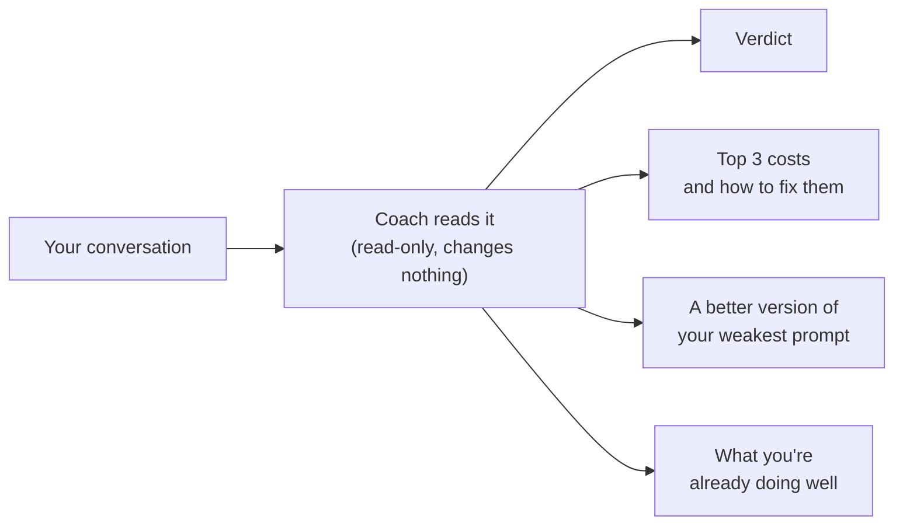
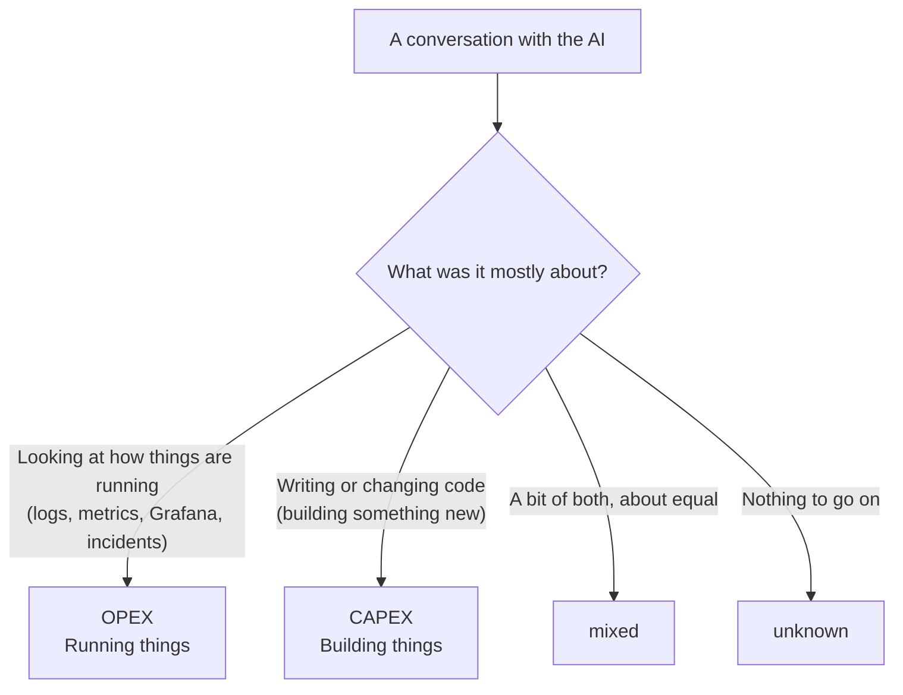
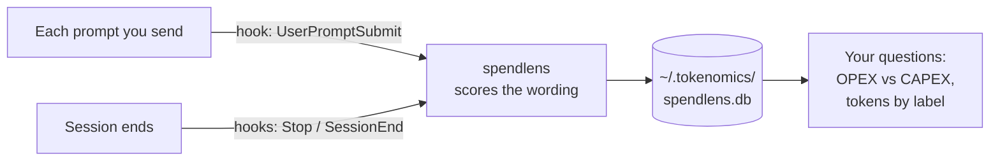
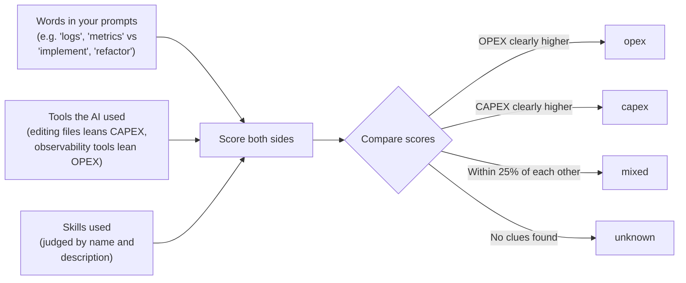

<p align="right"><a href="../README.md">← Back to README</a> · <a href="README.md">All docs</a></p>

# Helper reference

The full detail on every tokenomics helper: what it does, how it decides, and what it records. For a shorter "which one do I need?" guide, see [Skills, tools and hooks](skills-tools-and-hooks.md).

| | Helper | Kind | Jump to |
|---|---|---|---|
| 🧑‍🏫 | **coach** | skill | [coach](#coach) |
| 📊 | **spend-report** | skill | [spend-report](#spend-report) |
| 🔍 | **spendlens** | hook | [spendlens](#spendlens) |
| 🪙 | **pennywise** | hook | [pennywise](#pennywise) |
| 🥗 | **diet** | hook | [diet](#diet) |
| 💳 | **budget** | hook | [budget](#budget) |
| 🥡 | **doggybag** | hook | [doggybag](#doggybag) |
| 💷 | **bangforbuck** | skill + hook | [bangforbuck](#bangforbuck) |
| 🤝 | **haggle** | skill + hook | [haggle](#haggle) |
| 🕵️ | **sherlock** | skill + hook | [sherlock](#sherlock) |
| 📏 | **waistline** | skill + hook + CI | [waistline](#waistline) |
| 👅 | **tastetest** | skill + tool | [tastetest](#tastetest) |
| 🧹 | **springclean** | skill + tool | [springclean](#springclean) |
| 🦫 | **groundhog** | hook + skill | [groundhog](#groundhog) |
| 📟 | **statusline** and **band** | tool | [statusline](#statusline) · [band](#band) |
| 📈 | **dashboard** | tool | [dashboard](#dashboard) |
| 🗄️ | **your data** | | [Looking at your data](#looking-at-your-data) |

> Every cost tokenomics shows is an estimate, not a bill. See the [disclaimer](../README.md#disclaimer).

---

## coach

Reads your conversation and tells you where tokens were wasted, with simple fixes. Read-only: it changes nothing.

Ask in Claude Code:

- *"coach, review my prompts"*
- *"why was that session expensive?"*
- or type `/tokenomics:coach`



**What it looks for:**

| Common problem | In everyday words |
|---|---|
| Low cache hit ratio / cache rebuilds | The AI keeps re-reading things it could have remembered cheaply. |
| Vague or correction-heavy prompts | Unclear asks lead to wrong answers and costly do-overs. |
| Oversized context | Too much material loaded into the conversation. |
| Repeated file reads | The same file is opened again and again. |
| Mixed topics | One long chat covering several unrelated jobs. |

The coach needs a Claude Code conversation record, so Copilot sessions can't be reviewed.

For raw numbers, run the analyser directly: `node scripts/coach.ts [--session ID] [--json]`

---

## spend-report

Say **"spend report"** (or "where did my tokens go this week?") and the skill runs `scripts/report.ts` and summarises it:

- money spent (in your currency) and the OPEX/CAPEX split of that spend
- top projects and models
- the costliest sessions
- what pennywise, doggybag, diet and budget did
- three suggestions tied to your own numbers

Ask for any period: "this month", "today", "all time".

Run it yourself:

```bash
node scripts/report.ts                       # last 7 days, as Markdown
node scripts/report.ts --days 30 --json
node scripts/report.ts --currency EUR        # GBP, USD or EUR for this run
```

---

## spendlens

Quietly labels each conversation as **OPEX** (running things) or **CAPEX** (building things) and saves it to a small database on your computer. It never blocks or slows your session, and it shows nothing on screen.

### What OPEX and CAPEX mean here



This lets a team answer questions like *"How much of our AI spend goes on building, and how much on keeping things running?"*

### When it runs



### What gets recorded for each session

- The **session id** and which assistant it was (`source`)
- The **label**: `opex`, `capex`, `mixed` or `unknown`
- The **scores** behind that label and the **number of prompts**
- Which **skills** were used, and whether each looks like OPEX or CAPEX
- **Token counts**: input, output, and prompt-cache reads and writes

Your prompts' text is **not** stored unless you switch that on (`TOKENOMICS_STORE_PROMPT=1`).

### How it decides



- At session end, the whole transcript is re-scored and tool calls are counted.
- Each distinct skill that lands clearly on one side adds weight 6 to it, so one skill outweighs a few keyword hits. An ambiguous skill adds nothing.
- Example: "Analyses App Insights" → OPEX; "Create Unit Tests using NUnit" → CAPEX.
- A skill's description is read from its `SKILL.md` / command file on disk. Claude Code looks in the project's `.claude/`, `~/.claude/` and installed plugins, or otherwise in a skill listing found in the transcript. Copilot looks in the project's `.github/` and `.claude/` and in `~/.copilot/`.
- To adjust the scoring, edit `OPEX_PATTERNS` / `CAPEX_PATTERNS` in `tokenomics/engine/classifier.ts`, or use `TOKENOMICS_SKILL_MAP` (see [Configuration](configuration.md)). One change applies to Claude Code and Copilot alike.

### Optional: let an AI model decide

Keywords miss prompts that use none of your words. Set `TOKENOMICS_LLM=1` and a model reads the session and decides; if the call fails or times out, the keyword label is used instead, so nothing is ever lost.

- It runs **once per session**, not per prompt. `Stop` fires every turn, so it only classifies the first time there; at `SessionEnd` (or Copilot's `sessionEnd`) it re-classifies if the session has changed. Identical input is never classified twice.
- The model sees the first 5 prompts (300 characters each), the **names and counts** of tools used (never their arguments or file contents), and the skills used with their descriptions.
- Text is redacted first (API keys, tokens, emails, long opaque strings), but **it still leaves your machine**. Point it at a local model if your prompts are sensitive.
- It works with any OpenAI-compatible endpoint: OpenAI, OpenRouter, or a local server such as Ollama or LM Studio.

| Column (`sessions` table) | Meaning |
|---|---|
| `label` | The label to use: the model's if it succeeded, otherwise the keyword label |
| `label_source` | `llm` or `keywords` |
| `llm_label`, `llm_confidence`, `llm_reason`, `llm_model` | The model's verdict (`opex`, `capex`, `mixed` or `unknown`), a 0 to 1 confidence, a one-sentence reason, and which model said it |

The keyword scores are always stored too, so you can compare the two. Failures are written to `spendlens.db.err`; the hook still never blocks a session.

### Token columns

| Column (`sessions` table) | Meaning |
|---|---|
| `skills` | List of distinct skills used (Skill tool calls and `/slash` commands) |
| `skill_opex`, `skill_capex` | How many of those skills were judged OPEX / CAPEX |
| `skill_detail` | Per skill: `name`, judged `side`, `basis` (`map`, `name`, `description`, `name+description`, `none`) and the description used |
| `input_tokens`, `output_tokens` | Fresh input and generated tokens |
| `cache_creation_tokens`, `cache_read_tokens` | Prompt-cache writes and reads |
| `total_tokens` | Sum of the four above. Cache reads usually dominate, so use `input_tokens + output_tokens` for a leaner figure. |
| `billing_model` | What the assistant charges for: `anthropic_tokens` (Claude Code) or `copilot_premium_requests` (Copilot). Don't add the two together. |
| `usage_status` | `reported` when the assistant gave token counts, `unavailable` when it didn't (always the case for Copilot). Empty token columns mean "not known", not zero. |
| `evidence` | What the label is based on: `transcript` (the whole conversation) or `hook-events` (prompts and tool calls seen one at a time) |

Tokens are counted once per message. Work done by sub-agents in separate transcript files is not included. For Copilot, tool calls are also kept one row each in the `tool_events` table (tool name and kind only, never arguments).

---

## pennywise

*Penny wise, pound foolish.* A model router (`scripts/pennywise.ts`): every prompt gets a complexity score and goes to the model that suits it, so a hello-world never runs on the priciest model and an architecture question never gets stuck on the cheapest.

**How it scores.** Weighted signals, in the style of auto-routers such as LiteLLM's complexity router: prompt length, code blocks, simple-task phrases (*typo*, *rename*, *commit message*, *convert JSON*), technical terms, complex work (*refactor*, *debug*, *across the codebase*), reasoning words (*architecture*, *trade-offs*, *root cause*, *prove*, *security*), multi-step structure and stacked questions. The total lands in one of four tiers, each mapped to a model:

| Tier | Default model | Typical prompt |
|---|---|---|
| `SIMPLE` | Haiku | "create a hello world console app", "fix the typo in README" |
| `MEDIUM` | Sonnet | "add a /health endpoint to the flask api" |
| `COMPLEX` | Opus | "refactor the auth module across all services" |
| `REASONING` | Opus | "design the architecture for a distributed queue and compare the trade-offs" |

See exactly why a prompt landed where it did:

```text
$ tokenomics router explain "create a hello world console app"
tier:    SIMPLE  (score -0.25)
model:   claude-haiku-5-5
signals: short -0.1, simple-task -0.35, build-verb +0.2
```

Change the map with `TOKENOMICS_ROUTER_TIERS="SIMPLE=haiku,MEDIUM=sonnet,COMPLEX=opus,REASONING=fable"` or `~/.tokenomics/router.json` (`{"tiers": {...}, "thresholds": {"MEDIUM": 0.15, "COMPLEX": 0.5, "REASONING": 0.95}}`). Aliases resolve to the newest listed model of that family in `data/model-prices.json`; full model ids work too.

### Two ways to route

**1. Hook (default, nothing to set up).** Claude Code doesn't let a hook switch the session's model, so pennywise has your session hand the prompt, word for word, to a subagent on the tier's model (the Agent tool's `model` parameter) and relay the answer. The tool calls, file reads and output, most of a task's tokens, are billed at that model.

```text
pennywise: routing down to Haiku (SIMPLE, score -0.25) instead of Opus.
Start a prompt with 'keep-model:' to keep it on Opus.
```

It routes **down** to save money and **up** when a prompt is harder than your session's model (`TOKENOMICS_PENNYWISE_UP=off` to only ever route down). Because a subagent starts with a blank slate, the hook only hands over prompts that stand on their own: follow-ups like "yes, do it" or "fix that error" stay with your session.

**2. Proxy (a true per-request router).** Run a local Anthropic-API proxy and point Claude Code at it; every new turn is scored and the request goes upstream on the chosen model, with the whole conversation, no subagent needed:

```bash
tokenomics router serve                       # http://127.0.0.1:8787 -> https://api.anthropic.com
ANTHROPIC_BASE_URL=http://127.0.0.1:8787 ANTHROPIC_MODEL=pennywise claude
```

- **Only `pennywise` (or `auto`) is routed.** Requests for any other model pass through untouched, including Claude Code's own small background calls. `TOKENOMICS_ROUTER_MODELS="*"` routes every main-model request instead.
- **Cache-aware.** Inside a tool loop the model never changes. A new turn can always move **up**; it only moves **down** when the prompt cache has gone cold or the context is small (`TOKENOMICS_ROUTER_STICKY_TOKENS`, default 20,000), because switching models means re-writing the context into the new model's cache.
- **Fallback.** If a routed request fails (overloaded, rate-limited, model not found), it is retried once on the fallback model (`TOKENOMICS_ROUTER_FALLBACK`, default the `COMPLEX` tier).
- Your API key or login passes straight through; the proxy listens on `127.0.0.1` only. `TOKENOMICS_ROUTER_UPSTREAM` points it at another Anthropic-compatible endpoint (a gateway, Bedrock/Vertex proxy).
- While `ANTHROPIC_BASE_URL` points at the proxy, the hook steps aside so prompts aren't routed twice.

### Overrides and settings

- Start a prompt with `keep-model:` to keep it on your model, or `haiku:`, `sonnet:`, `opus:`, `fable:` to force one. Works in both modes.
- Slash commands are never routed.
- `TOKENOMICS_PENNYWISE=block` pauses a down-route instead and suggests `/model haiku` (send the same prompt again to run it anyway). `warn` shows that suggestion without pausing. `proxy` turns the hook off in favour of the proxy. `off` disables pennywise.
- Each decision is logged to the `pennywise_events` table (`routed`, `routed-up`, `proxy-routed`, `proxy-fallback`, `blocked`, `warned`, `overridden`), and shows up in the spend report.
- Signals and weights live in `SIGNALS` at the top of the script.
- The hook is Claude Code only (Copilot CLI ignores hook output on prompt submit).

---

## diet

Every token pulled into the conversation is paid for again on every later turn. **diet** (`scripts/diet.ts`) is a pre-tool hook (`PreToolUse` on `Read|Bash` in Claude Code, `preToolUse` in Copilot CLI) that refuses a small set of calls known to flood the context, and tells the AI how to ask for less. The AI then retries with a narrower call by itself:

| Stopped | Suggested instead |
|---|---|
| Reading a generated file whole: lockfiles, `*.min.js`, source maps, snapshots (over 64 KB) | `grep` for what you need, or read a range |
| `kubectl logs`, `docker logs`, `journalctl` with no limit | `--tail=200`, `--since=15m` |
| `git log` with no limit | `-n 20 --oneline` |
| `find /` or `find ~` with no `-maxdepth`; `ls -R`; `tree` with no `-L` | start from the project, `git ls-files`, `-L 2` |
| `cat` of a file over 64 KB | `grep -n`, `head`, `sed -n 'A,Bp'` |

- A command that already pipes (`| grep`, `| head`), redirects to a file, or limits itself is never touched, and a file that can't be found is never blocked.
- To let one command through, append `# diet-ok`.
- Each block is logged to `diet_events` with an estimate of the tokens kept out, which shows up in the spend report.
- Rules live in `tokenomics/engine/diet.ts`, shared by both assistants.

---

## budget

Set a limit and **budget** (`scripts/budget.ts`, a `UserPromptSubmit` hook) keeps an eye on it. Limits are in your chosen [currency](configuration.md#currency) (pounds by default), so `20` means £20, $20 or €20:

```bash
export TOKENOMICS_BUDGET_DAILY=20      # per day, all sessions together
export TOKENOMICS_BUDGET_SESSION=5     # per session
```

- At **80%** of a limit you get one notice.
- At **100%**, your next prompt is paused with what you've spent and some cheaper ways on (`/compact`, a smaller model, a fresh session).
- To carry on anyway, send the same prompt again or start it with `over-budget:`; you won't be paused again for that limit that day.
- `TOKENOMICS_BUDGET_MODE=warn` only ever shows notices.
- Check where you are with `node scripts/budget.ts status`.

Spend is worked out from the token counts spendlens records at the end of each turn, priced per model like the statusline (so it is at most one turn behind, and an estimate, not your invoice). Each increase is stored with its date, so a session that runs past midnight counts towards the right day. Copilot bills premium requests, which hooks can't see, so Copilot sessions never count towards a budget. Copilot also ignores prompt-hook output, so budget is Claude Code only.

---

## doggybag

*Pack up the leftovers.* When the prompt cache goes cold, carrying on in the old session means paying to re-write the whole conversation into the cache again. **doggybag** (`scripts/doggybag.ts`) packs a small digest first, so you can carry on from that instead.

**Where it goes.** Into the project: `<project>/.doggybag/<session id>.md`, plus `.doggybag/latest.md` (always the newest). The folder carries its own `.gitignore` (`*`), so it is never committed whatever your repo's rules are. The newest 10 per project are kept. Set `TOKENOMICS_DOGGYBAG_DIR` to an absolute path to keep them all in one place instead.

**How it times it.** Hooks cannot run on a timer, so on every `Stop` (Claude Code) or `userPromptSubmitted` (Copilot) it starts a small background watcher. The watcher reads the cache clock from the transcript (5 minutes, or 1 hour if the session uses the 1-hour cache) and packs the doggybag 60 seconds before expiry. If you carry on working, the clock moves and the watcher waits for the new deadline. `SessionEnd` stops the watcher and packs one if there is not already a current one.

**Ready on your next prompt.** Come back after the cache has expired and type your next prompt: the `UserPromptSubmit` hook makes sure the doggybag is packed (even if the watcher died with a sleeping laptop) and tells you what the cold prompt will cost:

```text
doggybag: the prompt cache went cold 42 min ago, so this prompt re-writes about 180,000 tokens (about £0.71).
Cheaper: /clear and your doggybag (1,450 tokens, .doggybag/latest.md) loads automatically.
```

Type `/clear` (or start a new session in the folder) and the `SessionStart` hook loads the latest doggybag into the conversation for you; nothing to paste. `TOKENOMICS_DOGGYBAG_COLD=block` pauses that first cold prompt once (send it again to carry on anyway); `off` stays quiet. Small sessions (under 20,000 tokens of context) are never interrupted.

**What's in it.** Git branch and changes, tasks, your last few requests, the last reply, files edited, recent commands, an estimate of a full resume against the size of the note, and how to carry on. It is built from the transcript by plain code; **no model is called, so it costs no tokens**.

- `tokenomics doggybag` (or `node scripts/doggybag.ts write`) packs one on demand for the folder's latest session.
- `TOKENOMICS_DOGGYBAG_INJECT=0` only tells you a doggybag exists instead of loading it.
- Each one is logged to the `handoff_events` table (the old name, kept so your history carries over).
- The old `TOKENOMICS_HANDOFF_*` settings still work.
- Copilot CLI support is best effort: its hook payload and transcript format are less documented, so the digest may be thinner.

---

## Value, waste and quality

Seven helpers that answer the questions a spend total can't:

| Question | Helper | Kind |
|---|---|---|
| Is the AI actually delivering value for the money? | [bangforbuck](#bangforbuck) | skill + hook |
| Is this task worth spending £2 on? | [haggle](#haggle) | skill + hook |
| Where is the money disappearing? | [sherlock](#sherlock) | skill + hook |
| Am I getting worse value from AI than I was last month? | [waistline](#waistline) | skill + hook + CI tool |
| Can I prove that an optimisation hasn't damaged quality? | [tastetest](#tastetest) | skill + tool |
| What in my instructions costs money every request for nothing? | [springclean](#springclean) | skill + tool |
| Is the AI going round in circles? | [groundhog](#groundhog) | hook + skill |

They read Claude Code transcripts (the record of every tool call and its result), so most of them are Claude Code only; groundhog also catches identical repeated calls in Copilot CLI. Like everything else here they store numbers and tool names, never your prompts or code.

---

## bangforbuck

*Cost per outcome.* Stop measuring tokens saved; measure what it costs to get useful work done. **bangforbuck** (`scripts/bangforbuck.ts`) runs at the end of every turn (`Stop`, and `SessionEnd`) and writes one row per session to the `ledger` table: cost, tokens, tool calls, and the outcomes the agent actually achieved, read from what it did rather than what it said:

| Outcome | Counted when |
|---|---|
| bug fixed | the same test command went from failing to passing, or a fix-type request ended with the change committed or the tests green |
| completed feature | a build-type request ("add", "implement", ...) ended with code edited and then committed, a PR opened, or the tests green |
| passing test suite | a test run passed (npm/pnpm/yarn test, jest, vitest, pytest, go test, cargo test, node --test and more; consecutive passes count once) |
| commit / pull request | a successful `git commit`, `gh pr create` or PR tool call |
| successful agent task | a subagent came back without an error |

Ask *"is the AI worth the money?"* or run `tokenomics bangforbuck` for the last 30 days: cost per session that got something done, cost per feature, bug fix and passing suite (with the change against the period before), and, per model, **cost per session and cost per success side by side**. The cheapest model isn't the best value if it needs three goes: when those two disagree, the report says so. Sessions with nothing to show are totalled separately.

- `bangforbuck.ts session` shows what one session bought; `mark feature "csv export"` records an outcome the heuristics can't see; `ingest ~/.claude/projects` backfills the ledger from old transcripts.
- `TOKENOMICS_BANGFORBUCK=off` stops the recording.

---

## haggle

*Agree a price before work starts.* **haggle** (`scripts/haggle.ts`) quotes substantial tasks the moment you send them (`UserPromptSubmit`), tracks the spend as the work runs (`PreToolUse`), and stops the agent at an agreed maximum.

**The quote** is built from how the task is likely to run, learnt from your own ledger: typical turns per task scaled by how complex the prompt is (the same scoring pennywise uses), the context each request re-reads (cache reads), what each turn adds (tool results: cache writes) and what the model writes (output). The range is half to twice the turns. Once contracts have finished, quotes are calibrated by how far off earlier ones were.

```text
haggle: complex task, quoted £1.20 (likely £0.55–£2.90: input £0.40, tools £0.35, output £0.45). Cap £2.40. Set your own price with 'haggle £X: ...'.
```

**Contracts.**

- Automatic quotes (complex prompts, or any estimate over £0.50) tell you when the task passes its estimate and its cap, but never stop anything.
- Start a prompt with **`haggle £2:`** to agree a price yourself. That is a hard cap: when it's reached, the agent's next tool call is refused with an instruction to stop, report what's done and what's left, and ask you to approve more.
- Reply **`haggle +£1`** (or `approve` once it has stopped) to raise the cap; **`haggle off`** drops the contract.
- `TOKENOMICS_HAGGLE=strict` enforces every quote's cap; `off` turns it all off. `TOKENOMICS_HAGGLE_MIN` (0.50) and `TOKENOMICS_HAGGLE_CAP_X` (2) tune when a contract starts and how much headroom it gets.

**"Is this task worth £2?"** `tokenomics haggle quote "migrate the auth module to the new token API" --price 2` answers yes / probably / tight / unlikely, with the breakdown. `tokenomics haggle status` lists recent contracts, quoted against actual.

---

## sherlock

*Find the hidden waste.* A forensic audit of what the agent actually did, step by step. **sherlock** (`scripts/sherlock.ts`) finds the steps that added cost but no information:

| Finding | What it means |
|---|---|
| repeated file read | the same file (same range) read again with no edit to it in between |
| redundant call | the same call with the same input and the same result, nothing edited in between |
| repeated search | a differently worded search that returned exactly what an earlier one did |
| unused result | a big tool result that nothing afterwards refers to (a heuristic: "probably unused") |
| overlapping subagents | two subagents briefed on largely the same job |
| unnecessary delegation | a subagent sent to do a one-step lookup a single Read or Grep would have done |

Each finding is costed: a wasted result is written into the cache once and re-read on every later request until the context is compacted, at that model's rates; a subagent also pays to load its own system prompt and tools. Ask *"where is the money disappearing?"* or run `tokenomics sherlock` (`--session <id>` for another session). At `SessionEnd` it logs each session's estimated waste to `sherlock_events`, which the spend report totals. `TOKENOMICS_SHERLOCK=off` stops the logging.

---

## waistline

*AI cost regression testing.* Treat cost creep like a performance regression: catch it before it becomes normal. **waistline** (`scripts/waistline.ts`) compares equivalent work across two periods of the ledger, or against a saved baseline:

- median cost per session, cost per result, and per kind of task (feature, bug fix, ...)
- context consumption: average context per request and peak context
- tool calls per session, **new tools** with large output, and tools whose output grew
- **model changes**: more of the work on a different model, and its cost per turn

`tokenomics waistline --days 30` compares the last 30 days with the 30 before (default 7). A measure up more than 15% (`--threshold`, or `TOKENOMICS_WAISTLINE_THRESHOLD`) is a regression; fewer than 3 sessions on either side is never called a trend. Once a day, at session start, it shows a one-line notice if last week's spend per session or per result rose past the threshold (`TOKENOMICS_WAISTLINE=off` to silence it).

**In CI.** Save a baseline once and commit it, then compare transcripts from your CI agent runs on every build:

```bash
node scripts/waistline.ts --save-baseline .tokenomics-baseline.json --days 30
node scripts/waistline.ts --baseline .tokenomics-baseline.json --transcripts ./agent-transcripts --ci
```

`--ci` exits 1 on a regression and appends the report to the GitHub Actions job summary.

---

## tastetest

*Never sacrifice quality for savings.* Compare two runs of the same task, a baseline and an optimised one (a cheaper model, a trimmed CLAUDE.md, a new prompt), and prove whether the saving survived. **tastetest** (`scripts/tastetest.ts`):

- **cost and tokens** from each side's transcript (or `--a-cost` / `--b-cost`);
- **quality** from evidence: your tests, linter and type checker run in each side's working copy (auto-detected from package.json, pyproject.toml, Cargo.toml, go.mod, or `--check "cmd"`), plus each transcript's own signals (did the last test run pass, how many tool calls failed);
- a **quality-adjusted saving**: 1 − (cost B / quality B) ÷ (cost A / quality A), and a verdict: *safe saving*, *cheaper but worse*, *false economy* (quality fell too far, or a check that passed for A broke for B), *paid more, got better*, *no saving* or *worse*.

```bash
git worktree add ../taste-a && git worktree add ../taste-b      # run the same task once in each
tokenomics tastetest --a <session-a> --a-dir ../taste-a --b <session-b> --b-dir ../taste-b --save "haiku trial"
```

`--save` keeps the result; `tokenomics tastetest history` lists them. `TOKENOMICS_TASTETEST_TIMEOUT` (600 seconds) bounds each check.

---

## springclean

*Context hygiene.* Instruction files are sent with every request of every session, so a stale line is paid for again and again. **springclean** (`scripts/springclean.ts`) audits `CLAUDE.md`, `.claude/CLAUDE.md`, `CLAUDE.local.md`, `~/.claude/CLAUDE.md`, `@imports`, `AGENTS.md`, `.github/copilot-instructions.md`, Cursor and Windsurf rules, nested instruction files and `.mcp.json` for:

| Finding | Example |
|---|---|
| oversized | a 4,000-token CLAUDE.md (over `TOKENOMICS_SPRINGCLEAN_MAX`, 1,500) |
| duplicate | the same rule in CLAUDE.md and AGENTS.md |
| outdated | a path that no longer exists, `npm run x` with no `x` script, a missing `make` target |
| bloat | a changelog section, a 40-line code example, a 30-row table |
| contradiction | "use npm" in one file, "use pnpm" in another; "always X" vs "never X" |
| startup | thousands of tokens before any work starts; many MCP servers project-wide |

It proposes a cleanup with the tokens it saves per request and an estimate per month, priced on your own sessions (or typical ones until there is history). Read-only; the skill applies only the edits you approve.

---

## groundhog

*Stop the AI living the same few minutes over and over.* **groundhog** (`scripts/groundhog.ts`) is a pre-tool hook (`PreToolUse` on every tool in Claude Code; `preToolUse` in Copilot CLI) that catches loops before they get expensive:

| Loop | Caught when |
|---|---|
| identical call | the 3rd call with exactly the same input, with nothing changed since (`TOKENOMICS_GROUNDHOG_REPEAT`) |
| failing command | the same command has failed 3 times in a row (`TOKENOMICS_GROUNDHOG_FAILS`), or twice with nothing edited in between |
| edit flip-flop | the same edit made or undone on a file for the 3rd time |
| no progress | 20 calls, most of them failing, no check passing, and the context still growing |

The first time, the call is refused with the evidence ("`npm test` has failed 3 times in a row, last error: ...") and an instruction to step back and change strategy. Then, by `TOKENOMICS_GROUNDHOG`:

- `block` (default): refuse twice more at most, then let it through and tell you;
- `interrupt`: refuse once, then end the turn so you can step in;
- `warn`: never refuse, just tell you; `off`.

Polling (`sleep`, `kubectl get`, background-task output) is never counted, and a shell command ending in `# groundhog-ok` is never stopped. Each catch is logged to `groundhog_events`. `tokenomics groundhog` (or *"is it going round in circles?"*) replays a finished session and lists every loop it got into, with roughly what each cost. In Copilot CLI, which has no transcript, only identical calls in a row are caught.

---

## statusline

One live line: model, how full the conversation is, tokens, cost and a countdown to when the prompt cache goes cold. It shows in two places:

| | Where | What it is | Manage it |
|---|---|---|---|
| **statusline** | The bottom of Claude Code or GitHub Copilot CLI **in a terminal** | The CLI's own status line: a `statusLine` entry in its `settings.json` | `/tokenomics:statusline` installs or removes it, per CLI |
| **[band](#band)** | The **Claude desktop app**, above the prompt box | A row the plugin draws in the app's band (the app doesn't draw a status line) | On with the plugin; `/tokenomics:statusline band off` hides it |

Both show the same line, worked out by the same script (`scripts/statusline.ts`).

<p align="center"></p>

| Part | What it tells you |
|---|---|
| `Sonnet 5.5` | The model, in a coloured pill. |
| `━━━━━━━━━╸── 76% ctx` | How full the conversation is. The bar warms along its length: **green**, **amber from 75%**, **red from 90%**, where `ctx ▲` turns red too. When it is nearly full, start a fresh conversation. |
| `8.5M tok` | Total tokens used so far, in short form (`950`, `12.3K`, `8.5M`). |
| `£1.37` | What the session has cost, in your currency. A `~` in front (`~£1.37`) means it is an estimate. |
| `◕ 04:12 cache` | A countdown to when the prompt cache expires. While it runs, repeated context is cheap. The pie clock empties as it runs down (`● ◕ ◑ ◔`), fading from **green** through **amber** to **red**. `○ cache cold` means the cache has gone cold, and `--:--` means nothing has been cached yet. |

### Install the statusline

Node.js 22.18+, nothing else. With the plugin, in Claude Code:

```text
/tokenomics:statusline                 # or: /tokenomics:statusline both   (Claude Code + Copilot CLI)
/tokenomics:statusline uninstall       # to remove
```

The plugin switches it on for you at the start of your next session (so does the [one-line installer](installation.md#the-one-line-installer)), as long as no other status line is set (`TOKENOMICS_STATUSLINE=ask` makes it ask first, `off` leaves it off). The plugin keeps the installed copy up to date at each session start. From a terminal:

```bash
tokenomics statusline --install claude     # or: copilot, both
tokenomics statusline --uninstall claude   # to remove
tokenomics statusline --status             # where is it installed, and is the band on?
```

**Light or dark.** The statusline follows your computer's setting by default. To force one, put `{"theme": "dark"}` (or `"light"`) in `~/.tokenomics/statusline.json`. Preview every state with `tokenomics statusline --demo --theme light`. For very plain terminals use `--ascii` or set `NO_COLOR=1`.

**Currency and prices:** see [Configuration](configuration.md#currency).

<details>
<summary><b>Good to know about the statusline's countdown</b></summary>

- It counts from the last request that used the cache. The cache lasts 5 minutes, or 1 hour if your session uses the 1-hour cache. Override with `"cache_ttl"` (seconds).
- Claude Code redraws the statusline every second (this needs a recent version; on older ones it updates after each message).
- Copilot CLI doesn't say how often it redraws or when its cache expires, so there the countdown is approximate and may only move when Copilot redraws.
- For a smoothly ticking countdown in any assistant, run `node scripts/statusline.ts --watch` in a spare terminal pane.
</details>

### band

The same figures in the **Claude desktop app** (and the mobile app), in the **band above the prompt box**, laid out as a strip of stats: each figure large, with a small caption under it, the context as a rounded bar with the statusline's green-to-red colours, and the cache countdown as a ring that runs down. Captions turn amber or red when something needs you (`context · compact soon`, `cache going cold`), in the app's own theme colours. The app doesn't draw the CLI's status line, so the plugin draws this row itself (`hooks/band.tsx`, a [mod](https://code.claude.com/docs/en/plugins/mods/interface)).

- **On with the plugin.** It doesn't depend on the statusline: the band shows even if your terminal has another status line, or none.
- **Exact.** It uses the same figures Claude Code gives the terminal's status line, so the cost has no `~`. The countdown ticks every second, and the numbers update as replies and tool results land.
- **VS Code** has no band, so the line shows there as the plugin's status line above the prompt box.
- **Where mods can't run** (an older Claude Code, or mods turned off), the desktop app and VS Code get the line as a short message after each reply instead, e.g. `✦ Opus 5.5  ·  ━━━━━━━╸──── 64% ctx  ·  1.7M tok  ·  ~£0.81  ·  ● 04:58 cache (cold at 12:37)`. It's a snapshot, so the countdown also tells you the clock time the cache goes cold.

```text
/tokenomics:statusline band off       # hide it (or: tokenomics statusline --band-off)
/tokenomics:statusline band on        # show it again
```

`TOKENOMICS_BAND=off` (or `on`) overrides the saved choice. The band turns on or off at the next reply.

---

## dashboard

A local web UI over the spendlens database: a headline **% OPEX vs % CAPEX** split bar, daily usage trend, per-project split, skills used and recent sessions. Switch the measure between tokens, sessions and prompts, and the range between 7d, 30d, 90d and all time. Light and dark mode follow your system.

<picture>
  <source media="(prefers-color-scheme: dark)" srcset="assets/dashboard-dark.png">
  
</picture>

```bash
tokenomics dashboard                      # opens http://127.0.0.1:8765 (runs in the background)
tokenomics dashboard --demo               # preview with seeded fake data
tokenomics dashboard --stop               # stop it
tokenomics dashboard --foreground --db /path/to/spendlens.db --port 9000
```

Inside Claude Code, `/tokenomics:dashboard` (or *"open the dashboard"*) does the same.

It reads the database read-only, listens on 127.0.0.1 only, and needs nothing beyond Node.js 22.18+. It uses `TOKENOMICS_DB` if set.

---

## Looking at your data

Everything lives in one SQLite file, `~/.tokenomics/spendlens.db`. Open it with any SQLite tool.

Your 10 most recent sessions:

```bash
sqlite3 ~/.tokenomics/spendlens.db \
  "select session_id, source, label, opex_score, capex_score, prompt_count from sessions order by updated_at desc limit 10;"
```

What each outcome cost, last 30 days (the bangforbuck report does this properly):

```bash
sqlite3 ~/.tokenomics/spendlens.db "select primary_outcome, count(*), round(sum(cost_usd),2) from ledger where day >= date('now','-30 day') group by 1;"
```

How many sessions of each label:

```bash
sqlite3 ~/.tokenomics/spendlens.db "select label, count(*) from sessions group by label;"
```

Tokens used by each label:

```bash
sqlite3 ~/.tokenomics/spendlens.db "select label, count(*) sessions, sum(input_tokens+output_tokens) tokens from sessions group by label;"
```

| Table | What's in it |
|---|---|
| `sessions` | One row per session, including `cost_usd` and `model` for Claude Code |
| `prompt_events` | One row per prompt, with its scores |
| `tool_events` | Copilot tool calls (name and kind only) |
| `cost_events` | Dated spend increases |
| `ledger` | One row per Claude Code session for bangforbuck, waistline and haggle: cost, tokens, tool calls (by name), outcomes |
| `outcome_marks` | Outcomes recorded by hand (`bangforbuck.ts mark`) |
| `contracts` | haggle's quotes, caps and what each task really cost |
| `tastetest_runs` | Saved taste tests |
| `pennywise_events`, `handoff_events`, `diet_events`, `budget_events`, `sherlock_events`, `groundhog_events`, `waistline_events` | What each helper did |

---

<p align="center"><a href="installation.md">← Installation</a> · <a href="README.md">All docs</a> · <a href="configuration.md">Configuration →</a></p>
