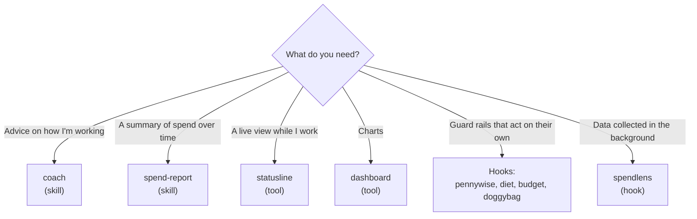
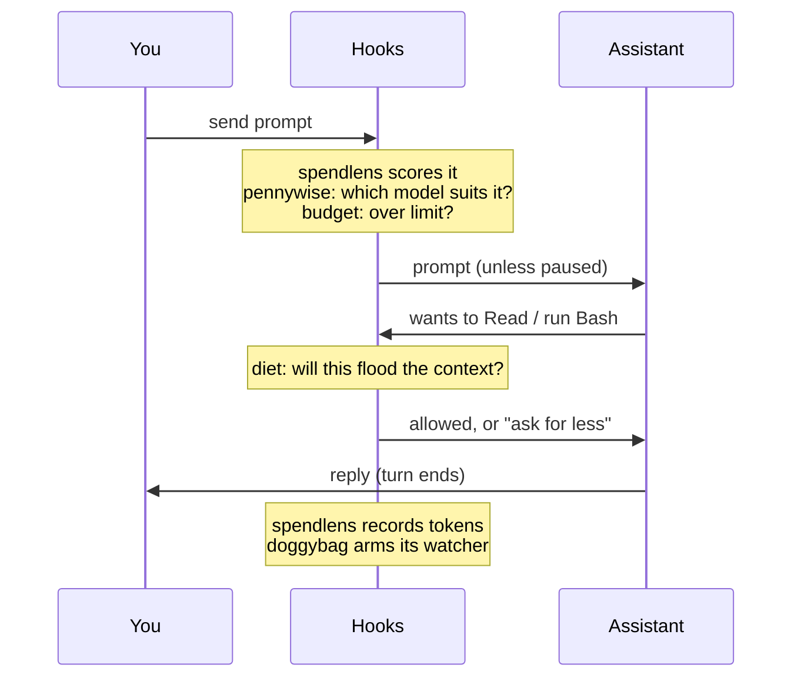

<p align="right"><a href="../README.md">← Back to README</a> · <a href="README.md">All docs</a></p>

# Skills, tools and hooks: what each one does and when to reach for it

tokenomics is made of three kinds of helper. This page lists every one, says what it does, and, most usefully, **when to reach for it**.

| Kind | How it runs | You... |
|------|-------------|--------|
| **Skills** | The assistant runs them when you ask in plain words (or type the slash command). | ask for them. |
| **Hooks** | The assistant runs them automatically at set moments (a prompt is sent, a tool is about to run, a session ends). | do nothing. Tune or switch them off with settings. |
| **Tools** | Scripts you run yourself from a terminal. | run them when you want a number, a view or a change of setup. |

New to tokens, the prompt cache or why context costs money? Read [How tokens work](how-tokens-work.md) first, then [Saving tokens](saving-tokens.md) for habits that pair well with these helpers.

---

## At a glance: "I want to..."

| I want to... | Reach for | Kind |
|--------------|-----------|------|
| Know why a session was expensive, or get better at prompting | [coach](#coach) | Skill |
| See what I spent this week / month, and where | [spend-report](#spend-report) | Skill |
| Know how full the conversation is and what it has cost, right now | [statusline](#statusline) | Tool |
| Know how long until the prompt cache goes cold | [statusline](#statusline) | Tool |
| See OPEX vs CAPEX and usage trends as charts | [dashboard](#dashboard) | Tool |
| Check where I am against my spending limit | [budget status](#budget-1) | Tool |
| Stop myself overspending | [budget](#budget) | Hook |
| Send each prompt to the right model (cheap for trivial, strong for hard) | [pennywise](#pennywise) | Hook (or the [router proxy](#tokenomics-router)) |
| Stop the AI pulling huge files or logs into the conversation | [diet](#diet) | Hook |
| Pick up after a break where I left off, cheaply | [doggybag](#doggybag) | Hook (plus `tokenomics doggybag`) |
| Know how much AI time went on building vs running things | [spendlens](#spendlens) + [dashboard](#dashboard) / [spend-report](#spend-report) | Hook + Tool / Skill |
| Get raw numbers for a script or spreadsheet | [coach.py --json](#coachpy), [report.py --json](#reportpy), or [sqlite3](reference.md#looking-at-your-data) | Tool |
| Refresh model prices | [update_prices.py](#update_pricespy) | Tool |



---

## Skills

Skills are instructions the assistant follows when you ask. They only run when you ask for them, so they cost tokens only then.

### coach

**What it does.** Reads the current conversation's transcript (read-only) and tells you, with numbers, where tokens were wasted: low cache hit ratio, cache rebuilds, oversized context, vague or correction-heavy prompts, repeated file reads, huge tool results, model switches, mixed topics. It rewrites your weakest prompt and points out what you are doing well.

**Reach for it when:**

- A session felt slow or expensive and you want to know why.
- The statusline shows a big cost or a nearly full context and you're not sure what caused it.
- spend-report names one session as the costliest and you want the detail (give it the session id).
- You want to improve your prompting habits generally. Running it at the end of a long session is a good routine.

**Don't reach for it when:** you want spend across many sessions (use [spend-report](#spend-report)), or you're on Copilot CLI (there is no transcript to read).

**How:** say *"coach, review my prompts"*, *"why was that session expensive?"*, or type `/tokenomics:coach`. Script behind it: [`coach.py`](#coachpy).

### spend-report

**What it does.** Turns the spendlens database into a short report for a period (default the last 7 days): money spent in your currency, the OPEX/CAPEX split, top projects and models, the costliest sessions, what pennywise, doggybag, diet and budget did, and three ways to spend less tied to your own numbers.

**Reach for it when:**

- It's the end of the week (or month) and you want to know where the money went.
- Someone asks how much AI time goes on building vs running things.
- You want to check whether the guard-rail hooks are actually saving anything.
- You've hit a budget pause and want context ("am I always this high?").

**Don't reach for it when:** you want to look inside one session (use [coach](#coach)) or want charts (use the [dashboard](#dashboard)).

**How:** say *"spend report"*, *"where did my tokens go this week?"*, or name a period: *"spend report for this month in dollars"*. Script behind it: [`report.py`](#reportpy). Needs the plugin installed so spendlens has been recording.

---

## Hooks

Hooks run automatically once the plugin is installed. You don't call them; you decide whether to keep them on and how strict they are. Each guard-rail hook has a `block` / `warn` / `off` setting (see [Configuration](configuration.md)).

Where each hook fires:

| Moment | Claude Code event | Copilot CLI event | Hooks |
|--------|-------------------|-------------------|-------|
| Session starts (or `/clear`) | `SessionStart` | (none) | doggybag |
| You send a prompt | `UserPromptSubmit` | `userPromptSubmitted` | spendlens, pennywise\*, budget\*, doggybag |
| A tool is about to run | `PreToolUse` (`Read`, `Bash`) | `preToolUse` | diet |
| A tool has run | (none) | `postToolUse` | spendlens |
| The assistant finishes a turn | `Stop` | (none) | spendlens, doggybag |
| Session ends | `SessionEnd` | `sessionEnd` | spendlens, doggybag |

\* Claude Code only: Copilot ignores prompt-hook output, so it can't pause a prompt.



### spendlens

**What it does.** Labels each session **OPEX** (running things: logs, metrics, incidents), **CAPEX** (building things: writing or changing code), `mixed` or `unknown`, and saves one row per session to `~/.tokenomics/spendlens.db` with token counts and cost. It never blocks or shows anything. Every other reporting helper reads its data.

**Reach for it when:** you want any history at all. Keep it on; spend-report, the dashboard and budget rely on it. Reach for its settings when:

- Labels look wrong: map your own skills with `TOKENOMICS_SKILL_MAP`, or edit the keyword lists in `tokenomics/engine/classifier.py`.
- Keywords keep missing: set `TOKENOMICS_LLM=1` to let a model decide once per session (prompts leave your machine, redacted; point it at a local model if sensitive).
- A team wants one shared view: point `TOKENOMICS_DB` at a shared location.

**Script:** `scripts/spendlens.py` (`prompt`, `tool`, `finalize`, and `capabilities` to see what each assistant supports). Details: [What spendlens saves](reference.md#spendlens).

### pennywise

**What it does.** A model router. Scores each prompt from weighted signals (length, code, simple-task phrases, technical terms, complex work, reasoning words, multi-step structure) into one of four tiers, `SIMPLE` → Haiku, `MEDIUM` → Sonnet, `COMPLEX` → Opus, `REASONING` → Opus (you choose the map). As a hook it hands the prompt to a subagent on that model, routing down to save money and up when your model is out of its depth. As a local proxy (`tokenomics router serve`) it rewrites the model of every request, cache-aware, with fallback.

**Reach for it (keep it on) when:** you tend to leave one model selected all day, or a team is new to choosing models. Run the proxy when you want every turn routed with full context rather than handed to a subagent. Set it to `block` if you'd rather be asked to switch with `/model`, or `off` if you always pick models deliberately.

**To steer one prompt:** start it with `keep-model:`, or `haiku:` / `sonnet:` / `opus:` / `fable:` to force a model. Curious why a prompt went where it did? `tokenomics router explain "<prompt>"`. Claude Code only. Details: [Using pennywise](reference.md#pennywise).

### diet

**What it does.** Before a `Read` or `Bash` call runs, refuses a small set of calls known to flood the context (whole lockfiles or minified files, unbounded `kubectl logs` / `git log` / `find /`, `cat` of a huge file) and tells the AI how to ask for less. The AI retries with a narrower call on its own. Each block is logged with an estimate of tokens kept out.

**Reach for it (keep it on) when:** you do a lot of ops or debugging work (logs, big repos), since one unbounded log dump is paid for again on every later turn. Raise `TOKENOMICS_DIET_MAX_KB` if it blocks files you genuinely need whole.

**When you need the whole thing:** append `# diet-ok` to the command. Works in Claude Code and Copilot CLI. Details: [Using diet](reference.md#diet).

### budget

**What it does.** Tracks spend against a daily and/or per-session limit in your currency. One notice at 80%; at 100% your next prompt is paused with cheaper ways forward (`/compact`, a smaller model, a fresh session).

**Reach for it when:** you're paying out of your own pocket, you have a monthly allowance to stretch, or you're trialling a new, pricier model. It does nothing until you set `TOKENOMICS_BUDGET_DAILY` and/or `TOKENOMICS_BUDGET_SESSION`.

**When it pauses you:** send the same prompt again, or start it with `over-budget:`; you won't be paused again for that limit that day. Use `TOKENOMICS_BUDGET_MODE=warn` for notices only. Claude Code only (Copilot bills premium requests, which hooks can't see). Details: [Using budget](reference.md#budget).

### doggybag

**What it does.** Just before the prompt cache expires, packs a short "where we got to" note into your project at `.doggybag/latest.md` (the folder ignores itself in git): branch and changes, tasks, your last requests, files edited, recent commands, and how to carry on. No model is called, so it costs nothing. If you come back after the cache went cold, your next prompt makes sure it's packed and tells you what carrying on cold would cost; `/clear` (or a new session in the folder) loads it automatically.

**Reach for it when:** you step away from a session for more than a few minutes and plan to come back. Instead of carrying on in the cold session (which re-writes the whole conversation into the cache), type `/clear` and keep going. Need one now? `tokenomics doggybag`.

**Turn it off** (`TOKENOMICS_DOGGYBAG=off`) if you never resume work across breaks. Copilot support is best effort. Details: [Using doggybag](reference.md#doggybag).

---

## Tools

Scripts you run yourself. All need only Python 3.8+ and live in `scripts/`. Run them from the repo (or plugin) folder.

### statusline

`scripts/statusline.py`: a live line at the bottom of Claude Code or Copilot CLI in a terminal, showing model, context fill, total tokens, cost and the cache countdown. In the Claude desktop app the same line is the **band** above the prompt box (`hooks/band.tsx`).

**Reach for it when:** you want to *see* cost as you go rather than find out afterwards. It's the best everyday early warning: start a fresh conversation when the context bar goes red, and finish your thought (or let doggybag pack a note) before the cache timer runs out.

| Command | Use it to |
|---------|-----------|
| `/tokenomics:statusline` (plugin) or `tokenomics statusline --install claude` (or `copilot`, `both`) | Install it (backs up your settings first). `--uninstall` removes it, `--status` says where it is. |
| `tokenomics statusline --band-off` (`--band-on`) | Hide (or show) the band in the desktop app. |
| `tokenomics statusline --set-currency USD` | Choose £, $ or € for every cost tokenomics shows. |
| `tokenomics statusline --update-rate` | Fetch today's exchange rates. |
| `tokenomics statusline --watch` | A smoothly ticking countdown in a spare terminal pane. |
| `tokenomics statusline --demo --theme light` | Preview every state and colour. |

Details: [statusline](reference.md#statusline) and [band](reference.md#band) reference.

### dashboard

`scripts/dashboard.py`: a local web page over the spendlens database with a % OPEX vs % CAPEX bar, daily trend, per-project split, skills used and recent sessions.

**Reach for it when:** you want trends or a picture to share (a team review, a finance question), rather than a written summary. `--demo` shows it with fake data before you have any of your own.

```
tokenomics dashboard              # http://127.0.0.1:8765
tokenomics dashboard --demo
```

Read-only, local only. Details: [dashboard reference](reference.md#dashboard).

### report.py

`scripts/report.py`: the engine behind [spend-report](#spend-report).

**Reach for it directly when:** you want the report without asking the assistant (no tokens spent), or want JSON for a script or spreadsheet.

```
python3 scripts/report.py                     # last 7 days, Markdown
python3 scripts/report.py --days 30 --json    # --days 0 for all time
python3 scripts/report.py --currency EUR
```

### budget

`python3 scripts/budget.py status` shows today's and this session's spend against your limits. **Reach for it** before a big piece of work, or after a budget notice, to see how much headroom is left.

### coach.py

`scripts/coach.py`: the analyser behind the [coach](#coach) skill.

**Reach for it directly when:** you want the raw flags and numbers without spending tokens on the assistant's write-up, or want to analyse an older session.

```
python3 scripts/coach.py                     # newest transcript for this folder
python3 scripts/coach.py --session <id> --json
python3 scripts/coach.py --transcript path/to/file.jsonl
```

### tokenomics router

`tokenomics router serve` runs pennywise as a local routing proxy; `tokenomics router explain "<prompt>"` shows the tier, score and signals for a prompt. **Reach for it** when you want every request routed with full context, or to tune the tiers.

### tokenomics doggybag

`tokenomics doggybag` (or `python3 scripts/doggybag.py write`) packs a doggybag on demand. **Reach for it** when you're about to stop and want the note now rather than waiting for the cache timer.

### spendlens.py capabilities

`python3 scripts/spendlens.py capabilities` lists what each assistant can report (transcript, token counts, tool events, billing). **Reach for it** when a column is empty and you want to know whether that's expected for that assistant.

### update_prices.py

`scripts/update_prices.py`: refreshes `data/model-prices.json` from Claude's pricing page. A GitHub Action already runs it every Monday.

**Reach for it when:** a new model has launched or prices changed and you don't want to wait for Monday, or (`--check`) to confirm the file is current. To override a single price instead, use `"prices"` in `~/.tokenomics/statusline.json` (see [Prices](configuration.md#prices)).

```
python3 scripts/update_prices.py            # fetch and update
python3 scripts/update_prices.py --check    # exit 1 if out of date
```

---

## A sensible setup

- **Everyone:** install the plugin (spendlens, diet, doggybag and pennywise run by default) and the [statusline](#statusline).
- **Paying personally or on an allowance:** also set a [budget](#budget).
- **Weekly:** ask for a [spend-report](#spend-report).
- **After any session that surprised you:** ask the [coach](#coach).
- **Teams:** share a database with `TOKENOMICS_DB` and look at the [dashboard](#dashboard) together.

See [Installation](installation.md) to get set up, [Configuration](configuration.md) for every setting, and [Installation → Troubleshooting](installation.md#troubleshooting) if something looks wrong.

---

<p align="center"><a href="saving-tokens.md">← Saving tokens</a> · <a href="README.md">All docs</a> · <a href="reference.md">Helper reference →</a></p>
