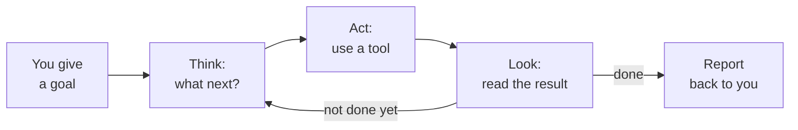

<p align="right"><a href="../README.md">← Back to README</a> · <a href="README.md">All docs</a></p>

# What is agentic AI?

Claude Code and GitHub Copilot CLI are **AI agents**: they don't just answer, they read your files, run commands, make changes and check their own work. That is also why their bills can surprise you. This guide explains agentic AI in two parts:

1. **[The simple version](#part-1-the-simple-version)**: no technical background needed. Five minutes.
2. **[The technical version](#part-2-the-technical-version)**: the agent loop, tool calling, subagents, and why agents spend tokens the way they do.

Read Part 1 and stop there if that is all you need.

This is the third of three short guides: [What is generative AI?](what-is-generative-ai.md) → [What is an LLM?](what-is-an-llm.md) → **What is agentic AI?**

---

## Part 1: The simple version

### The short answer

**Agentic AI is an AI that is given a goal and allowed to take actions, one step after another, until the goal is done.**

A plain chatbot *tells* you how to do something. An agent *does* it.

| You ask | A chatbot | An agent |
|---|---|---|
| "Why is this test failing?" | Suggests some likely causes. | Runs the test, reads the error, opens the file, finds the bug, fixes it, runs the test again to check. |
| "Rename this function everywhere." | Explains how to search and replace. | Searches the project, edits every file, checks it still builds. |
| "Book me a table for Friday." | Lists some restaurants. | Checks your calendar, searches, and makes the booking (if it has been given access). |

### A helpful comparison

Think of the difference between **asking a friend for directions** and **getting in a taxi**.

- The friend (a chatbot) tells you the route. You do the driving.
- The taxi driver (an agent) takes you there. You give the destination, they make the turns, deal with roadworks and pick a new route if a road is closed.

And like a taxi, **the meter is running the whole time**, whether the route was efficient or not.

### How an agent works

An agent is an [LLM](what-is-an-llm.md) put inside a loop and given some **tools**: things it is allowed to do, such as "read a file", "run a command", "search the web" or "edit this file".



It thinks about what to do, does one thing, looks at what happened, and decides the next step. It keeps going round until it believes the job is finished, it gets stuck, or it needs to ask you something.

### Why agents use so many tokens

Remember that an LLM has no memory between messages, so the **whole conversation is sent again every time** (see [How tokens work](how-tokens-work.md)). An agent sends a message to the model **after every single step**, and every file it reads and every command output it sees is added to that conversation.

So one request from you ("fix the failing test") might become thirty or more trips to the model behind the scenes, each one re-reading everything so far. That is why one agent task can cost far more than a chat, and why small inefficiencies add up:

- reading the same big file twice;
- running a command that keeps failing, again and again;
- wandering off to tidy things you never asked about;
- using the most expensive model for simple steps.

tokenomics is built for exactly this. **groundhog** spots the agent going round in circles, **blinkers** catches it straying beyond what you asked, and **sherlock** shows you, step by step, which actions bought nothing.

### Keeping an agent safe and useful

- **Be clear about the goal**, and what "done" looks like ("the tests pass", "only change this folder").
- **Keep the approvals on for risky actions.** Good agents ask before deleting things, pushing code or spending money.
- **Check the result**, not just the summary. Agents can be confidently wrong, just like the LLM inside them.
- **Watch the cost.** The tokenomics statusline shows it live, and **budget** can stop a task before it overspends.

That's the big picture. If you want the machinery, read on.

---

## Part 2: The technical version

### 2.1 What makes a system "agentic"

There is no single official definition, but agentic systems share these traits:

| Trait | Meaning |
|---|---|
| **Goal-directed** | Given an objective, not a single question. |
| **Tool use** | Can take actions in the world through defined interfaces. |
| **Autonomy over control flow** | The model, not the developer, decides the next step and when to stop. |
| **Feedback loop** | Observes the result of each action and adapts. |

It helps to think of a spectrum rather than a yes/no:

| Level | Who decides the steps | Example |
|---|---|---|
| **Single call** | Nobody: one prompt, one answer. | Summarise this text. |
| **Workflow / chain** | The developer hard-codes the steps; the LLM fills in each one. | Extract → translate → format. |
| **Router** | The LLM picks one of a few fixed paths. | Classify a ticket and send it to the right handler. |
| **Agent** | The LLM chooses tools and steps in an open-ended loop. | Claude Code fixing a bug. |
| **Multi-agent** | Several agents (or an orchestrator with subagents) divide the work. | A lead agent fanning research out to helpers. |

Workflows are cheaper and more predictable; agents handle open-ended work. A good rule is to use the least autonomy that gets the job done.

### 2.2 The agent loop

At its core, an agent is a short program wrapped around an LLM:

```
messages = [system prompt, tool definitions, user goal]
loop:
    response = llm(messages)
    messages.append(response)
    if response has no tool calls: break        # the model says it is done
    for call in response.tool_calls:
        result = run_tool(call)                 # read file, run command, ...
        messages.append(tool_result(call, result))
return final response
```

This pattern is often called **ReAct** (reason + act): the model reasons, emits an action, observes the result, and repeats. Modern models are trained specifically to work well in this loop.

Real agents add more around it: permission checks before risky tools, limits on the number of turns, hooks that can inspect or block a call (this is where tokenomics plugs in), and context management for long runs.

### 2.3 Tool calling

The model never runs anything itself. It is given **tool definitions** (a name, a description and a JSON schema for the inputs) and, when it wants to act, it writes a structured **tool call**:

```json
{ "type": "tool_use", "name": "Read", "input": { "file_path": "src/auth.ts" } }
```

The agent program (the **harness**) runs the tool and sends back a **tool result** containing the output. The model then continues with that result in its context.

Cost points to notice:

- **Tool definitions are input on every call.** Dozens of tools with long descriptions can add thousands of tokens to every single request (they are usually cached, which helps).
- **Tool calls are output.** If the model writes a whole file through an edit tool, every character is billed at the output rate.
- **Tool results are input, forever.** A 50 KB log or a 2,000-line file stays in the history and is re-sent on every later step until the context is compacted or the session ends.

Standard protocols such as the **Model Context Protocol (MCP)** let one agent use tools from many providers through the same interface. Each connected MCP server adds its tool definitions to the context.

### 2.4 Why agent costs grow quickly

Put the loop and the stateless API together:

- One user request becomes *N* model calls, one per step.
- Step *n* re-sends everything from steps 1 to *n − 1*, including every tool result.
- Total input therefore grows roughly with the **square** of the number of steps ([How tokens work, 2.3](how-tokens-work.md#23-input-tokens)).

The prompt cache softens this a great deal (re-sent history is billed at about a tenth of the input price while the cache is warm), but the shape stays the same: long agent runs with big tool outputs are where most spend goes. The common failure patterns, and the tokenomics helper that targets each, are:

| Pattern | What happens | Helper |
|---|---|---|
| **Loops** | The same call again with nothing changed; a command failing repeatedly; edits made and undone. | [groundhog](reference.md#groundhog) |
| **Scope creep** | Changes nobody asked for: extra docs, refactors, dependency bumps. | [blinkers](reference.md#blinkers) |
| **Redundant work** | Files read twice, searches rephrased into the same results, big outputs never used. | [sherlock](reference.md#sherlock) |
| **Context floods** | Huge files or logs pulled into the context. | [diet](reference.md#diet) |
| **Over-specced model** | The largest model doing simple steps. | [pennywise](reference.md#pennywise) |
| **Runaway spend** | A task running far past what it is worth. | [budget](reference.md#budget), [haggle](reference.md#haggle) |

### 2.5 Subagents and multi-agent systems

An agent can hand part of a task to a **subagent**: a fresh model call with its own, empty context, its own instructions and often a cheaper model. The subagent does the work and returns only a short summary to the parent.

| Benefit | Cost |
|---|---|
| Keeps bulky intermediate work (search results, file dumps) out of the parent's context. | The subagent starts cold: it must re-read whatever it needs, with no cache from the parent. |
| Allows parallel work and cheaper models for simple sub-tasks. | Overlapping or one-step subagents can cost more than doing the work inline. |

Used well, subagents reduce total cost; used carelessly, they multiply it. sherlock's audit flags subagents that overlapped or did a one-step job.

### 2.6 Memory and long-running agents

Because the context window is finite and every token in it is re-sent, long-running agents need ways to manage what they remember:

- **Compaction**: summarising older history into a shorter note and continuing from that.
- **Context editing**: dropping old tool results that are no longer needed.
- **External memory**: writing notes to files (a to-do list, a `CLAUDE.md`, a progress log) and reading them back when needed.
- **Fresh sessions with a hand-over note**: tokenomics' **doggybag** packs a short summary just before the cache goes cold, so the next session can start small instead of reloading a long, cold history.

### 2.7 Measuring whether an agent was worth it

Token counts say what an agent *cost*. They don't say whether it *worked*. For agents, a good measure of value ties cost to an observable outcome:

- did the tests pass, did the build succeed, was a commit or PR made;
- was the change accepted, reverted or refused;
- did a cheaper setup (smaller model, less context) reach the same result?

That is the focus of tokenomics' signature helpers: [bangforbuck](reference.md#bangforbuck) (cost per successful result), [sherlock](reference.md#sherlock) (the cost of every wasted step) and [tastetest](reference.md#tastetest) (proof that a cheaper run didn't lose quality).

### 2.8 Risks and guard-rails

Giving a model the power to act brings risks a chatbot doesn't have:

| Risk | Example | Common guard-rail |
|---|---|---|
| **Destructive actions** | Deleting files, force-pushing, dropping a database. | Permission prompts; allow-lists; sandboxes. |
| **Prompt injection** | A web page or file contains hidden instructions the agent follows. | Treat tool results as data, not instructions; limit what tools can reach. |
| **Doing too much** | Large unrequested changes. | Clear scope in the prompt; tools like blinkers. |
| **Runaway cost** | An agent looping for hours. | Turn limits, budgets, loop detection. |
| **Unverified results** | "All tests pass" when they weren't run. | Check outcomes from real signals, not the agent's summary. |

### 2.9 Quick reference

| Term | One-line summary |
|---|---|
| Agent | An LLM in a loop, choosing and using tools to reach a goal. |
| Tool | An action the model may request: read, edit, run, search, call an API. |
| Tool call | The model's structured request to use a tool; billed as output. |
| Tool result | What the tool returned; added to the context as input. |
| Harness | The program that runs the loop, executes tools and enforces permissions. |
| ReAct | The reason → act → observe loop pattern. |
| Subagent | A separate model call with its own context, returning a summary. |
| MCP | A standard protocol for connecting tools to agents. |
| Compaction | Summarising old history to fit and cheapen the context. |
| Hook | A point where outside code can inspect or block an agent's action. |

### Further reading

- Yao et al. (2022), *ReAct: Synergizing Reasoning and Acting in Language Models*.
- Anthropic: [Building effective agents](https://www.anthropic.com/engineering/building-effective-agents)
- Anthropic: [Tool use with Claude](https://platform.claude.com/docs/en/agents-and-tools/tool-use/overview)
- [Model Context Protocol](https://modelcontextprotocol.io)

---

<p align="center"><a href="what-is-an-llm.md">← What is an LLM?</a> · <a href="README.md">All docs</a> · <a href="how-tokens-work.md">How tokens work →</a></p>
