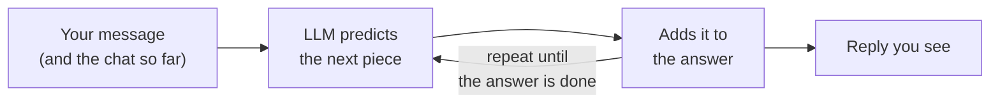

<p align="right"><a href="../README.md">← Back to README</a> · <a href="README.md">All docs</a></p>

# What is an LLM?

Claude, the models behind GitHub Copilot, ChatGPT and Gemini are all **large language models**, or **LLMs**. Every token tokenomics counts is a token an LLM read or wrote. This guide explains what they are in two parts:

1. **[The simple version](#part-1-the-simple-version)**: no technical background needed. Five minutes.
2. **[The technical version](#part-2-the-technical-version)**: transformers, training, the context window, model sizes, and how all of it shows up in your bill.

Read Part 1 and stop there if that is all you need.

This is the second of three short guides: [What is generative AI?](what-is-generative-ai.md) → **What is an LLM?** → [What is agentic AI?](what-is-agentic-ai.md)

---

## Part 1: The simple version

### The short answer

**An LLM is a computer program that has read an enormous amount of text and learned to continue it.** Give it the start of something (a question, an instruction, half a sentence) and it writes what is most likely to come next.

It is a kind of [generative AI](what-is-generative-ai.md): the kind that works with **language**, which for these purposes includes computer code.

### What the letters mean

| Letter | Word | What it means |
|---|---|---|
| **L** | Large | It is huge: billions of internal settings, trained on a library bigger than any person could read in many lifetimes. |
| **L** | Language | It works with words (and code, which is just another language to it). |
| **M** | Model | It is a *model* of language: a mathematical summary of how text tends to go, not a database of facts. |

### Autocomplete, but enormous

You already know a tiny version of this: the keyboard on your phone that suggests the next word. Type "See you" and it offers "tomorrow" or "soon".

An LLM is the same idea scaled up enormously. Instead of guessing one word from the last two, it looks at **everything** you have written in the conversation and writes a whole answer, one small piece at a time. Because it learned from so much text, "what usually comes next" turns out to include explaining, summarising, translating, arguing, and writing working code.



### Three things that surprise people

1. **It doesn't remember you between messages.** Each time you reply, the app sends the **whole conversation** to the model again from the top. That is why long chats get slower and more expensive (see [How tokens work](how-tokens-work.md)).
2. **It doesn't look things up** (unless it has been given a search tool). It answers from patterns it learned, which can be out of date or simply wrong. It sounds just as confident either way.
3. **It writes in pieces called tokens.** A token is roughly three-quarters of a word. You pay for every token it reads and every token it writes.

### Bigger and smaller models

Providers usually offer a range of sizes. Claude, for example, comes as **Haiku** (small and fast), **Sonnet** (middle) and **Opus** (largest and most capable).

Think of it like hiring help: you wouldn't pay a senior consultant to tidy a spreadsheet. Bigger models are better at hard problems but cost more per token. For simple jobs a small model is often just as good, at a fraction of the price. tokenomics' **pennywise** helper does that matching for you.

### What an LLM is not

- **Not a search engine.** It generates; it doesn't retrieve (unless given a tool to).
- **Not a person.** It has no feelings, wishes or memory of you, even when it writes as if it does.
- **Not always right.** Check anything that matters.
- **Not an agent by itself.** On its own it only *writes text*. When it is allowed to run commands, edit files and decide its own next step, it becomes [agentic AI](what-is-agentic-ai.md).

That's the big picture. If you want the machinery, read on, or go straight to [What is agentic AI?](what-is-agentic-ai.md).

---

## Part 2: The technical version

### 2.1 Next-token prediction

An LLM is a function that takes a sequence of tokens and returns a probability distribution over the next token:

```
P(next token | all previous tokens)
```

Generation is a loop: sample a token from that distribution, append it, run the model again on the longer sequence, repeat until a stop token or the `max_tokens` limit. This is called **autoregressive** generation. Everything an LLM does (chat, code, tool calls, reasoning) is this loop running over a carefully shaped input.

Text is turned into token IDs by a **tokeniser** before it reaches the model, and back into text afterwards. [How tokens work, 2.1](how-tokens-work.md#21-tokenisers) covers tokenisers in depth.

### 2.2 The transformer

Almost every current LLM is a **decoder-only transformer**. In outline:

1. **Embedding.** Each token ID is mapped to a vector (a list of a few thousand numbers). Position information is added so the model knows the order.
2. **Transformer layers**, stacked dozens of times. Each has:
   - **Self-attention**: every token looks at every *earlier* token and decides how much each one matters to it. This is how "it" in a sentence gets linked to the right noun, or a function call to its definition 2,000 lines earlier.
   - **Feed-forward network**: a per-token transformation where much of the model's learned "knowledge" is thought to be stored.
3. **Output layer.** The final vector for the last position is turned into a score for every token in the vocabulary, then into probabilities.

The model's **parameters** (weights) are the numbers in all of those layers: that is the "large" in LLM, from billions to well over a trillion in the biggest models. Some models use a **mixture-of-experts** design, where only a fraction of the parameters are used for each token, to keep running costs down.

### 2.3 Training

| Stage | Data | What it teaches |
|---|---|---|
| **Pre-training** | Trillions of tokens of web text, books, code, papers. | Language, facts, reasoning patterns, coding: by predicting the next token, over and over. |
| **Instruction tuning** | Curated examples of instructions and good answers. | To answer the question rather than just continue the text. |
| **Preference / reinforcement training** | Human and AI judgements of which answer is better; tasks with checkable results (tests pass, maths is right). | To be helpful, honest and safe; to reason through hard problems; to use tools well. |

After training, the parameters are fixed. The model learns nothing from your conversation; anything it "knows" about your task is only what is in the current input.

### 2.4 The context window

The **context window** is the maximum number of tokens the model can attend to in one request, input and output combined. Current frontier models offer hundreds of thousands to around a million tokens.

Two consequences matter for cost:

- **The API is stateless.** Chat apps and coding assistants re-send the system prompt, tool definitions and the full history on every turn. Input grows with every message, and the total input across a session grows roughly with the *square* of its length (see [How tokens work, 2.3](how-tokens-work.md#23-input-tokens)).
- **Attention has a cost per token.** Processing more context takes more compute, and quality can drop when the important detail is buried in a very long context. Keeping context lean is cheaper *and* often gives better answers.

### 2.5 Inference: prefill and decode

Running a model (inference) has two phases:

| Phase | What happens | Speed | Price |
|---|---|---|---|
| **Prefill** | The whole input is processed in parallel to build the model's internal state (the **KV cache**). | Fast per token. | Input price. |
| **Decode** | Output tokens are generated one at a time, each needing a full pass. | Slow per token. | Output price, typically about 5x input. |

The **prompt cache** stores the prefill state for a prompt prefix so that a later request starting with the same bytes can skip recomputing it. That is why cache reads are around a tenth of the input price. Details in [How tokens work, 2.5](how-tokens-work.md#25-the-prompt-cache).

Many models can also **think** before answering: they generate reasoning tokens first, then the reply. Those reasoning tokens are billed as output, whether or not you see them. An **effort** or thinking-budget setting controls how much of this happens.

### 2.6 Model sizes and choosing one

Providers ship families of models at different sizes and prices. Broadly:

| Tier | Strengths | Typical uses |
|---|---|---|
| **Small** (e.g. Claude Haiku) | Fast, cheap. | Classification, extraction, simple edits, routing, sub-tasks inside an agent. |
| **Medium** (e.g. Claude Sonnet) | Strong all-round, good value. | Most day-to-day coding and writing. |
| **Large** (e.g. Claude Opus) | Best at long, complex, ambiguous work. | Architecture, hard debugging, long agentic tasks. |

Prices per token can differ by an order of magnitude between tiers, so model choice is often the biggest single lever on cost. The right choice is the cheapest model that **still succeeds** at the task, which is what tokenomics' [pennywise](reference.md#pennywise) (routing) and [bangforbuck](reference.md#bangforbuck) (cost per successful result) are built around.

### 2.7 Giving a model knowledge it doesn't have

Because parameters are frozen, there are four ways to get new or private information into a model's answer:

| Approach | How | Trade-off |
|---|---|---|
| **Put it in the prompt** | Paste the document, file or data into the conversation. | Simple; but every token is re-sent on every turn. |
| **Retrieval-augmented generation (RAG)** | Search a document store for the relevant passages and add only those to the prompt. | Cheaper context; quality depends on the search. |
| **Tools** | Let the model call a search, file reader or API when it decides it needs to. | Flexible; this is the step towards [agentic AI](what-is-agentic-ai.md). |
| **Fine-tuning** | Train the model further on your data. | Changes behaviour and style well; a poor way to add fast-changing facts. |

### 2.8 How it shows up in your bill

Every request to an LLM reports token counts, and each is priced differently:

```
cost = input tokens        x input price
     + cache write tokens  x input price x 1.25 (5-minute cache)
     + cache read tokens   x input price x ~0.1
     + output tokens       x output price (including thinking)
```

So the things that make an LLM expensive are: a long conversation, big files or logs in the context, a cold cache, long answers, lots of thinking, and a bigger model than the job needs. Each one has a tokenomics helper aimed at it; see [Saving tokens](saving-tokens.md).

### 2.9 Quick reference

| Term | One-line summary |
|---|---|
| LLM | A large neural network trained to predict the next token of text. |
| Token | The unit of text a model reads and writes; ~0.75 English words. |
| Transformer | The architecture behind nearly all LLMs, built on self-attention. |
| Parameters | The learned numbers inside the model; billions of them. |
| Pre-training | Learning language by predicting the next token over a huge dataset. |
| Context window | Max tokens (input + output) in one request. |
| Stateless | The model keeps nothing between requests; history is re-sent. |
| Prefill / decode | Reading input in parallel / writing output one token at a time. |
| Thinking tokens | Reasoning the model does before answering; billed as output. |
| RAG | Fetching relevant passages and adding them to the prompt. |

### Further reading

- Vaswani et al. (2017), *Attention Is All You Need*: the transformer.
- Brown et al. (2020), *Language Models are Few-Shot Learners*: GPT-3 and in-context learning.
- Ouyang et al. (2022), *Training language models to follow instructions with human feedback*: instruction tuning and RLHF.
- Anthropic: [Models overview](https://platform.claude.com/docs/en/about-claude/models/overview)

---

<p align="center"><a href="what-is-generative-ai.md">← What is generative AI?</a> · <a href="README.md">All docs</a> · <a href="what-is-agentic-ai.md">What is agentic AI? →</a></p>
